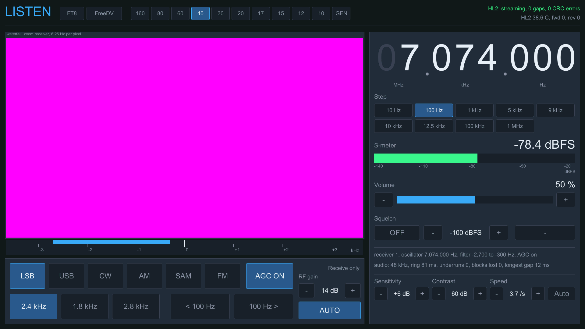
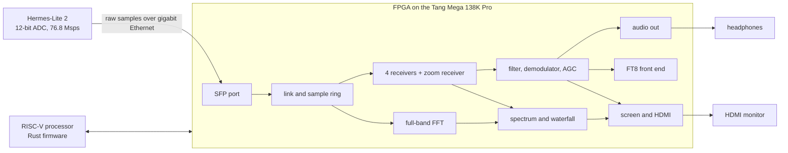

<!-- SPDX-License-Identifier: Apache-2.0 -->
<!-- Copyright 2026 Franz Schöning, https://www.schoning.com -->
# fpga-sdr

fpga-sdr is an HF software defined radio built in an FPGA. A Hermes-Lite 2 sends every raw sample of its 12-bit ADC (76.8 million a second, 0 to 38.4 MHz) over gigabit Ethernet to a Sipeed Tang Mega 138K Pro board, and the FPGA on that board does the radio: four independent receivers with filters, demodulators and AGC, a full-band spectrum and a zoom waterfall, an FT8 decoder front end, audio to headphones and HDMI, and a 1920x1080 screen on an HDMI monitor. The FPGA's built-in RISC-V processor runs bare-metal Rust firmware for the screen, the control of the Hermes-Lite 2 and the decoding of FT8 and FreeDV. No PC is needed to operate it once it is loaded.

The repository is also meant as a place to learn SDR and FPGA development from a complete, working design, with every Verilog file and most Rust files commented for a reader who is new to the subject. If you know a little programming and nothing about FPGAs or radio, start with the reading list further down.



This is the LISTEN screen, rendered on the PC by the firmware's own simulator (`fw/tr-sim`). On the real monitor the FPGA draws the waterfall into the empty area on the left, which is why it shows as a solid color here. The other screens (FT8, FreeDV and the panel view) are in [docs/img](docs/img).

## How it is put together



The signal path (everything from the sample ring to the pixels) is logic in the FPGA and runs at full speed. The processor in the chip only runs the screen, the control of the Hermes-Lite 2, the FT8 and FreeDV decoding, and the setup of the logic. [docs/learn/ARCHITECTURE_TOUR.md](docs/learn/ARCHITECTURE_TOUR.md) follows this picture block by block and names the file for each one.

## Who this is for

It is for you if you want to see how a complete radio looks inside an FPGA, with real numbers, real timing problems and the dead ends we ran into, or if you want to build on parts of it (the receivers, the DDR3 waterfall, the HDMI screen, the Rust firmware) for your own project. The reading list below is written for somebody who knows a little programming and nothing about FPGAs or radio.

It is not a finished product you can download and run. You need one specific board, one specific radio front end and a Gowin license that covers the chip, you build everything yourself, and the transmit side has never been tested end to end (see below). If you want a radio that works today with less effort, buy a Hermes-Lite 2 and use it with a PC program such as Thetis or SparkSDR.

## What it does today

- Receive on LSB, USB, CW, AM, SAM and FM anywhere from 100 kHz to 30 MHz with 1 Hz tuning, filter presets, AGC,
  squelch and an S-meter (the LISTEN screen).
- Decode FT8 on the band's FT8 frequency every 15 s, with the time from the network.
- Receive FreeDV 700D and 700E.
- Show a zoom waterfall around the tuned frequency, drawn by the FPGA.
- Take mouse and keyboard input from a PC over the home network.
- Act as a USB sound card on the board's "Custom USB" socket, and as a USB host for a mouse, keyboard or headset on a
  PMOD board.

Transmit is built as well: the transmit chain in the chip (interpolation up to 76.8 Msps and the up-mixer), the sample path
to the Hermes-Lite 2, the FT8 transmit waveform and the safety checks. All of it passes its simulations, but it has never been
tested end to end, meaning from the screen to a signal at the antenna. Because of that the firmware as released holds the
last step back: the call sign is the placeholder N0CALL, the Hermes-Lite 2 is never sent its transmit permission, and the
network input drops every key that would transmit. Out of the box the radio therefore behaves as a receiver, and you should
test the transmit side on a dummy load first and only with the license to transmit.

Several parts are built and simulated but not yet proven on the board (the audio outputs, the latest timing-clean
bitstream, the S-meter calibration). `docs/USER_MANUAL.md` says which.

## What it needs

Hardware:

| Item | Notes |
|---|---|
| Sipeed Tang Mega 138K Pro (core module and dock) | Gowin GW5AST-LV138FPG676A, 1 GB DDR3 |
| Hermes-Lite 2 | with the raw front end firmware, branch `hl2-rawfront-release` of github.com/Schoning-Labs/Hermes-Lite2 |
| Copper SFP module that speaks 1000BASE-X to the host | in cage SFP0; this project uses a 10Gtek "1.25G SFP-T" (Marvell 88E1111) |
| Network cable from the HL2 to that module, and one from the board's RJ45 socket to your home network | the RJ45 link gives DHCP, network time and the loader |
| HDMI monitor | the picture is 1920x1080 at 30 Hz |
| Antenna on the HL2 | |

Software:

| Tool | Used for |
|---|---|
| Gowin EDA V1.9.12.04 with a license that covers the GW5AST-138 | the bitstream; the free Education edition cannot target this chip |
| Git Bash (or another bash) on Windows | the build scripts |
| Rust, through rustup | the firmware; `rust-toolchain.toml` pins the version and the `riscv32imafc-unknown-none-elf` target |
| xPack RISC-V GCC (only its `objcopy`) | turning the firmware into flat images in `tools/ladder_fw.sh` |
| oss-cad-suite (iverilog, Verilator, yosys) | simulation and resource estimates, optional |
| Python 3.10 with pyserial | loading and the PC input program |

## How to build

The bitstream, from the repository root in bash:

```sh
gowin/p1/build.sh
```

This regenerates the Gowin IP (PLLs, the AE350 processor, the SerDes) from the configuration files in `gowin/p1/ip/`,
runs synthesis, place and route and the bitstream writer, and prints how many timing end points fail. A full run takes
about an hour. The result is `gowin/impl/sdr_top/impl/pnr/sdr_top.fs`. Set `GOWIN_IDE` if Gowin is not in
`C:/Gowin/Gowin_V1.9.12.04_x64/IDE`, `TR_NRX` for another number of receivers (1 to 8, default 4; 8 needs
`TR_NO_ZOOM=1`), and read the header of `gowin/p1/build.sh` for the other switches.

The firmware:

```sh
tools/ladder_fw.sh chip
```

This builds the stage-0 loader, the radio firmware image `fw/target/ladder/ft8fw.img` and the PC sender for the loader.
Set `TR_CALL` and `TR_GRID` to your call sign and locator first; without them the image uses N0CALL. To let the radio
load the HL2's message-layer program into the HL2's processor at every HL2 start, run
`eval "$(tools/hl2_msg_bin.sh /path/to/Hermes-Lite2)"` first; `docs/HL2_CONTROL.md` explains it.

The simulations: each block has its testbench and a run script under `sim/` (for example `bash sim/hl2sfp/run.sh`), and
`sim/top/tb_sdr_core.v` runs the whole of the radio's own logic. The Rust crates that do not need the board have
host tests (`cargo test -p tr-station` and so on, from `fw/`).

## How to run

`run.bat` loads the radio into the board and opens the PC input window. It loads into the FPGA's SRAM and the processor's RAM only, so nothing is written to flash and it has to be run again after every power-off. The loading itself is done by a board loader tool (`board.py` with its `board.json`) that is not part of this repository, so `run.bat` works only on a machine that has such a tool. Its folder is set by `RADIO_BOARD_TOOL`, and `RADIO_NETBOOT` and `RADIO_BOARD_LOCK` name the network boot image and the lock file; none of the three has a default. Without the tool you can load the board yourself: `tools/ladder_fw.sh write-chip` prints the Gowin programmer commands that write the bitstream and the stage-0 loader to the flash, and `fw/target/release/tr-loader-send` then sends `ft8fw.img` over the debug cable's serial port (`--cmd run` starts it from RAM without touching the flash). `docs/learn/TOOLS.md` section 5 describes what `run.bat` does step by step, so that you can repeat it with your own tools. `docs/USER_MANUAL.md` covers the screens, the keys and what to check when nothing appears.

## Bitstreams and firmware images

This repository ships neither a bitstream nor a built firmware image, so you build both yourself. A bitstream contains Gowin's encrypted IP (the AE350 processor, the DDR3 controller and the SerDes), which is generated from a licensed Gowin installation and cannot be passed on, and a firmware image is a GPL-3.0 work for the reasons in the next section, which is easier to respect when everybody builds from the source in front of them. The Gowin EDA Education edition cannot target the GW5AST-138, so you need a Gowin license that covers it. If you only want to read the design, run the simulations or work on the firmware crates that have host tests, none of this matters, and no board or Gowin license is needed.

## Where to start reading

1. [docs/learn/FPGA_PRIMER.md](docs/learn/FPGA_PRIMER.md): what an FPGA is, this board, and how a design is built.
2. [docs/learn/SDR_PRIMER.md](docs/learn/SDR_PRIMER.md): sampling, I/Q, filters, FFT, demodulation and FT8 with this
   radio's numbers.
3. [docs/learn/ARCHITECTURE_TOUR.md](docs/learn/ARCHITECTURE_TOUR.md): the whole radio from the antenna to the speaker
   and the screen, with the file for each part.
4. [docs/learn/OUTLINE.md](docs/learn/OUTLINE.md): the reading order of the source files, chapter by chapter.
5. [docs/learn/GLOSSARY.md](docs/learn/GLOSSARY.md): every term used in the code and the documents.

The design documents in `docs/` go deeper on each block, and `docs/learn/HISTORY.md` tells how the design got to where it is, including the attempts that failed.

## License

Everything Franz Schöning wrote for this project is licensed under the Apache License 2.0 (file `LICENSE`, and `SPDX-License-Identifier: Apache-2.0` in each file's header). That covers the Verilog, the constraint files, the Rust crates of the firmware and the tools, and the documents. The repository also holds a few parts that come from other projects, and each of them stays in a folder of its own under its own license, which is named in the file headers and in the file `NOTICE`:

- `fw/vendor/mfsk-core` (the FT8, FT4 and WSPR decoder by Naoki Sakurai JL1NIE, patched, see `fw/vendor/VENDOR_PATCH.md`): GPL-3.0 or later.
- `fw/tr-modes/src/frontend/candidates.rs`, `fw/tr-modes/src/frontend/decode.rs` and `fw/tr-modes/src/txbb.rs` (the FT8 decoder steps that follow mfsk-core and WSJT-X): they keep their GPL-3.0-or-later headers until their authorship is settled.
- `fw/tr-codec2` and `fw/tr-freedv` (Rust ports of David Rowe's Codec 2 and FreeDV): LGPL-2.1.
- `rtl/vendor/hdmi` (the hdl-util HDMI encoder): MIT or Apache-2.0.
- `sim/h1_link_rx/hl2` and `sim/h2_link_tx/hl2` (Hermes-Lite 2 and HPSDR Ethernet modules used as the far end of two testbenches, and two files from the author's Hermes-Lite 2 fork): GPL-2.0 or later, with a `LICENSE` in each folder.

**The built firmware is GPL-3.0.** The firmware links the Slint GUI toolkit, which Cargo fetches from crates.io and which is available under the GPL-3.0 (the other Slint licenses do not cover a bare-metal embedded product without a paid plan), and it contains the vendored FT8 decoder, which is GPL as well. A firmware image built from `fw/` is therefore one combined work under the GPL-3.0, and anyone who gives such an image to somebody else has to provide the complete corresponding source, which is this repository at the same commit together with the crates named in `fw/Cargo.lock`. The Apache-2.0 source files in it can be combined into that work without trouble, while the GPL parts cannot be taken out of the combined work and relicensed. If you copy code out of this repository for another project, copy it from the Apache-2.0 folders, and look at the header of each file first.

`docs/learn/LICENSES.md` goes through each of these parts and says what it obliges you to do. It is an engineer's reading of the license texts and is not legal advice.

Copyright 2026 Franz Schöning, https://www.schoning.com
