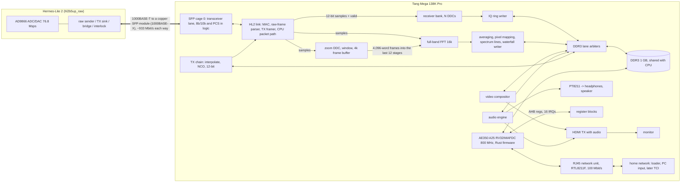

<!-- SPDX-License-Identifier: Apache-2.0 -->
<!-- Copyright 2026 Franz Schöning, https://www.schoning.com -->
# fpga-sdr architecture

Owner decisions are in [DECISIONS.md](DECISIONS.md) and are not reopened here. Board facts and their
sources are in [BOARD.md](BOARD.md). Work order is in [PLAN.md](PLAN.md). The HL2 side is specified in
`docs/rawfront/PROTOCOL.md` of the `hl2-rawfront-release` branch (local worktree
`G:/proj/worktrees/Hermes-Lite2-hl2-rawfront-release`); section numbers below written as "PROTOCOL 5.2"
refer to it.

Numbers marked *estimate* are not measured. Each has a work package in PLAN.md that measures it.

## 1. System overview

Division of work, following the owner decision "as much as possible in hardware":

| In the FPGA | In the Rust firmware |
|---|---|
| HL2 link at full rate both ways, sample unpacking, gap filling, TX pacing | HL2 control: discovery, start/stop, registers, TX lease, filter board, DHCP for the HL2 |
| N receivers (mix, decimate) | tuning, rates, channel-filter coefficient design (written to the FPGA) |
| per receiver: noise blanker, channel filter, SSB/CW/AM/SAM/FM demodulation, AGC, S-meter level, 12 ksps audio (3.10) | noise reduction on audible receivers that have it switched on (12 ksps) |
| audio mixer: every receiver's audio, volume and pan, 12 to 48 ksps, clocked in HL2 time (3.11) | volume, pan and routing settings |
| FT8/FT4 front end per decoder receiver: spectrogram, Costas sync search, candidate down-conversion and soft symbols (3.12) | FT8/FT4/WSPR and every other decoder: candidate choice, fine sync, LDPC, OSD, unpacking, subtraction |
| full-band and zoom FFT, averaging, waterfall drawing | choosing spans, levels, colours; filter-curve tables |
| compositing spectrum/waterfall/overlays (including S-meter bars) over the GUI, HDMI encoding with audio | GUI (Slint), rendered into a framebuffer |
| TX interpolation and mixing to 76.8 Msps | TX baseband for every mode at 48 kHz |
| audio output to PT8211 and HDMI | TCI server, network stack, VITA-49 context packets |
| VITA-49 signal-data packets on the SFP link (3.13) | |

The split above was revised in the cpu-budget work (`docs/CPU_BUDGET.md`): measured CPU cost of the
original split (demodulation, filters and AGC in firmware) was 2-4 times the estimate, and the owner's use
(8 receivers, FT8 on all of them) did not fit. The per-sample DSP of every receiver therefore moved into the
FPGA; the firmware keeps only what is algorithm-heavy or changes often (noise reduction, decoders, GUI).

## 2. Clock domains

All local clocks come from the 50 MHz oscillator (BOARD). The HL2 has its own crystal: its samples arrive
at 76.8 MHz of *its* clock, which differs from ours by a few ppm. Nothing in the Tang runs on an "ADC
clock"; the sample stream carries a valid strobe.

| Domain | Frequency | Source | Used by |
|---|---|---|---|
| `n1_rxc` | 125 MHz | recovered clock of SFP0's transceiver lane (the HL2 link) | PCS receive, MAC receive, raw-frame parser |
| `sfp_txc` | 125 MHz | transmit clock of the SFP lanes, from the 125 MHz reference the firmware sets in the clock chip | PCS transmit, MAC transmit, TX framer |
| `clk_eth` | 100 MHz | PLL | RJ45 network unit (home network) |
| `clk_dsp` | 120 MHz (50 x 12 / 5; was 150 MHz until 2026-10-12, docs/DECISIONS.md) | PLL | receiver bank, FFTs, spectrum, TX chain, audio engine |
| `clk_ahb` | 80 MHz (50 x 16 / 10; was 100 MHz until 2026-10-13, docs/DECISIONS.md) | PLL | AE350 AHB/APB, register blocks |
| `clk_cpu` | 800 MHz | PLL | AE350 core |
| DDR3 | 300 MHz memory clock (`ddr3_memory_clk`), 75 MHz controller clock (`ddr3_sys`, ratio 1:4); was 400 / 100 MHz until 2026-10-20, docs/DECISIONS.md | PLL, placed at PLL_L[0] | Gowin DDR3 IP, bridge, lane arbiters |
| `clk_pix` / `clk_pix5` | 74.17 / 370.83 MHz (1080p30, 50 x 89 / 60 and 50 x 89 / 12); 1080p60 gave a black picture on the board (docs/DECISIONS.md 2026-10-22) | PLL | compositor, HDMI encoder, OSER10 |

Crossings: async FIFOs for sample and packet streams; handshake synchronisers for registers (written in
`clk_ahb`, used in the other domains). Audio sample timing (48 kHz) is derived in `clk_dsp` by a phase
accumulator whose increment is locked to the HL2 sample count (3.11); HDMI audio clock regeneration
(N/CTS) is counted against `clk_pix`.

**Two sample clocks exist and are handled at exactly two points:**

1. RX audio: receiver output is at the HL2's clock. The audio output (speaker, headphones, HDMI) is
   **clocked in HL2 time** too: its 48 kHz tick is a phase accumulator in `clk_dsp`, steered by a slow
   digital PLL so that it produces exactly one tick per 1,600 `adc_valid` pulses on average (3.11). No
   sample-rate conversion is needed anywhere in the audio path. (Before the cpu-budget work the firmware
   resampled each audible stream with a fill-steered ratio; that cost CPU on every sample and is gone.)
2. TX: the HL2 plays one TX sample per HL2 ADC clock. The TX chain produces **one output sample for every
   received RX sample** (section 3.6), so it runs at the HL2's rate without estimating it.

## 3. FPGA blocks

### 3.1 HL2 link (SFP0)

The HL2 is on SFP cage 0 (quad 1 lane 0) through a 1000BASE-T copper SFP module running 1000BASE-X; the RJ45 socket
is the home network (3.8). The lane's aligner, 8b/10b and PCS are in logic (`rtl/sfp/sfp_phy.v`) and hand bytes with
a byte enable to the link below (docs/HL2_SFP.md). Until 2026-10-21 the HL2 was on the RJ45 socket through the
RTL8211F's RGMII; the steps below still describe the link, with the RGMII receive and transmit replaced by the PCS.

What the HL2 needs from us (PROTOCOL 1-9): UDP only, jumbo frames, no ARP needed (the HL2 learns our MAC
and IP from the start datagram; we learn its MAC from the discovery reply), CRC not checked by the HL2.

Receive path (`n1_rxc`, at most one byte per clock, any clock may carry none):

1. Bytes from the PCS, preamble/SFD strip, **CRC-32 check** (the HL2 does not check, we do: a bad frame is
   dropped and becomes a counted gap).
2. Classifier: IPv4/UDP from the HL2's IP, source port 1024, first payload byte 0xA5 -> raw-frame parser.
   Everything else (discovery and register-write replies, port-1027 bridge and message replies, ARP, DHCP,
   ICMP) -> CPU receive ring (BSRAM, 16 KB) + interrupt.
3. Raw-frame parser (PROTOCOL 5.2): header fields into registers (sequence, first-sample index, flags, the
   transmit-safety byte, overflow count, and in v3 headers the TX sink status and echo/interlock status);
   samples unpacked (3 bytes -> 2 x 12-bit two's complement) into an async FIFO to `clk_dsp`.
4. Gap filler (`clk_dsp`): the 48-bit index of each frame is compared with the expected index. A jump of k
   samples (lost or CRC-failed frame) inserts k zero samples, so every downstream block keeps exact sample
   time and NCO phase. k above 65,536 is a resync (counted, flagged, no fill). `clk_dsp` at 120 MHz fills
   faster than real time (76.8 Msps), so the fill catches up.
5. Safety byte (PROTOCOL 5.4): copied to a register on every frame; a change raises an interrupt. Bit 7 (trip)
   or bit 6 (over-temperature) makes the TX framer send zeros at once, in logic, without waiting for firmware.

Transmit path (`sfp_txc`):

- Arbiter with two sources: the TX sample framer (priority) and the CPU transmit queue (BSRAM, 4 KB).
- TX sample framer: PROTOCOL 6.2 frames (magic 0x5A, version 1, sequence, 48-bit TX index, N = 5,970
  samples, 9,000-byte IP MTU) to HL2 port 1026. Ethernet/IP/UDP headers and IP checksum made in logic from
  registers (our MAC/IP/port, HL2 MAC/IP).

Line budget (PROTOCOL 5.1, 5.7; duplex on means 48-byte headers, N = 5,948):
UDP payload 48 + 5,948 x 1.5 = 8,970 B; per frame on the wire 8,970 + 8 + 20 + 14 + 4 + 8 + 12 = 9,036 B;
76.8e6 / 5,948 = 12,912 frames/s; **12,912 x 9,036 x 8 = 933 Mbit/s** received. The TX direction is the same
size (N = 5,970: 8,971 B payload, 76.8e6 / 5,970 x 9,037 x 8 = 930 Mbit/s). About 65 Mbit/s remain each way
for control datagrams, which need well under 1 Mbit/s.

Addressing on this link: the firmware runs a minimal DHCP server so the HL2 gets an address within a second of
power-up (default Tang 10.99.0.1, HL2 10.99.0.2) instead of waiting about 15 s for link-local. If the HL2 is
already on a link-local address, the firmware uses whatever address discovery reports. The HL2 link does not
use smoltcp: all traffic is UDP between two known peers, so the `tr-hl2` crate builds and parses these frames
directly (as the PC tool rawcap does).

### 3.2 Receiver bank (in progress on branch `rx-dsp`)

Chain per receiver, as being built on `rx-dsp` (`rtl/rx/rx_channel.v`): CORDIC mixer at the input rate ->
3-stage CIC decimate by 10 (7.68 Msps) -> 5-stage CIC decimate by 40/20/10/5 -> 65-tap FIR decimate by 4 ->
**48, 96, 192 or 384 kHz**. N = 4 to 8 instances, one register port, one shared output stream. **N is the build setting `NRX` (owner 2026-10-13): 4 in the target chip with the zoom, 8 only without the zoom (`TR_NRX=8 TR_NO_ZOOM=1`); the register layout stays the 8-receiver one and the chip reports its count in `system.status.num_rx`.**

**Interface contract** (matches `rtl/rx/rx_bank.v` on `rx-dsp` as of 2026-09-25, with the clarifications this
system needs):

| Port | Width | Meaning |
|---|---|---|
| `clock` | 1 | `clk_dsp`, 120 MHz. **Not an ADC clock** |
| `rst` | 1 | synchronous reset |
| `adc_data` | 12 | signed two's complement, as unpacked from the HL2 frames |
| `adc_valid` | 1 | one sample per high cycle. Average 76.8 M per s (51 % of cycles), may be high on consecutive cycles (bursts of up to one frame), gaps are arbitrary. Every sample is a real ADC sample or a gap-fill zero: sample count = HL2 time |
| `reg_wr`, `reg_addr`, `reg_wdata[31:0]` | | per receiver: address bit 0 = 0: phase increment; = 1: control `{enable, rate_sel[1:0]}`. Written from the register block in `clk_dsp` |
| phase increment | 32 | `round(f_Hz / 76.8e6 x 2^32)`, signed; f is relative to the HL2 ADC clock (0.018 Hz steps) |
| `rate_sel` | 2 | 0 = 48 k, 1 = 96 k, 2 = 192 k, 3 = 384 k samples/s (of HL2 time) |
| `out_valid`, `out_index`, `out_i[23:0]`, `out_q[23:0]` | | one IQ sample of receiver `out_index` per valid cycle; no back-pressure (the IQ writer always accepts) |

Asks for the `rx-dsp` branch (none change the ports): document the gain from ADC full scale to output full
scale and the group delay in input samples per rate (the firmware needs both for S-meter calibration and
VITA-49 timestamps); confirm the bank accepts `adc_valid` on consecutive cycles; keep a testbench that drives
`adc_valid` with a bursty 51 % pattern, not only every cycle.

**Open defects found by WP R4** (`docs/R4_BACKEND.md` section 9, end-to-end test `sim/rx_backend/r4_chain.v`):
with `adc_valid` not high on every clock the bank decimates by clocks instead of valid samples
(`cordic_mixer.v`'s `out_strobe` stays high once its valid pipeline is full), and its shared-stream
arbiter repeats a sample on the next clock when no other receiver is pending. Both are reproduced by
`tr-rxmodel`; the fix belongs in both together.

Downstream, the IQ writer stamps each 256-sample block per receiver with the HL2 sample index of the block
start (counted from `adc_valid`), so firmware and VITA-49 have one timebase.

### 3.3 Full-band spectrum

- Input: the same 12-bit stream. Window: 4-term Blackman-Harris (about -92 dB side lobes, needed because a
  12-bit ADC plus FFT gain spans more than 80 dB), coefficient ROM of 8,192 entries (symmetric half).
- FFT: **16,384 points**, streaming (pipelined, one sample per valid cycle in `clk_dsp`), real input fed as
  complex with zero imaginary part. Bin spacing 76.8e6 / 16,384 = **4.6875 kHz**; 0-30 MHz = 6,400 bins;
  0-38.4 MHz = 8,192 bins. One transform per 16,384 samples = **4,687.5 transforms/s**, all of them used
  (no dead time), so averaging gains the full sensitivity.
- Power, then per display column reduction over the bins that fall in it: max (so narrow carriers stay
  visible) or mean (noise floor), selectable. On 1,920 columns 0-30 MHz is 3.33 bins per column; zoom within
  the full-band data goes down to 1 bin per column (9 MHz on 1,920 columns).
- Averaging over K transforms per output line in linear power (BSRAM, 1,920 x 40 bit), K from the line rate:
  at 30 lines/s K = 156. Peak-hold as a second mode.
- Output per line: 16-bit dB values (1/64 dB steps) into a double-buffered spectrum line buffer (read by the
  compositor), and an 8-bit colour index (after firmware-set offset and gain) to the waterfall writer.
- Implementation (**decided in WP F1**, details and measurements in [F1_FFT.md](F1_FFT.md)): our own
  streaming radix-2^2 single-path delay-feedback FFT, `rtl/fft/fft_r22sdf.v`. Chosen over ZipCPU
  `dblclockfft` (about six times the block RAM at 16k, 36 multipliers, about 10 dB more arithmetic noise in
  its default configuration) and the Gowin FFT IP (encrypted, cannot be simulated in iverilog/Verilator,
  documented only as a load/compute/unload core that cannot take a continuous stream).
  - Interface: 15-bit real input (12-bit sample times window, 3 fraction bits; the window stays in F2),
    one sample per `adc_valid`, frames counted from reset. Output one word per input, bit-reversed order
    with the bin number alongside (`out_bin`), 29-bit unscaled complex DFT, no reorder buffer (F2 drops
    the mirror half, the odd `out_index` words, and reorders after the power step). 39 cycles from a
    frame's last sample to its first output word.
  - Measured (testbench, bit-exact with the Python model `tools/fft_r22sdf.py`): tone peaks in the right
    bin; SFDR 93.3 and 94.4 dBc for -1 dBFS tones at 7.1 and 30.0 MHz, equal to a double-precision FFT
    of the same 12-bit samples (the ADC sets the SFDR); FFT error 107 to 113 dB below the tone; FFT noise
    38 dB below the ADC noise floor; no overflow at full scale.
  - Resources (yosys `synth_gowin -family gw5a`, synthesis only; replaces the earlier estimate of 56 DSP
    and 36 BSRAM halves): **24 DSP multipliers (27 x 18), 35 BSRAM blocks of 18 kbit**, about 3,300 LUT +
    2,900 carry bits, 5,300 registers. This count was made when `clk_dsp` was planned at 150 MHz; `clk_dsp` runs at 120 MHz now (section 2), and the place-and-route figures are in 3.14.
  - The zoom has no FFT of its own: its 4,096-sample frames go into the last 12 stages of this 16k FFT (3.4).

### 3.4 Zoom spectrum

One extra DDC (same building blocks as a receiver, but its own decimation plan: 76.8 M / 25 = 3.072 M down
to 76.8 M / 1,600 = 48 k, in powers of two, and further down to 3 kHz) feeding a **4,096-point complex transform**: span = output rate, bin = span / 4,096 (3.072 MHz span:
750 Hz bins; 48 kHz span: 11.7 Hz bins). Same averaging, dB and waterfall path as 3.3. The zoom centre
follows the selected receiver or is set freely.

The zoom has no FFT of its own (docs/ZOOM_FIT.md section 2). Its windowed samples are collected in a frame buffer of
4,096 complex words (`rtl/zoom/zoom_frame.v`, 8 block RAMs), and a full frame is played into the full-band FFT of 3.3
behind its second stage, i.e. through its last 12 stages, as a fifth block between two full-band frames; a tag at the
output sends the bins to the zoom context. The bins are word for word those of a separate 4,096-point FFT. The cost
is up to 5 % of the full-band line rate at the widest span (0.08 % at 48 kHz).

### 3.5 Spectrum/waterfall drawing and video compositor

Waterfall storage: per waterfall a DDR3 ring of 8-bit lines, 1,920 bytes wide, 2,048 lines (3.9 MB). The
writer appends one line per spectrum line; scrolling is a start-line register, nothing is moved.

Compositor (`clk_pix`), per pixel, bottom to top:

1. Slint layer: RGB565 framebuffer in DDR3 (4,147,200 B at 1,920 x 1,080), read ahead two lines into BSRAM.
2. Up to 4 FPGA windows, each a rectangle set by registers, of type *spectrum trace* (from the line buffer:
   filled area and trace line per column) or *waterfall* (DDR3 ring + 256-entry palette), source full-band or
   zoom.
3. Overlays inside windows: frequency and dB grid, up to 8 receiver passbands (translucent bands, colours from
   registers), tuning cursor, and the **filter-board curves** (per-column y table in BSRAM written by firmware,
   up to 8 curves, one highlighted).
4. Slint on top where it draws anything other than the key colour: inside a window rectangle the RGB565 key
   0xF81F (magenta) means "show the FPGA layer". Outside all windows Slint is always shown. This lets menus and
   pop-ups cover the waterfall without any extra alpha plane.

Resolution and timing come from registers so the same compositor later drives a small RGB panel (for
example 1,024 x 600); Slint then renders at the panel size.

HDMI: TMDS encoding in logic with data islands (hdl-util/hdmi, MIT OR Apache-2.0, has a Gowin OSER10 path)
so the monitor gets **HDMI audio**. **The output is 1,920 x 1,080 at 30 Hz** (CEA mode 34, pixel clock 74.17 MHz,
742.5 Mbit/s per lane): the same lane rate that Sipeed's 720p60 example proves on these pins (BOARD). 1,920 x 1,080
at 60 Hz (about 1.49 Gbit/s per lane) was the first target and gave a black picture on the board (docs/DECISIONS.md
2026-10-22). The 2,200 x 1,125 totals and the owner's 1,920 x 1,080 layout are unchanged.

### 3.6 TX path

1. Firmware writes 48 kHz complex baseband (int16 I/Q) into a DDR3 ring; one format for every mode (SSB,
   AM, FM, CW envelope, all digital modes).
2. FIR interpolate x4 (to 192 kHz, with CIC droop compensation), CIC interpolate x400 (5 stages) to
   76.8 Msps, CORDIC up-mix (HL2 `cpl_cordic.v` is the model), real part, round to 12 bits, gain register.
   The HL2 TX modules `FirInterp8_1024.v`, `CicInterpM5.v`, `cpl_cordic.v` (radio_openhpsdr1) are the starting
   point.
3. Rate: the chain advances one output sample per `adc_valid` (per received RX sample, including gap-fill
   zeros). Long-term this is exactly the HL2's DAC rate. A trim adds or drops one sample at a time to hold
   the HL2 TX FIFO fill (v3 header bytes 32-33, PROTOCOL 6.3) near 12,000 of 16,384 (the target rawcap uses,
   PROTOCOL 6.4). Start: pre-fill 12,000 samples, then lock.
4. Framer sends when 5,970 samples are queued. TX sample FIFO in the Tang: 16,384 samples.
5. Safety: the framer sends zeros whenever TX is not enabled by firmware, and at once when the safety byte
   shows a trip or over-temperature. The HL2's own interlock (lease, temperature, inhibit, watchdog,
   maximum key-down; PROTOCOL 9) stays the final authority. The firmware renews the lease only while the
   operator keys, from a timer interrupt every 25 ms, and never sets the key bit on its own.

Testing without RF: HL2 echo mode (register 0x31 = 5, PROTOCOL 6.5) returns the played TX samples in the RX
stream; the real DAC (0x31 = 3) is used only on an explicit owner instruction.

### 3.7 Audio

- Firmware writes 48 kHz stereo int16 into a DDR3 ring (board-clock rate, section 2).
- PT8211 path: interpolate x8 to 384 kHz word rate (the PT8211 accepts 8x oversampling at 48 kHz) so the
  DAC's images move far above hearing; LSB-justified 16-bit serializer, BCK = 384 k x 32 = 12.288 MHz
  (limit 20 MHz). The PT8211 has no volume control: volume is applied in firmware.
- HDMI path: the same 48 kHz samples into the HDMI audio packets.
- Later: CW sidetone generator in logic, mixed after the ring, keyed from the key input, for low latency.

### 3.8 Home network (RJ45) and the SFP lanes

Since 2026-10-21 (docs/DECISIONS.md, docs/HL2_SFP.md) the home network is on the board's RJ45 socket and the HL2 is on
SFP0. This section first described SFP0 as the home-network port; the parts that moved are noted.

- **RJ45:** the network unit (`rtl/net/eth_top.v` behind `rtl/net/net_unit.v`), RTL8211F at 100 Mbit/s
  full duplex, clock `clk_eth` 100 MHz, register page 0xE924_0000 (docs/NET_ID.md), interrupt line 6. It carries
  DHCP, SNTP, the network loader and the PC input (docs/NETINPUT.md). 100 Mbit/s is enough for control, the GUI,
  TCI and the loader, not for raw streams.
- **SFP0:** the HL2 link (3.1). The transceiver lane runs 1.25 Gbit/s raw 10-bit words; 8b/10b, alignment and the
  PCS with clause-37 auto-negotiation are in logic (docs/SFP_LINKS.md). The PCS tries 1000BASE-X first and SGMII after
  3 s without a link. The MAC and packet memory that the home network had on this lane are not built.
- **SFP1:** the board-to-board link at 2.5 Gbit/s (docs/SFP_LINKS.md), unchanged.
- The MS5351 reference for both lanes is set to 125 MHz by our firmware over I2C at start-up (docs/SFP_LINKS.md);
  the BL616 is not involved.
- Load on the home network: TCI and VITA-49 would need at most about 200 Mbit/s (8 receivers x 384 k x 8 B =
  24.6 MB/s), more than the RJ45 unit's 100 Mbit/s; VITA-49 streams on the network are not built.

### 3.9 DDR3 sharing and bandwidth

As built (docs/MEM_1GB.md): the default chip uses both DDR3 chips (1 GB) through the AE350's "Customized Data
Memory", Gowin's DDR3 IP in the logic and the bridge `rtl/mem/ddr_mem.v`, which gives the same two 64-bit lanes to the
arbiters below; the shared-controller path described next is kept as the 256 MB fall-back (`TR_DDR=256`).

Access path: the AE350 "DDR3 Data Memory" option with **"Shared DDR3: Logic R/W Mode"** (BOARD): the CPU uses
DDR3 as its data memory, the fabric gets one write lane and one read lane, configured **64 bits wide**. Two
arbiters in the fabric put the fabric masters onto these lanes:

- read lane: video (Slint layer, waterfalls) first, then audio and TX rings, then the rest;
- write lane: IQ writer first, then waterfall writer, then raw capture, then the FT8/FT4 front
  end's own slot capture and spectrogram ring writes (F5, `docs/F5_FT8SPEC.md`; negligible
  bandwidth, added last so it never perturbs the three tiers above).

Why this path: it is Gowin's supported way to share the one DDR3 bus with the hard CPU, and it has a
reference example. Fallback if its arbitration starves video: "Customized Data Memory" (the CPU data-memory
AHB comes out to the fabric) plus our own arbiter in front of the Gowin DDR3 Memory Interface IP. The lane
arbiters are written against a small internal port so they work with either.

Budget (peak DDR3-600 x 32 bit = 2.4 GB/s at the 300 MHz memory clock; fabric lanes 64 bit x 75 MHz = 600 MB/s each;
the first plan was DDR3-800, 3.2 GB/s, and 800 MB/s lanes):

| Stream | Arithmetic | MB/s |
|---|---|---|
| Slint layer scan-out | 1,920 x 1,080 x 2 B x 30 Hz | 124.4 |
| Waterfall scan-out, worst case full screen | 1,920 x 1,080 x 1 B x 30 Hz | 62.2 |
| Waterfall writes | 2 x 1,920 B x 60 lines/s | 0.2 |
| IQ writes, 8 receivers at 384 k | 8 x 384,000 x 2 x 4 B | 24.6 |
| Audio + TX rings | 48,000 x 4 B x 2 | 0.4 |
| Receiver audio rings and noise-reduction return rings (3.10, 3.11) | 8 x 12,000 x 2 B x 2 | 0.4 |
| FT8/FT4 spectrogram rings (3.12) | 8 x 25 frames/s x 1,024 bins x 4 B | 0.8 |
| CPU (code and data misses, Slint drawing) | *estimate* | 200 |
| Raw capture (debug only) | 76.8e6 x 2 B | 153.6 |
| **Total** | | **about 567** |

Total about 24 % of the 2.4 GB/s peak. Read lane about 187 MB/s (31 % of 600), write lane about 179 MB/s with
capture on. (At 1080p60 the video lines were twice as large: read lane about 374 MB/s, total about 753 MB/s; the
rebalance arithmetic in 3.14 still uses those figures and 800 MB/s lanes.) The lane figures at 75 MHz were not
measured on the board. The unknown is not the average but how long the shared controller can
hold off the video read lane; the video line prefetch must cover that (2 lines = 7.7 KB of Slint data, about 59 us at 1080p30, where one line takes 29.7 us).
Risk 4 measures it.

### 3.10 Receiver back end: channel filter, demodulation, AGC (built in WP R4)

Added in the cpu-budget work (`docs/CPU_BUDGET.md`) and built in WP R4 (`docs/R4_BACKEND.md` has the full
fixed-point specification, measurements and verification; `rtl/rx_backend/`, bit-exact Rust model in
`tr-dsp::backend`). One back end serves all NRX receivers (4 in the target chip, 8 at most), time-shared, downstream of the receiver bank's
shared output stream (3.2). The bank itself is unchanged.

Chain per receiver (24-bit scale = signed 24-bit samples; every formula in R4_BACKEND.md section 3):

1. **Input scaling and noise blanker** at the bank's rate (48-384 ksps): `sat24(in << in_shift)`, default
   6 because the bank's samples use only 17 of their 24 bits. Magnitude `max + 3/8 min`, floor as unsigned
   24.16 fixed point with shift time constants (fast down, slow up), trigger at `floor * thr/16`, hold the
   last good sample for `hold` samples. Same algorithm as `tr-dsp::blanker`.
2. **Decimation to 24 ksps**: a cascade of 1-4 equiripple half-bands (11, 15, 23, 63 taps, Q25
   coefficients, pass band +/-9.6 kHz, alias rejection measured 113-118 dB). One engine, 2 multipliers.
3. **Channel filter**: complex FIR, **up to 1,024 taps at 24 ksps**, **32-bit** complex coefficients with a
   per-bank exponent (18-bit coefficients would leave the USB filter's opposite sideband at -90 dB instead
   of the float design's -140 dB). The firmware designs the coefficients (`tr_dsp::backend::design`, the
   `fastconv::BandpassFilter::design` formula). Two filter units (receivers 0-3 and 4-7), 4 multipliers
   each, one complex tap per clock; each unit has a pool of 6 coefficient banks, a receiver switches bank
   between two samples (`bank_sel`), so the firmware writes a new filter into a free bank and switches
   without a glitch; receivers may share a bank.
4. **Demodulator**: one iterative CORDIC (20 iterations, 1/2^24-turn angles) plus one shared multiplier.
   SSB/CW/data: real part of the one-sided filter output (CW pitch by tuning the receiver `pitch` Hz off and
   centring the filter there). AM: envelope minus a DC tracker. SAM: phase-locked carrier (CORDIC angle
   error, PI loop, CORDIC rotation). FM: phase difference, optional one-pole de-emphasis. IQ pass-through.
5. **AGC in the log domain** at 24 ksps: level = log2 of the envelope (leading one + 1,024-entry table,
   0.009 dB), target gain = reference - level (no divider), attack/hang/decay as in `tr-dsp::agc` with
   the gain smoothed in dB, gain applied through a 2^x table and one multiply. Time constants equal
   `tr-dsp::agc`'s within 2 % (each measured in its own domain). Bypass or FM: a fixed gain.
6. **S-meter** (1/64 dB relative to a 2^23 envelope, register per receiver) and a **squelch** on it (any
   mode). **Half-band to 12 ksps** (pass band 4.8 kHz) or stay at 24 ksps (audio to 9.6 kHz).

Outputs: (a) a stream of 16-bit audio (or 16-bit I and Q) per receiver with the HL2 sample index of the
bank sample that completed it, for the audio mixer (3.11); (b) per receiver a DDR3 **ring** of 128-sample
blocks, each with a header (stamp, sequence number, S-meter), written through a write-lane client of the
F4 arbiter, interrupt line 10 per block for the receivers the firmware subscribes to.

Interface: register page 0xE80C_0000 (`hw/regmap/rx_backend.toml`): per receiver a 128-byte slot (mode,
rates, blanker, AGC, loops, squelch, status, stamp base, ring); 12 bank-configuration registers; a
coefficient window of 1,024 taps x {re, im} at 0x8000 into the bank chosen by `coef_sel`. The IQ writer
(3.2) gets a per-receiver enable, so receivers that are only listened to or decoded no longer write
wideband IQ to DDR3.

Throughput at 150 MHz (at the 120 MHz of today: filter units 83 % busy, docs/CLOCK_STUDY.md), 8 receivers at 384 ksps with 1,024 taps: filter units 66 % busy each, decimator
29 %, demodulator/AGC engine under 20 %.

Resources (yosys, R4_BACKEND.md section 7): **12 DSP blocks** and **81 block RAMs of 18 kbit** (the
coefficient pools are 48 of them, the filter delay lines 24), about 17,000 LUT4 and 9,300 flip-flops.

Why in the FPGA and not in the firmware: in firmware this chain cost 20-34 % of the core for one receiver at
384 ksps with noise reduction (measured, `docs/S2_BENCH.md` section 5); in the FPGA it takes 4 % of the
DSP blocks for all 8 receivers and no CPU. The algorithms are fixed and well understood, which suits the
FPGA, and the owner decision is to do as much as possible in hardware.

What stays in the firmware for each receiver: choosing and designing the filter (coefficients), the noise
reducer (below) and all decoders. The `tr-dsp` float filters, demodulators and AGC stay in the crate as
references and for `tr-sim` on the PC.

**Noise reduction stays in the firmware.** It is the one stage still changing (the spectral subtraction is a
first version; better estimators are the likely next step), and at 12 ksps it is cheap: 251 instructions per
sample measured, 4.3 Mcycles/s per receiver at IPC 0.7 (`docs/CPU_BUDGET.md` section 4). For a receiver with
noise reduction the firmware reads the back end's audio ring (AGC bypassed), runs noise reduction and AGC,
and writes a return ring that the mixer plays instead of the back end's own output for that receiver. Added
latency: one 128-sample block plus the 256-sample frame, about 32 ms.

### 3.11 Audio mixer and audio clock locked to the HL2 (cpu-budget)

- Inputs: the back end's audio of each receiver (12 or 24 ksps) or, per receiver, the firmware's
  noise-reduction return ring instead; the existing 48 kHz stereo ring from the firmware (3.7: system
  sounds, TX monitor, TCI audio); later the CW sidetone.
- Per receiver: volume and pan (left and right gain, 16 bit), mute. Sum at 12 ksps, interpolate x4 to
  48 kHz (polyphase FIR, left and right), add the firmware ring, saturate, and hand the 48 kHz stereo
  samples to the existing A1 engine (x8 interpolator, PT8211, HDMI audio tap). Receivers at 24 ksps join
  after the first x2 stage.
- **Audio clock in HL2 time**: the 48 kHz tick is A1's `audio_nco_tick` with its increment trimmed by a
  digital PLL: a counter compares ticks against `adc_valid` / 1,600, and a PI loop with about 0.1 Hz
  bandwidth (so the burstiness of `adc_valid` does not reach the tick) adjusts the increment by a few ppm.
  Jitter stays one `clk_dsp` period, as A1 measured. When the HL2 stream stops, the increment holds its
  last value (the firmware ring keeps playing). This removes the firmware's fill-steered resampler
  (section 2) and with it every per-sample firmware task for plain listening.
- Register page 0xE809_0000 (audio) grows: per-receiver volume/pan/mute/source, return-ring pointers, PLL
  status (locked, current trim in ppm).
- Resources (*estimate*): 2 DSP blocks (volume/pan multiply-accumulate, interpolator, shared), 4 BSRAM
  blocks (FIFOs, coefficients).

### 3.12 FT8/FT4 decoder front end (cpu-budget)

Added in the cpu-budget work. FT8 decode, measured for the first time (`docs/CPU_BUDGET.md` section 5),
costs 894 M instructions per 15 s slot for one receiver at a light setting (30 candidates, no OSD), even with
hardware double precision and a good FFT: about 85 Mcycles/s, 10.6 % of the core, per receiver. 83 % of that
is regular, per-sample signal processing that the FPGA does well:

| Part of a lean FT8 decode (busy slot) | Share | Here |
|---|---|---|
| Per-candidate soft-symbol correlation (8 tones x 79 symbols x 1,920 samples) | 39.5 % | (d) candidate engine |
| Spectrogram (372 transforms of 3,840 points, power) and the software down-conversion FFTs | 36.0 % | (b) spectrogram engine; (d) replaces the down-conversion |
| Costas sync search | 4.9 % | (c) sync search |
| FFT planning | 6.0 % | software fix (plan cache) |
| LDPC, LLRs, fine sync, bookkeeping | 13.3 % | stays in Rust |

The front end is our own design (no open FPGA FT8 decoder exists; Red Pitaya/Zynq projects decode on the
CPU). Every stage is modelled bit for bit by a Rust reference (PLAN S15) that also runs on the PC, so the
decoder can be tested against WSJT-X sample recordings before any RTL exists. The same engines serve FT4
(4 tones, 576 samples per symbol, 7.5 s slots) and JS8 (FT8 waveform family, other symbol lengths) through
parameters; WSPR (2-minute slots) uses only (d).

**(a) Slot capture.** Each decoder receiver's 12 ksps audio from the back end (3.10) goes to a DDR3 slot
buffer (ring of 30 s, 720 KB per receiver). The firmware sets the slot boundary as an HL2 sample index
(from UTC via the network, or the operator's clock). Later decode passes replay residual audio the CPU wrote
back (after subtracting decoded signals) from the same kind of buffer.

**Fixed-point specification (PLAN S15).** The Rust model in `fw/tr-modes/src/frontend/` is the reference the
RTL of F5-F7 must equal word for word; each module's doc comment restates its stage and `docs/S15_FT8MODEL.md`
has the measurements. Every ROM table (twiddles, NCO, FIR) is generated with the pure-Rust `libm`, the same on
every machine, and written as `$readmemh` files by `ft8-frontend tables <dir>`; the RTL loads those files, so
model and RTL tables agree by construction. `ft8-frontend vectors <wav> <dir>` writes testbench vectors (slot
audio, spectrogram words, sync records, pass-1 and pass-2 requests and outputs). "Round" below means: add half
an LSB, then shift right arithmetically (round half up). Nothing saturates unless it says so. Measured: on the
WSJT-X sample recordings the model decodes at least as many messages as mfsk-core's own pipeline at the same
candidate count, and its fixed point costs nothing measurable (at most 0.03 dB) against a float version of the
same front end, at audio levels from 10 to 6,000 LSB of noise. The model covers FT8; FT4 and JS8 (other
symbol lengths, tone counts and Costas patterns in the same engines) are not modelled yet.

**(b) Spectrogram engine (F5).** Every 480 samples (40 ms) per decoder receiver: frame j = 0 .. 371 of the slot
(slot sample 0 is the slot boundary) is audio samples `480 j .. 480 j + 1,919` (16 bit), rectangular window,
zero-padded to 3,840, as WSJT-X `sync8` and mfsk-core. The 3,840-point transform is 256 x 15:

1. For n1 = 0 .. 14, the F1 FFT at 256 points (`fft_r22sdf.v` with `LOG_N = 8`, `IW = 16`, complex input with
   imaginary part 0) over `u[n2] = a[15 n2 + n1]`, n2 = 0 .. 255 (zero for `15 n2 + n1 >= 1,920`, so half of
   every input is zeros). F1's arithmetic unchanged: full-precision butterflies, 18-bit twiddles, rounding
   and saturation only after its three twiddle multiplies; output 24 bit. The model is bit-exact with
   `tools/fft_r22sdf.py` (vector `fw/tr-modes/tests/data/s15_fft256_vector.txt`). An iterative
   implementation with one butterfly unit is equally valid if it performs the same operations.
2. For every kept bin k = 0 .. 1,023 (0 to 3,196.9 Hz, 3.125 Hz apart): `A[k] = sum over n1 of
   Y_n1[k mod 256] x W_3840^((n1 k) mod 3,840)`, complex, the full 24 x 18-bit products summed exactly (at most
   46 bits). Only k / 256 = 0 .. 3 of each 15-point DFT is needed, so this is a multiply-accumulate, 15 per bin
   and 15,360 per frame, with no Winograd kernel. `W_3840` is 18 bit: `round(cos x (2^17 - 1))`,
   `-round(sin x (2^17 - 1))`, from a first-octant table with F1's symmetry mapping.
3. `X = round(A / 2^17)` (27-bit signed), `P = Xr^2 + Xi^2` (54 bit), stored `S = min(round(P / 2^sh),
   2^32 - 1)` as a 32-bit word. `sh` is a per-receiver register, default 16; `sh = 0` stores `P` saturated. At
   `sh = 16`, audio with 10 LSB of noise gives a noise floor of about 3 counts per bin, and only a single tone
   near full scale saturates. The firmware may move `sh` with the audio level (it sees the noise floor in the
   sync results).

The spectrogram ring holds 372 x 1,024 words per receiver (1.5 MB), time-major. Load: 8 receivers x 25
frames/s x (15 x 256 FFT points + 15,360 multiply-accumulates), about 1.5 % of one engine at the 150 MHz this was first computed for, so about 1.9 % at the 120 MHz `clk_dsp` of today.

**(c) Costas sync search (F6).** At slot end, per receiver (the early-decode runs at 11.8 s and 13.5 s that
WSJT-X does are not modelled yet), for carrier bins i = ia .. ib (registers; the firmware sets
`ia = round(fmin / 3.125)`, `ib = min(round(fmax / 3.125), 1,009)`) and lags L = -63 .. 63 in 40 ms steps (63,
and the block-0 start frame 13, are what mfsk-core's f32 expressions give). Costas block b = 0 .. 2, position
n = 0 .. 6 sits in frame `m = 13 + 4 (36 b + n) + L`; only frames 0 .. 371 count:

- `t_b = sum over n of S[m][i + 2 COSTAS[n]]`, `t0_b = sum over n of sum over k = 0 .. 6 of S[m][i + 2 k]`
  (64-bit sums of the 32-bit cells);
- `score(t, t0) = min(floor(6 t x 2^16 / (t0 - t + 6)), 2^32 - 1)`: the expected tone over the mean of the
  other six, plus one count so it never divides by zero, Q16.16. One pipelined integer divider (55-bit
  dividend, 40-bit divisor) serves all lanes: about 240,000 divides per receiver, 1.6 ms at one per clock. It
  replaces the cross-multiplication of the first sketch, which needed 80-bit products;
- `sync(i, L) = max(score(t_0 + t_1 + t_2, t0_0 + t0_1 + t0_2), score(t_1 + t_2, t0_1 + t0_2))`.

Per bin the engine keeps the first maximum over |L| <= 10 (primary) and over all L (secondary), lags visited
in ascending order, each with the scores at L - 1, L and L + 1 (0 outside -63 .. 63). Record per bin, 8 words:
`lag_p | lag_s << 8` (8-bit two's complement each), three primary scores, three secondary scores, 0. The CPU
normalises by the 40th percentile over the band, interpolates dt with a parabola through the three scores,
sorts, drops near-duplicates and keeps `max_cand` (`frontend::candidates`, the tail of mfsk-core's
`coarse_sync` unchanged): about 0.3 M instructions per slot, measured. Stripe buffering: 32 bins x 372 frames
in BSRAM (a carrier reads 13 bins), 8 lanes.

**(d) Candidate engine (F7).** For a batch of up to 8 candidates of one receiver from the CPU, the slot's audio is
replayed once from DDR3 (samples outside the slot count as 0) and every lane runs pass 1:

1. NCO: `p[n] = n x inc mod 2^32` (0 at the slot's first sample), `inc = round((f0 + 21.875 Hz) x 2^32 /
   12,000)` from the CPU, f0 the candidate's tone-0 frequency, so the NCO sits on the centre of the 8-tone
   signal. Table index `((p + 2^19) mod 2^32) >> 20` (rounded), 4,096-entry 18-bit cos/sin ROM
   (quarter-wave by symmetry).
2. Mix to `e^(-jp)`: `re = round(x cos / 2^13)`, `im = round(-x sin / 2^13)` (21 bit).
3. CIC, 4 stages, decimation 30, differential delay 1, to 400 sps; exact (41-bit registers, integrators may
   wrap). Output j is the 4th-order boxcar sum ending at input `30 j + 58`, i.e. centred on input `30 j`.
   `q = round(cic / 2^16)` (25 bit).
4. FIR, 65 symmetric 18-bit taps (Kaiser beta 6, cut-off 31.25 Hz at 400 sps), decimation 2:
   `y[k] = round(sum over i = 0 .. 64 of h[i] q[2k + 32 - i] / 2^20)`, k = 0 .. 3,199 (22 bit). `y[k]` is
   centred on audio sample 60 k, time k / 200 s after the slot boundary, WSJT-X's `cd0` time base. DC gain
   16: a tone of amplitude A at the NCO frequency gives a phasor of magnitude 8 A. Response around the NCO:
   -0.17 dB at 20 Hz, -1.1 dB at 25 Hz, -32 dB at 40 Hz, below -60 dB from 45 Hz, below -98 dB from 80 Hz
   (aliases included). A 129-tap version measured no better (0.05 dB in the sweep, one decode fewer on the
   busy recording), so the cheaper one is specified.

The baseband (3,200 complex words of 2 x 32 bit, 25.6 KB) goes to DDR3. The CPU finds the fine time and
frequency on it (mfsk-core's WSJT-X three-stage search: dt in 5 ms steps, frequency in 0.5 Hz steps; about
0.8 M instructions per candidate, measured) and starts pass 2 with `rinc = round((21.875 Hz - delf) x 2^32 /
200)` and a start sample `i0`:

5. Rotate: `z[m] = y[m] (cos + j sin)`, table index `((m x rinc + 2^19) mod 2^32) >> 20` (same ROM), each part
   `round(... / 2^17)` (22 bit). Tone t of the refined carrier moves to t x 6.25 Hz.
6. Soft symbols: for s = 0 .. 78 and t = 0 .. 7, `C[s][t] = round(sum over n = 0 .. 31 of z[i0 + 32 s + n]
   x W_32^((t n) mod 32) / 2^17)` per part (27 bit; z = 0 outside 0 .. 3,199), `W_32` from a 32-entry 18-bit
   ROM. This is WSJT-X `ft8b`'s frequency tweak followed by a 32-point DFT per symbol (bins 0 .. 7), with the
   same per-symbol phase reference, so the coherent 2- and 3-symbol LLRs work unchanged.

The 79 x 8 soft symbols (5 KB) go to DDR3; the CPU applies the Costas gate (nsync > 6) and runs LLR, LDPC, OSD,
CRC and unpacking (mfsk-core, unchanged). Time: one replay of 180,000 samples per batch, 1.2 ms at one sample
per clock; 8 receivers x 60 candidates = 60 batches, about 72 ms per slot at the 150 MHz this was first computed for (90 ms at today's 120 MHz `clk_dsp`), plus pass 2 (80,000
complex multiply-accumulates per candidate).

**Stays in Rust**: candidate choice after the sync search, fine sync, LLRs, LDPC belief propagation, OSD, CRC,
message unpacking, signal subtraction for later passes, the decode scheduler (the operator's receiver first)
and all FT4/WSPR/JS8 protocol logic. Owner steer: LDPC, CRC, unpacking and subtraction on the CPU. Subtraction
(`frontend::subtract`): the decoded message is regenerated as GFSK at the decode's frequency and a sub-sample
dt; its complex amplitude is `x conj(ref)` summed in 5 ms blocks and smoothed over +/-0.33 s (WSJT-X
`subtractft8`'s window, without its two 180,000-point FFTs per signal); the residual audio goes back to the
slot buffer for a second pass through (b) to (d).

**CPU effect** (measured under QEMU with `tools/qemu_s15.sh`; everything the FPGA does not do, per slot per
receiver; `docs/S15_FT8MODEL.md` section 5 and `docs/FT8_OFFLOAD.md` section 3 have the tables): with
mfsk-core's full ladder (OSD on every candidate that belief propagation cannot decode, blind-CQ a-priori pass)
and the packed OSD kernels of PLAN FO1, **162-244 M instructions at 60 candidates**, one pass: inside the
315 M cap. (S15 measured 652-748 M for the same ladder with mfsk-core's original OSD, and rationed OSD.)
Subtraction costs 8-11 M per signal; two passes at 60 candidates cost 449-814 M and belong in the operator
receiver's extra allowance. With two passes the busy sample slot gives all 8 of WSJT-X's reference decodes.

Interface: register page 0xE80D_0000 (per decoder receiver: enable, mode FT8/FT4/JS8, slot boundary index,
power shift `sh`, sync band `ia`/`ib`; engine commands: run sync search; run a candidate batch, pass 1 or
pass 2, from a list in DDR3 with `inc`, or `rinc` and `i0`, per lane; status and interrupt line 11 on
completion). Resources (*estimate*, not synthesised): (b) 12 DSP for the F1 core as it is (three twiddle
multipliers), 4 for the combine, 2 for the power; (c) no DSP (adders and one divider in logic); (d) per lane
2 for the mix and 2 for the FIR (I and Q, 33 folded taps each at one sample per clock), 8 lanes, plus 8 shared
by pass 2. BSRAM in 18-kbit primitives: (b) 10 (input frame 1,920 x 16 bit: 2; F1 delay lines: 1; combine
accumulators 1,024 x 2 x 46 bit: 6; `W_3840` octant ROM: 1); (c) 22 (a stripe of 20 carriers needs 32 bins x
372 frames x 32 bit = 381 kbit: 21; lane state: 1); (d) 12 (NCO quarter-wave ROM: 1; FIR delay lines 65 x 2 x
25 bit per lane: 8; output FIFOs: 2; pass 2: 1). Total about **58 DSP, 44 BSRAM (18 kbit)**. An iterative FFT
sharing the combine's multiplier saves 12 DSP; running the replay at half rate with one FIR multiplier per lane
saves 8; stripes of 8 carriers (20 bins) save 8 BSRAM at 2.5 times the stripe reloads.

#### FT8 back end: where it runs (PLAN FO1)

**Decision: the FT8 back end (LLRs, belief propagation, OSD, a-priori passes, CRC, unpacking, subtraction)
stays on the AE350. No second (soft) RISC-V core in the fabric and no LDPC or OSD engine now.** Measurements
and method: `docs/FT8_OFFLOAD.md`.

The owner's question was whether a gateware RISC-V with custom DSP instructions should do the heavy decode and
leave the AE350 for the UI. What was heavy was mfsk-core's OSD, written one byte per bit with a bitwise CRC
for every test pattern: 6 M instructions per npre1 search, 16-260 M per npre2 search, eight searches per
failed candidate. The same searches with 32-bit rows and a linear CRC syndrome (VENDOR_PATCH fix 7,
identical results, tested) cost 0.44 M and 1.9 M, and the whole ladder dropped from 655-746 M to 162-244 M
instructions per slot per receiver at 60 candidates:

| Option | Chip cost | FT8 on the AE350 per receiver (60 candidates, one pass) | Verdict |
|---|---|---|---|
| (a) status quo, OSD rationed to fit the cap | none | up to 315 M; rationing costs 0.35 dB (one search) to 0.73 dB (no OSD) | superseded |
| (b) soft core (NEORV32 or VexRiscv) running the back end | 3.9-6.3k logic for the core (yosys gw5a; with FPU and custom-instruction slot the upper figure), 2-3 DSP, 16-86 BSRAM for its memory, about 6-9k logic in all; a second firmware image and debug path | about 60 M left on the AE350 (fine sync, candidate list, reading the engines' words); the soft core runs 25-135 M instructions/s (5-24 % of the A25) and the 8-receiver back end needs 53-98 M/s of f32 code | rejected: slower than the work, logic the chip does not have (3.14) |
| (c) min-sum LDPC engine, driven over registers | about 0.6-1k logic, 3 BSRAM, 0 DSP (sketch); 0.26 ms per 30-iteration run | 65-115 M less (6-11 % of the core for 8 receivers) | reserve (PLAN FO4), not needed at the cap; fixed-point numerics need their own model and sweep |
| (c) GF(2) OSD engine | about 5.7k logic, 8 BSRAM (sketch) | 31-69 M less (3-7 % of the core for 8 receivers) | rejected: poor return per LUT |
| **(d) software: packed OSD + the three mfsk-core hooks** | none | **162-244 M, the full ladder on every candidate** | **adopted (PLAN FO1, done)** |

What (d) buys: full-depth single-pass decoding on **all 8 receivers**, 15-23 Mcycles/s each (1.9-2.9 % of
the core per receiver, 23 % for 8 in the busiest recording) inside the unchanged 30 Mcycles/s allowance of
5.5, with no sensitivity given away: in the AWGN sweep (S5/S15 method, 200 trials per step) the full ladder's
50 % point is -21.02 dB for ordinary messages and -21.55 dB for CQ messages; rationing would have cost 0.35
(one OSD search instead of eight) to 0.73 dB (no OSD), and dropping the blind-CQ a-priori pass 0.60 dB on CQ
messages. A second pass (449-814 M) stays on the operator's receiver. Belief propagation is now the largest
part of the ladder (56-114 M of 100-184 M); making it cheaper in software is PLAN FO3, and the fabric
min-sum engine (FO4) is the reserve if the board's measured IPC (B10) or real busy-band traffic pushes FT8
over its cap. **Update (PLAN FO3, S17, FO2, `docs/FT8_CPU.md`):** LLRs and belief propagation rewritten
(bit-identical, a-priori passes min-sum instead of sum-product, 0.00 dB in both sweeps): 124-174 M per slot at
60 candidates, 331-560 M for the operator's two passes. The decode scheduler (`tr_modes::frontend::sched`) runs
the full ladder on every candidate of every receiver inside the per-receiver cap, cut at candidate boundaries.

The hooks (VENDOR_PATCH fix 6) give the scheduler (PLAN S17, FO2) a per-candidate entry,
`mfsk_core::ft8::decode_block::decode_soft_symbols`, with the outcome, the rung that decoded and the work
done (instruction or cycle ticks per ladder step), and an `Ft8Effort` with the OSD variants, seeds and npre2
and the a-priori switches, in case a slot has to be rationed after all.

### 3.13 VITA-49 stream framer on the SFP link (cpu-budget)

Same pattern as the HL2 TX framer (3.1): a hardware source on the SFP MAC's transmit arbiter reads the IQ
ring (or a receiver's audio ring) block by block and sends VITA-49.2 signal-data packets (profile in 6.1:
header, stream ID, integer and fractional timestamp from the block's HL2 sample index, payload) inside
UDP/IPv4/Ethernet headers built from registers. The firmware sends only the context packets (once a second
and on change) and sets up the streams. This takes the per-byte cost of streaming (copying up to 12.3 MB/s,
8 x 384 ksps of int16 IQ) off the CPU: about 53 Mcycles/s at an assumed 3 instructions per byte and IPC 0.7
(`docs/CPU_BUDGET.md` section 6). UDP checksum 0 (allowed for IPv4). Resources: no DSP, about 4 BSRAM
blocks (header template, one block of payload buffer). Low priority: it needs the SFP link (N1) first, and
until then nothing streams.

### 3.14 FPGA resource budget

Chip totals (`docs/BOARD.md`, corrected 2026-09-26 against UG300): **298 DSP blocks**, **340 BSRAM primitives
of 18 kbit** (6,120 kbit), **138,240 LUT4** and 138,240 registers; the 1,080 kbit of distributed RAM is those
same LUTs used as RAM16SDP4. Owner targets: DSP at most about 70 %, BSRAM at most about 75 %, logic (LUT) at
most about 70 %. Every BSRAM number here is in 18-kbit primitives.

This version is the **rebalance** work (branch `rebalance`, 2026-09-26). It replaces the first ledger of the
same day, which had DSP at 77 %, BSRAM at 95 % and a LUT number for only three blocks. It re-measures every
block that has RTL, derives every planned block from its own specification, adds the blocks the first ledger
missed, and lists the changes (C1 to C14) that bring the design under the targets, each with its cost.

#### Result

| | DSP (of 298) | BSRAM, 18 kbit (of 340) | Logic (of 138,240) |
|---|---|---|---|
| First ledger (2026-09-26) | 230 (77.2 %) | 323 (95.0 %) | 3 blocks only: 109,592 (79.3 %) |
| Design as it stands today, every block counted (current RTL, current specifications) | 261 (87.6 %) | 353 (103.8 %) | more than 244,000 (177 %) |
| **Rebalanced (C1 to C14)** | **164 (55.0 %)** | **226 (66.5 %)** | **about 104,300 (75.4 %)**; about 98,300 (71.1 %) without yosys's LUT1 buffers |
| Rebalanced, recounted the way place-and-route counts (branch `timing2`, "Place-and-route recount" below) | 175.5 (58.9 %) | 298 (87.6 %) | unchanged |

DSP fits with margin. **BSRAM does not, once counted the way place-and-route counts it** (a 32/36-bit-wide
simple-dual-port block counts 2; see "Place-and-route recount" below): 87.6 % of the 340 against the
75 % target. **Logic** sits at 71-75 % against the 70 % target, and 40,500 of the 104,300 are estimates for
blocks with no RTL yet. See "What still does not fit" at the end of this section.

#### How the numbers were made

- **Measured**: `tools/yosys_res.sh` (added in this work), yosys 0.69 `synth_gowin -family gw5a`, synthesis
  only, on the RTL of `master` (and of branch `f2-spectrum` for F2). Two differences from the per-block
  scripts in `sim/*/yosys_gw5a.ys`: every multiplier is counted as DSP pieces of at most 27 x 36 bits (yosys
  maps multipliers to DSP blocks for gw1n/gw2a but builds them from LUTs for gw5a), and "logic" is counted
  the way Gowin counts it: LUT1-LUT4 + ALU + 6 per RAM16SDP4 (3 CLS of a CFU). MUX2_LUT5..8 are the CFU's
  dedicated wide-function muxes, not LUTs, and are not added. No Gowin place-and-route exists yet (PLAN T1).
- **Adjusted**: a measured block, minus the measured sub-block a change removes, plus a yosys run of a
  sketch of the replacement (scratch sketches, not committed): a time-multiplexed 63-tap symmetric FIR for I
  and Q with one multiplier each, delay line in one BSRAM: 372 logic, 2 DSP, 2 BSRAM (yosys used 2 half
  blocks); an NCO mixer with a 1,024 x 18-bit quarter-wave table and first-order Taylor correction: 180 logic,
  4 DSP, 1 BSRAM; a 5-stage, 43-bit CIC decimator shared by 8 contexts with its state in LUT RAM: 1,114 logic.
- **Estimate**: blocks with no RTL, by a structural count against a measured block of the same kind; the
  method is named in each row.
- **Why the first ledger's LUT column differs** (R4 21,422, F1+F2 52,686, F3 35,484): it added MUX2 cells as
  LUTs, and F2's run built F1's 24 multipliers and F2's own 6 from LUTs (F2's script could not black-box
  `fft_mul`), about 26,000 of F2's 45,626. With the method above the same three blocks are 21,837, 19,120 and
  29,747.

#### Block table

"Now" is the design as it stands (built RTL as it is on `master`, planned blocks as currently specified).
"Rebalanced" applies the changes named in the last column. Logic in thousands.

| Block | Status | DSP now / rebal. | BSRAM now / rebal. | Logic now / rebal. | Gowin measured (P&R, 150 MHz then, WP RB10)^ | Source; changes |
|---|---|---|---|---|---|---|
| Receiver bank, 8 receivers (3.2, R1) | built; fixes on `r1-fix` | 8 / 40 | 0 / 14 | 61.2 / 13.2 | measured later, after RB3^ | measured, never before (rebalanced figure counted bottom-up per receiver: mixer 0.18k + first CIC 0.43k + FIR 0.37k + rest 0.55k, x 8, + 2 shared CICs 0.9k; subtracting the removed parts from the measured total instead would give 5.7k): per receiver 7.6k logic and 7.1k registers: FIR delay line and snapshot in flip-flops with 65-way read muxes 3.5k, CORDIC mixer 3.2k, CICs 1.5k. The first ledger's "16 DSP" assumed an 18-bit DSP port; the GW5A's 27 x 18 takes the 16 x 20 multiply in one. C1, C2, C3. **After RB3 and RB4 (C1 built, yosys): 40 DSP, 16 BSRAM (yosys counts each FIR delay-line memory and each mixer table as one), 18.6k logic, 21.3k registers**; each NCO mixer measured alone with Gowin: 4 DSP, 1 BSRAM, 306 logic, 191 MHz (RX_DSP.md section 10) |
| Receiver back end (3.10, R4) | built | 13 / 9 | 81 / 49 | 21.8 / 18.9 | **whole block 68.7 MHz** (branch `timing2`, 13 minutes of place-and-route on a quiet PC): logic 21.7k (1.0x), registers 13.2k, **DSP 23.5, BSRAM 91** (place-and-route counts); its worst paths are the top level's register read and write decode from the bus address (7.9 ns short). Engines alone: `bk_front` 154.0, `bk_decim` 160.3, `bk_chfilt` 151.8, `bk_ring` 156.5 MHz meet target, **`bk_post` 116.1 MHz does not** (first batch 103 by synthesis count: 6,144-deep coefficient pools rounded to 8,192, fixed); its own register decode (8.5k LUT, most of the slow placement in the first batch) rebuilt as an indexed mux | measured (the 13th multiplier is a small one yosys found outside `bk_mul`). C4, C5 |
| Full-band FFT + spectrum pipeline (3.3, F1 + F2) | F2 built, not merged (`f2-spectrum`) | 30 / 30 | 76 / 64 | 19.1 / 11.4 | F1 FFT alone (16k points): **Fmax 91.2 -> 140.4 MHz** (twiddle multiplier pipelined), DSP 24, BSRAM 59, logic 5.2k; whole spectrum pipeline after RB6: 80.8 to 85.6 MHz over runs, now limited by `rtl/spectrum` (K-accumulator read-combine-write, walk ratio ROM address, window interpolator), DSP 41, BSRAM 117, logic 7.4k | measured; 7.9k of it is one combinational 48-bit by 23-bit divide. C6 |
| Zoom DDC + window + 4k FFT (3.4, F3) | built | 116 / 30 | 17 / 20 | 29.7 / 11.9 | measured later, after RB1^ | measured (116 = F3's 114 plus the window's 2 multiplies, which F3's run built from LUTs); the parallel FIRs are 15.5k. C1, C7. **C1 built (RB4)**: `zoom_ddc` 7.0k logic, 8 DSP, 6 BSRAM by yosys (was 10.0k, 4, 5; F3_ZOOM.md 8.2) |
| Zoom averaging, dB, line buffers, waterfall output (3.4) | **missing from the first ledger**, in no WP | 6 / 6 | 21 / 17 | 5.7 / 3.0 | not built | estimate: F2's own memories and logic again (F3's output is raw FFT bins; the header of `zoom_spectrum.v` leaves averaging, dB and waterfall to a later stage). C6 |
| TX chain (3.6, X1) | built | 20 / 5 | 0 / 1 | 21.3 / 2.0 | after RB4 (C1 built): DSP 5, BSRAM 3 (2 FIR coefficient tables + the mixer table), logic 1.9k (was 4.9k after the timing work, 6.9k before); **Fmax 58.1 -> 119.8 -> 142.4 MHz, still fails by 0.36 ns**: the CORDIC paths are gone, the remaining 30 are `CicInterpM5`'s `pace` clock enable fanning out to all its registers | measured: parallel FIR 12.4k, CORDIC 9.2k. C1, C8 |
| Audio engine (3.7, A1) | built | 2 / 2 | 0 / 0 | 1.1 / 1.1 | DSP 2, BSRAM 1 (the interpolator's coefficient ROM, as designed), logic 0.74k; **Fmax 71.0 -> 157.4 MHz, meets target** | measured |
| Audio mixer (3.11, A2) | planned | 2 / 2 | 8 / 2 | 1.5 / 1.5 | not built | estimate: A1 as the analogue plus the DPLL and per-receiver gains; BSRAM coefficient ROM 1 + FIFO 1 (the first ledger's 8 was a doubled guess) |
| FT8/FT4 front end (3.12, F5-F7) | planned; S15 model in progress | 58 / 34 | 50 / 18 | 18 / 11.5 | not built | estimate from the S15 fixed-point specification (branch `s15-ft8model`): DSP is S15's own count; BSRAM derived below (the first ledger's 64 was unit-ambiguous; the sketch in 3.12 would be about 80). C9 |
| VITA-49 framer (3.13, N2) | planned | 0 / 0 | 8 / 2 | 1.5 / 1.5 | not built | estimate: H2's framer as the analogue; payload read from DDR3 in bursts through one packet buffer |
| Video: HDMI (V1) + compositor (V2) (3.5) | V1 built, V2 not started | 6 / 6 | 20 / 12 | 8.5 / 8.5 | not in this batch | estimate: V1 2k (hdl-util/hdmi; yosys cannot parse its SystemVerilog), V2 6.5k by structural count (two DDR3 readers, 4 window comparators, trace and waterfall renderers, 8 passbands with blending, grid, 8 curves, key-colour mux, registers). BSRAM: C10 |
| HL2 link RX (3.1, H1) | built | 0 / 0 | 21 / 9 | over 38 / 2.7 | measured later, after RB7^ | BSRAM "now" is what the memories would take if they mapped (banks 12, CPU ring 8, FIFO 1). Measured sub-blocks: `raw_frame_buffer` 37.7k logic (its two 8,192-sample banks are read asynchronously, which forces LUT RAM and read muxes); `cpu_rx_ring` does not become RAM at all (three writes in one clock) but about 131,000 flip-flops (run stopped). C11 |
| HL2 link TX (3.1, H2) | planned | 0 / 0 | 13 / 4 | 2.0 / 2.0 | not built | estimate (H1's MAC and framer logic as the analogue). 13 = CPU queue 2 + the 16,384-sample TX FIFO of 3.6 (196 kbit, 11 blocks) that the first ledger missed. C12 |
| SFP MAC + 1000BASE-X (3.8, N1) | planned | 0 / 0 | 23 / 4 | 4.0 / 4.0 | not built | estimate: PCS auto-negotiation 1k, MAC with CRC 1.2k, ring DMA 1.2k, registers. C13 |
| DDR3 lane arbiters + 2 waterfall writers (3.9, F4) | built | 0 / 0 | 4 / 4 | 2.6 / 2.6 | read arbiter 157.1 MHz (no change needed), logic 0.24k; write arbiter **139.6 -> 154.5 MHz**, logic 0.42k; waterfall writer (x1) **117.3 -> 244.4 MHz**, DSP 0 (the multiply was address arithmetic, removed), BSRAM 4 (a 64-bit-wide FIFO costs at least 4: 32/36-bit BSRAM counts 2), logic 0.11k. All meet target. This row's scope: about 0.9k logic, 0 DSP, 8 BSRAM | measured (each waterfall writer 2 BSRAM) |
| IQ writer (3.2) | planned; **missing from the first ledger** | 0 / 0 | 6 / 1 | 1.2 / 1.2 | not built | estimate. C14 |
| Raw capture writer (3.9) | planned; missing | 0 / 0 | 1 / 1 | 0.3 / 0.3 | not built | estimate |
| Register bus and AHB bridge (4.1, T3) | planned | 0 / 0 | 0 / 0 | 1.5 / 1.5 | not built | estimate |
| DDR3 memory controller behind the AE350's shared-DDR3 option | **missing**; unknown whether it is fabric | 0 / 0 | 4 / 4 | 5.5 / 5.5 | not built | allowance for a 32-bit soft DDR3 controller, not an estimate; B1/T1 find out (BOARD open question 8) |
| **Total** | | **261 / 164** | **353 / 226** | **over 244 / 104.3** | not a chip-wide total yet (RB10 first half and the timing work, gowin/reports/README.md) | |
| **Share of the chip** | | **87.6 % / 55.0 %** | **103.8 % / 66.5 %** | **177 % / 75.4 %** | | |

^ WP RB10 (docs/PLAN.md), first half, and the timing work after it (branch `timing`): real
Gowin EDA Standard synthesis and place-and-route at a 150 MHz clock constraint, the `clk_dsp` plan of the time (the radio runs it at 120 MHz now; `gowin/res.sh
--wrap`, `gowin/reports/README.md`), for the blocks stable on `master`. `rx_bank`, `zoom_spectrum`
and the HL2 link RX are measured in RB10's second half. Every block is measured through a
generated register wrapper (Gowin has no out-of-context place-and-route mode, and one package pin
per port distorts timing); logic figures are the block alone, the wrapper's cells subtracted.
"A -> B MHz" is before -> after the timing work, both through the same wrapper. Two counting rules
place-and-route applies that the DSP and BSRAM columns of this table do not: **a 32/36-bit-wide
simple-dual-port BSRAM counts 2 of the 340, and a 27 x 36 multiply counts 2 of the 298 DSP** (details in
`gowin/reports/README.md`); the rows where they apply are recounted in "Place-and-route recount"
below, which the table's own columns are not rewritten for. "Ratio" is Gowin's own Logic figure (LUT +
ALU + 6 x RAM16, the same convention `tools/yosys_res.sh` uses) divided by the yosys estimate for the
same RTL.

#### Place-and-route recount (branch `timing2`)

The DSP and BSRAM columns above count multipliers and 18-kbit blocks the way synthesis reports them.
Place-and-route, whose count is what fills the chip, counts two things double: **a 32- or 36-bit-wide
simple-dual-port BSRAM is 2 of the 340** (512 x 32 = 2, 512 x 36 = 2, 1,024 x 32 = 2, a 64-bit-wide memory
at least 4; a single-port 512 x 36 ROM is 1, measured on `nco_mixer`), and **a 27 x 36 multiply is 2 of
the 298 DSP** (27 x 18 and smaller 1, 12 x 12 half). Rows where these occur, with measured
place-and-route counts where the block is built:

| Row | DSP now / rebal. (table) | Recounted | BSRAM now / rebal. (table) | Recounted | Why |
|---|---|---|---|---|---|
| Receiver back end (R4) | 13 / 9 | **23.5 / 15.5** | 81 / 49 | **91 / 71** | DSP measured 23.5: the two filter units' four 24 x 32 multiplies each are 27 x 36 (2 each, 16), `bk_post`'s 27 x 36 (2), `bk_decim` 4, `bk_front` 1, a 12 x 12 half. C4 halves the filter multipliers (-8). BSRAM measured 91 for the whole block (branch `timing2`; the ledger's 81 counted each 32/36-bit memory once); rebalanced 71 = the table's 49, plus the 10 the measurement adds, plus 12 because C4's twelve 512 x 36 coefficient banks are 2 each: the pools go 48 -> 24, not 48 -> 12 (-24, not -36); C5's +4 kept |
| Full-band FFT + spectrum (F1 + F2) and zoom averaging/dB/waterfall (3.4), one module since RB6 | 30 + 6 = 36 / 36 | **41 / 41** | 76 + 21 = 97 / 64 + 17 = 81 | **117 / 117** | measured whole (`spectrum_pipeline`, C6 already built): the FFT alone is 24 DSP and 59 BSRAM; the four 21 x 21 power squares are 27 x 36 (2 each); 44/48-bit column and K accumulators and the 54-bit arrival FIFOs are multi-block wide memories, and the column buffers have two read ports (front end and walk), which duplicates them |
| TX chain (X1) | 20 / 5 | 20 / 5 | 0 / 1 | **3 / 3** | measured after C1 and C8 (RB4): FIR coefficient tables 2, NCO table 1 |
| Audio engine (A1) | 2 / 2 | 2 / 2 | 0 / 0 | **1 / 1** | measured: the interpolator's coefficient ROM |
| DDR3 arbiters + 2 waterfall writers (F4) | 0 / 0 | 0 / 0 | 4 / 4 | **8 / 8** | measured: each writer's FIFO is 64 bits wide, 4 blocks |
| Zoom DDC + window + FFT (F3) | 116 / 30 | 116 / 30 | 17 / 20 | 17 / **21** | C7's half-band delay line (I and Q in one 512 x 36 simple-dual-port block) is 2; the compensator FIFOs' width is not specified |
| IQ writer (C14) | 0 / 0 | 0 / 0 | 6 / 1 | 6 / **4** | assumed like the waterfall writer: one FIFO of 64-bit lane words is 4 |
| Raw capture writer | 0 / 0 | 0 / 0 | 1 / 1 | **4 / 4** | the same assumption |
| **Total** | **261 / 164** | **276.5 / 175.5** | **353 / 226** | **394 / 298** | |
| **Share** | 87.6 % / 55.0 % | **92.8 % / 58.9 %** | 103.8 % / 66.5 % | **115.9 % / 87.6 %** | |

Not recounted, because their memory and multiplier widths are not specified yet: receiver bank (its C1
NCO table is a single-port 512 x 36 ROM, 1, measured; C2's delay lines are 16-bit), FT8 front end,
compositor, HL2 link RX and TX, SFP, VITA-49 framer. Any of them with a 32/36- or 64-bit-wide
simple-dual-port memory will add to the BSRAM total in the same way.

**Result: DSP 58.9 % of 298, inside the 70 % target. BSRAM 87.6 % of 340, over the 75 % target
(255 blocks) by 43 blocks** once counted the way place-and-route counts, before the rows not yet
recounted. The largest single cause is the spectrum module (117 measured against 81 in the ledger); the
receiver back end's coefficient banks are next. Ways back under 255 are an owner decision, not made here;
candidates already named in this section: the K-frame accumulators in DDR3 ("Moves considered and
rejected", about -12 at the time, more at the place-and-route count), C4's fallback bank width, and
memories kept at 16/18 bits wide where a 32/36-bit port is not needed.

Registers after the rebalance: about 61,000 (44 %; R1 10.1k, F3 14.7k, F2 7.0k, R4 6.2k, the rest about 23k),
not a constraint. The first ledger's H1 "correction" (ping-pong = 17.9 kbit, 1 block) was itself wrong:
5,968 x 12 x 2 = 143,232 bits = 143 kbit (17.9 KB, as H1_LINK_RX.md said), 8 blocks.

#### The changes, each with its cost

**C1. NCO mixers instead of CORDICs** (the 8 receivers, the zoom DDC, the TX up-mixer). **Built in WP
RB4** (`rtl/rx/nco_mixer.v`, RX_DSP.md section 10): per mixer 4 DSP, 1 BSRAM (the table stored as
512 x 36, since a two-port 1,024 x 18 ROM became two ROMs in Gowin), 306 logic and 191 MHz after
Gowin place-and-route; mixer spurs 117.3 dBc worst over 1,000 random tuning words; latency 7
samples (receive), 8 clocks (transmit). The plan as first written: Phase accumulator,
sine table (1,024 x 18 bit quarter wave in one dual-port BSRAM, so sine and cosine each clock), first-order
Taylor correction (`sin(a + d) = sin a + d cos a`), 2 multipliers for the mix and 2 for the correction.
Saves about 3.0k logic per receiver-type mixer (CORDIC 3.2k measured, sketch 0.18k) and 9.0k for the TX's
32-bit CORDIC: about **-36k logic, -7k registers, +40 DSP, +10 BSRAM**. Quality: table amplitude rounding
about -108 dBc, residual phase error after correction (step 2 pi / 4,096, d^2/2 = 3 x 10^-7) about -130 dBc,
against the ADC's own 93 dB spurious-free range (F1) and the -70 dBc TX target (X1). Latency: a 4-clock
pipeline. Cost: the output is no longer bit-identical to the HL2 CORDIC, so R2's bit-exact model and R4's
end-to-end vectors are regenerated.

**C2. Receiver FIR delay lines in RAM** (R1). A circular buffer read by offset replaces the 65-entry shift
register and its 65-entry snapshot (8 x 4 x 65 x 16 flip-flops today); delay lines in BSRAM, two receivers
per block, one port each (a write per input sample steals one read cycle). **-2.7k logic and -4k registers
per receiver (-21k, -32k), +4 BSRAM.** Quality: none (same products in the same order: bit-identical).

**C3. Shared variable CIC** (R1). The 5-stage CIC (decimation 5 to 40, 43 bits) runs at 7.68 Msps per
channel. Two engines, each serving 4 receivers x I/Q = 8 contexts, state in 2 BSRAM: 8 x 7.68 M = 61 M
updates/s, 41 % of 150 MHz on average and 82 % during an HL2 frame burst (computed for the 150 MHz of the time; at today's 120 MHz `clk_dsp` multiply both by 1.25) (samples on every clock, 3.2), so no
queue is needed. **-9.7k logic** (16 x 661 measured, against 2 x 1,114 sketch less the LUT RAM moved to BSRAM),
**+2 BSRAM.** Quality: none (bit-identical).

**C4. Back-end channel filter with real prototype banks** (R4). The firmware's filters are windowed-sinc
low-pass prototypes `v[n]` (real, symmetric) moved to the passband centre: `c[n] = v[n] e^(j wc (n - m))`,
`m = (ntaps - 1)/2` (`tr_dsp::backend::design`). Then exactly
`y[k] = e^(j wc (k - m)) sum_n v[n] (e^(-j wc (k-n)) x[k-n])`: rotate the input by `-wc`, filter with the real
symmetric `v`, rotate the output back. A bank then holds 512 unique 32-bit taps (one 512 x 36 block) instead
of 1,024 complex 64-bit taps (4 blocks): **coefficient pools 48 -> 12 blocks (-36)**, and a real tap times a
complex sample after symmetric folding needs half the multipliers (**filter units 8 -> 4 DSP**). Needed: a
per-receiver centre-frequency phase accumulator and two rotations per 24 ksps sample (8 x 24,000 x 2 =
384,000 rotations/s), **accurate to 2^-25**, or their error spurs would limit the opposite-sideband rejection
below the measured 140 dB. Gains: IF shift and CW pitch without rewriting coefficients, and receivers with
the same bandwidth share a bank whatever their centres. Costs: every filter must be symmetric about its centre
(all current designs are); R4's bit-exact model, tests and the firmware designer are redone. **Fallback** if
the rotation cannot reach 2^-25: R4_BACKEND.md's own 27-bit complex coefficients (48 -> 36 blocks, opposite
sideband within 4-7 dB of the float design at the -140 dB level); BSRAM is then 250 (73.5 %), still inside.

**C5. Back-end per-receiver settings and state in RAM** (R4). The settings are held twice in flip-flops
(`r_*` arrays and their flattened copies) and read through 8-way muxes; the 239 RAM16SDP4 of FIFOs and state
go to BSRAM. **-3.4k logic (estimate), -4k registers, +4 BSRAM.** Quality: none.

**C6. One spectrum back end for both spectra** (F2, after it merges). (a) The K-frame divide becomes a
subtraction of logarithms: the walk already takes log2 of every column, so `log2(sum) - log2(K x bins)`
replaces the 48 by 23-bit divide (-7.9k logic; the displayed value may differ from today's by at most one
1/64 dB step). (b) The 8,192-entry window ROM keeps every 8th point and interpolates linearly: error at most
64/8 x 1.7 x 10^-7 = 1.4 x 10^-6, below the 18-bit coefficient step (7.6 x 10^-6), so the -92 dB side lobes
are unchanged (-7 BSRAM, no DSP: the fraction is 3 bits). (c) One column buffer plus a 512-entry arrival
FIFO instead of two column buffers: a walk takes 1,930 clocks of a 16,384-clock frame, and at most about 400
useful bins arrive during it (-5 BSRAM). (d) The same walk engine and log2 unit serve the zoom stream with
its own column buffer, K accumulator, line buffers and column tables (17 BSRAM): walk load (4,687.5 + 750
frames/s) x 1,930 clocks = 7 % of 150 MHz (about 9 % at today's 120 MHz). Cost: none in update rate; dB values within 1/64 dB of today's.

**C7. Zoom FIRs time-multiplexed** (F3). The first ledger's calculation is confirmed for the average rate:
at the widest span (3,072 kHz) the half-band decimator gets 7.68 Msps and delivers 3.84 Msps, 150 / 3.84 =
39.06 clocks per output; it needs 32 folded multiply-accumulates per channel, so one multiplier per channel
(82 % busy). **It misses one thing: `adc_valid` comes in bursts** (a whole HL2 frame of 5,968 samples on
consecutive clocks, 3.2), during which the input rate doubles and both filters fall behind by up to about
240 samples per frame, caught up in the gap before the next frame. So: the half-band's delay line is a
circular buffer at least 63 + 256 deep (one 512 x 36 BSRAM holds I and Q), and the compensator gets a
256-entry input FIFO and one multiplier per channel (15 MACs, 38 % busy on average) rather than one shared
multiplier (77 % on average, 150 % during a burst). **94 -> 4 DSP (-90), -14.8k logic, -6k registers,
+2 BSRAM.** Quality: none (same coefficients, exact integer sums: bit-identical). Latency: at most about
33 us of queue during a burst. Confirmed numbers: half-band 2 DSP (as the first ledger said), compensator 2 (not 1),
zoom FIRs 4 in total (not 3); the TX FIR's 1 (C8) is confirmed as stated.

**C8. TX FIR time-multiplexed** (X1). 10 taps x I/Q = 20 multiply-accumulates per 192 kHz output; one
output is due every 400 samples, which is at least 400 clocks even during a burst. One multiplier, 5 %
busy: **20 -> 1 DSP, -12.1k logic.** Quality and latency: none (bit-identical).

**C9. FT8 front end memory plan** (specification for F5-F7; S15's arithmetic unchanged and bit-exact):
- Spectrogram: accumulate each of the 15 sub-FFT outputs into 1,024 bin accumulators as it comes out (the
  sums are exact, so the order does not matter) instead of buffering all 15 x 256 outputs: 1,024 x 92 bit =
  6 blocks instead of 12; input frame (1,920 x 16 bit) read once from the DDR3 slot buffer into 2 blocks;
  twiddle ROM 1; 256-point FFT 1. **Spectrogram 10 blocks.**
- Costas sync search reads spectrogram rows from DDR3 in lag order instead of holding a 32-bin x 372-frame
  stripe (24 blocks): a row cache, per-carrier sums and per-bin records, **3 blocks**. Arithmetic: per
  receiver 127 lags x 21 Costas rows x (64 carriers + 12) bins x 4 B per pass, 16 passes = 13 MB; 8 receivers
  104 MB, read right after each slot end in bursts of 38 lane words (84 % efficient). The lowest read-lane
  tier gets what video leaves: 800 x 0.84 - 374 (video, F4) - 50 (VITA-49 and SFP, C13) = about 250 MB/s, so
  about 52 ms per receiver and 0.42 s for all 8. Cost: the operator's receiver's candidates are ready about
  50 ms after slot end instead of about 20 ms; the whole slot is not later, because the CPU's LDPC for 8
  receivers takes about 1.7 s anyway (S15: 120 M instructions per receiver at IPC 0.7).
- Candidate engine with **2 lanes instead of 8**: 480 candidates per slot (8 x 60) = 240 replays x 1.2 ms =
  0.29 s, still well inside the CPU's 1.7 s for the same candidates. Saves 24 DSP, 6 BSRAM (per-lane NCO
  ROMs) and about 6k logic. Each replay reads 180,000 x 2 B = 360 KB, 86 MB per slot in the lowest tier
  (5.8 MB/s on average; a replay only runs slower when video holds the lane).
- The rest: candidate engine 2 NCO ROMs + 2 buffers (4), slot-capture FIFO (1).
- Result: **DSP 58 -> 34, BSRAM 50 -> 18, logic about 18k -> 11.5k.** The "now" 50 is S15's design as
  written: spectrogram 16 (the 15 x 256 buffer 12, input 2, twiddles 1, FFT 1), stripe 24, 8 lane NCO ROMs 8,
  buffers 2. Slot capture and the spectrogram ring were already in DDR3 (3.12).

**C10. Compositor memories derived** (V2, instead of the 20-block guess): Slint line prefetch, 2 lines of
3,840 B (4); waterfall prefetch, 2 lines of 1,920 B for each of 2 waterfall windows (4); 2 palettes of
256 x 24 bit (2); filter curves at every 8th column with linear interpolation, 8 curves x 241 points x 12 bit
(2): **12 blocks**. At full column resolution the curves alone would be 8 x 1,920 x 11 bit = 169 kbit
(10 blocks). Cost: curves interpolated over at most 8 columns (125 kHz on the full-band view); the N2ADR
responses are smooth, so the error stays under a pixel.

**C11. HL2 link RX memories** (H1). The two 8,192-sample banks become one 8,192-sample ring with a registered
read (6 blocks): a frame drains at 125 M samples/s while the next arrives at 83 M/s, so 1.37 frames of space
are enough. The CPU receive ring becomes 4 KB (2 blocks) with one write port (the length word written
through the second port): HL2 control traffic is a few hundred bytes per second. **Logic 38k+ -> 2.7k,
about 131,000 registers -> under 3,000, BSRAM 21 (if it mapped) -> 9.** Cost: a non-raw frame larger than
4 KB is dropped (PROTOCOL has none).

**C12. HL2 TX sample FIFO cut-through** (H2, not built). The framer starts a frame once 1,000 samples are
queued instead of storing all 5,970: the link sends 83.3 M samples/s (125 MB/s at 1.5 B per sample) while the
chain makes 76.8 M/s, so the FIFO falls by at most 6.5 M/s x 72.3 us = 470 samples during a frame. Nothing
in the frame depends on its payload (UDP checksum 0, IP header from registers). **2,048 x 12 bit, 2 blocks
instead of 11.** Latency: about 65 us less.

**C13. SFP packet rings in DDR3** (N1, not built). The MAC writes received frames to a DDR3 ring through the
write lane and reads frames to send from a DDR3 ring through the read lane, like the IQ and audio rings
(4.2); BSRAM keeps two received frames and one frame to send (store and forward, so a stalled read lane
cannot break a frame). Standard 1,518-byte frames on the home network. **23 -> 4 blocks.** Bandwidth: receive
at most line rate, 125 MB/s (normally under 5), send at most about 25 MB/s (TCI streams; VITA-49 packets come
from N2 directly). The CPU gets cheaper, not dearer: cache maintenance of about 24 lines per 1.5 KB packet
instead of uncached 32-bit reads of a BSRAM window through the 80 MHz AHB.

**C14. IQ writer bursts** (not built). Each receiver's samples go out in 4-word bursts (F4's traffic model)
from one small shared FIFO, with the block stamps per receiver in registers: **1 block instead of
8 x 256 x 48 bit (6).** Cost: none.

#### DDR3 lanes after the rebalance

Arithmetic from 3.9 and F4_DDR.md section 3 (lane 64 bit x 100 MHz = 800 MB/s raw each way, the first plan; the lanes of the radio as built run at 75 MHz, 600 MB/s each way, so every percentage below is about a third higher; video needs
180-word bursts):

| Lane | Today (3.9) | Added | Total |
|---|---|---|---|
| Read, sustained | 373.6 MB/s (video 373.2, audio and TX rings 0.4) | VITA-49 payload 24.6 (it was not in 3.9), SFP send 25, FT8 spectrogram input 0.8 | about 424 MB/s (53 %) |
| Read, lowest tier, in bursts after each FT8 slot | 0 | sync search 104 MB, candidate replays 86 MB per 15 s (13 MB/s average) | takes what video leaves; bounded delay to video: one burst of at most 64 words (under 1 us) |
| Write | 178.4 MB/s with raw capture on | SFP receive at line rate 125 (worst), spectrogram 32-bit words 0.4 more | about 304 MB/s worst (38 %) |

Moves considered and **rejected**, with the arithmetic:

- Back-end coefficient banks in DDR3: 8 receivers x 24,000 samples/s x 1,024 taps x 8 B = 1.57 GB/s; after C4
  8 x 24,000 x 512 x 4 B = 393 MB/s, more than the read lane has left after video, and a filter cannot wait
  out a stall. The delay lines likewise.
- The spectrum's K-frame accumulators in DDR3: the walk is sequential, 1,920 x 6 B read and written per
  frame, 4,687.5 x 11.5 KB = 54 MB/s each way (zoom at most 8.6 MB/s). It fits the lanes and would save 12
  blocks, but ties the spectrum to DDR3 latency every 109 us. Not needed at 66.5 %; kept as a reserve.
- **One FFT engine for the full-band, zoom and FT8 spectra.** The 16k and 4k FFTs are streaming pipelines
  whose memory *is* the frame in flight (N - 1 words). Two concurrent streams need two copies of that memory
  whatever shares the arithmetic, so sharing saves multipliers (not scarce) and no BSRAM. Running FT8 through
  the zoom FFT would also need 4,096-point transforms: 2.93 Hz bins instead of 3.125 Hz, so FT8 tones are no
  longer 2 bins apart and the WSJT-X `sync8` metric that S15 reproduces breaks, plus a 4,096-sample buffer in
  front of the zoom FFT (8 blocks) to burst frames through it. Net gain about 2 blocks, at a decode-quality
  cost. No update-rate trade helps either: an SDF pipeline needs its full memory at any duty cycle.
- The real-input trick on the 16k FFT: already in use (stage 1 stores only the real part, `fft_bf.v`).
- Waterfall history, FT8 slot capture and spectrogram: already in DDR3 (3.5, 3.12).

#### Where the logic goes, and how much of it is yosys

The five largest users today, measured: the receiver bank 61.2k (44 % of the chip on its own), H1 over 38k,
F3 29.7k, R4 21.8k and X1 21.3k. None of that is an artefact of generic mapping except as marked:

| Cause | Where | Size | Artefact or real |
|---|---|---|---|
| Multipliers built from LUTs | F2's run (F1's 24 and F2's 6), F3's window | about 26k in F2 | yosys artefact (no GW5A DSP inference); fixed by counting multipliers as DSP |
| MUX2_LUT5..8 counted as LUTs | first ledger, all three rows | F2 6.4k, F3 6.8k | counting error: they are CFU muxes, not LUTs |
| LUT1 cells | everywhere | about 6k in the rebalanced design (4.3 %) | yosys artefact: buffers and inverters a vendor mapper absorbs |
| Combinational wide divide | F2 | 7.9k | real (RTL as written); C6 |
| Delay lines in flip-flops with wide read muxes | R1 FIR, F3 FIRs, X1 FIR | 28k, 15.5k, 12.4k | real; C2, C7, C8 |
| Memory with an asynchronous read or three write ports | H1 | 38k logic, about 131k registers | real, and would not fit the chip; C11 |
| Pipelined CORDIC per mixer | 8 receivers, zoom, TX | 3.2k each, TX 9.2k | real; C1 |
| One CIC per receiver channel | R1 | 10.6k | real; C3 |
| Per-receiver settings held twice in flip-flops | R4 | about 3-4k | real; C5 |

Gowin's own synthesis may map control logic more tightly than yosys's generic flow, but apart from the LUT1
buffers there is no evidence for how much; the rebalanced figure is not discounted for it.

#### What still does not fit: one owner decision

**Logic ends at 71-75 % against the 70 % target** (98,300 without LUT1 buffers, 104,300 with), and 40,500 of
it is estimates for blocks not built yet (FT8 front end, compositor, HL2 TX, SFP, VITA-49, IQ writer, mixer,
register bus, the DDR3 controller allowance). The overshoot (1-5 % of the chip) is smaller than the
uncertainty of those estimates (plus or minus 10-20 %). DSP (55 %) and BSRAM (66.5 %) need no decision.

Question for the owner: **accept logic up to about 75 % until Gowin's own synthesis measures it (PLAN T1),
or trim a capability now?** (Answered by the owner on 2026-11-12: there is no usage limit, see docs/DECISIONS.md.)

- **A (recommended): keep every capability, build C1-C14 (needed whatever is decided), decide again with
  Gowin numbers.** If Gowin's synthesis of R1, R4 and F3 (the three largest built blocks) confirms the design
  above 72 %, take trims from B in that order.
- **B: trim now**, from this list (each keeps every capability class; the costs are the owner's to weigh):
  1. FT8 Costas sync search on the CPU instead of the FPGA: -2.5k logic, -3 BSRAM; CPU +33 Mcycles/s for 8
     receivers (+4 % of the core; normal use 38.9 % -> 43 %, over its 40 % target, 5.5).
  2. VITA-49 framing in software instead of the N2 framer: -1.5k logic, -2 BSRAM; CPU +13 Mcycles/s (4
     receivers at 192 ksps) to +53 Mcycles/s (8 at 384 ksps) (5.5).
  3. Six receivers instead of eight (inside the owner's 4-8): about -3.5k logic, -2 BSRAM (NCO tables),
     -10 DSP.

  All three together take about 7.5k off, to about 96,800 (70.0 %) with the LUT1 buffers counted.

Recommendation A, because cutting a capability to save 1-5 % on numbers that are still 40 % estimates would
be premature, and nothing in C1-C14 depends on the answer.

## 4. CPU/fabric interface

### 4.1 Registers

- All fabric registers sit behind the **Extended AHB Slave** (32-bit, 0xE800_0000, 128 MB window). One
  64 KB page per block:

| Base | Block |
|---|---|
| 0xE800_0000 | system: ID, build hash, interrupt status/enable/clear, scratch, capture control |
| 0xE801_0000 | HL2 link: MAC/IP/port settings, raw-frame header mirror, counters, safety byte, gap statistics, TX framer and trim |
| 0xE802_0000 | HL2 link packet memory: receive ring (16 KB), transmit queue (4 KB) |
| 0xE803_0000 | receiver bank: per receiver phase increment and control (the `rx_bank` register port) |
| 0xE804_0000 | IQ writer: ring base/size in DDR3, write pointer, block size, interrupt threshold |
| 0xE805_0000 | full-band spectrum: window, averaging, column mapping, levels, line rate |
| 0xE806_0000 | zoom DDC and zoom spectrum |
| 0xE807_0000 | video: timing, framebuffer base/stride, windows, palette, overlays, filter-curve tables |
| 0xE808_0000 | TX chain: enable, NCO, gain, ring pointers, trim status |
| 0xE809_0000 | audio: ring pointers, outputs, sidetone |
| 0xE80A_0000 | SFP: transceiver, cages, I2C, network socket (PCS, MAC, packet memory; docs/SFP_LINKS.md) |
| 0xE80B_0000 | board link on SFP1: sample stream, control words (docs/SFP_LINKS.md) |
| 0xE80C_0000 | receiver back end: per-receiver mode, filter, AGC, blanker, S-meter; coefficient memory (3.10) |
| 0xE80D_0000 | FT8/FT4 decoder front end: slot timing, spectrogram, sync search, candidate engine (3.12) |
| 0xE80E_0000 | USB audio device: state, the PC's playback samples for the CPU, monitor and loop-back, fault counters (docs/USB_AUDIO.md) |
| 0xE80F_0000 | USB host on the Pmod board: two ports, the firmware's transaction, receive FIFOs, interrupt polls, speaker and microphone streams (docs/USB_HOST.md) |

- **One source of truth for the map**: a TOML description per block in `hw/regmap/`, from which a Rust
  `xtask` generates both the Verilog address decoder constants and the Rust register-access crate. Hand-kept
  copies are not allowed.

### 4.2 Data movement

- Rings in DDR3 with a write pointer and a read pointer register each. Fabric-written rings (IQ): the
  firmware invalidates the D-cache lines of the new data (Andes CCTL `L1D_VA_INVAL`) before reading.
  CPU-written rings (audio, TX, framebuffer): the firmware writes back (`L1D_VA_WB`) before moving the write
  pointer. No cache coherence hardware is assumed.
- Packet rings (HL2 link, SFP) are BSRAM inside the register window: no cache involved.
- The AE350's own DMAC is not used for fabric data.

### 4.3 Interrupts (the 16 fabric lines GP0-GP15 into the PLIC)

| Line | Source |
|---|---|
| 0 | HL2 link: packet received |
| 1 | HL2 link: status change (safety byte, link, overflow, gap) |
| 2 | IQ block ready (every block of 256 samples of the slowest receiver) |
| 3 | audio ring below low-water |
| 4 | TX ring below low-water |
| 5 | spectrum line done (only for firmware-side use) |
| 6 | SFP packet received |
| 7 | SFP link change |
| 8 | video frame start |
| 9 | raw capture done |
| 10 | receiver back end: audio block ready (receivers the firmware subscribes to, 3.10) |
| 11 | FT8/FT4 front end: sync search or candidate batch done (3.12) |
| 12 | USB audio: playback samples from the PC waiting (CPU FIFO at its mark) |
| 13 | USB host: record waiting, transaction done or line change (docs/USB_HOST.md) |
| 14 | board link (SFP1): control word waiting, link up or down (docs/SFP_LINKS.md) |
| 15 | spare |

## 5. Firmware

### 5.1 Platform facts that shape it (BOARD)

RV32IMAFDC A25 at 800 MHz, 32 KB + 32 KB caches, 64 KB ILM + 64 KB DLM, DDR3 as data memory at 0x0, flash
at 0x8000_0000 (reset vector), PLIC with 16 fabric lines, UART2. Rust target `riscv32imafc-unknown-none-elf`
(Tier 2, f32 in hardware), built with `-C target-feature=+d` so f64 also runs on the A25's D unit (ABI stays
ilp32f; mfsk-core's FT8 decode needs 3.3x fewer instructions with it, `docs/CPU_BUDGET.md` section 5). No
Andes C BSP is used: start-up, trap handling, PLIC, timer, UART, SPI flash and
cache control are written in Rust from the MUG1029 register descriptions.

### 5.2 Crates (Cargo workspace `fw/`)

| Crate | Content | Runs on PC too |
|---|---|---|
| `tr-regs` | generated register access (from `hw/regmap/`) | yes (host tests) |
| `tr-ae350` | start-up (riscv-rt), traps, PLIC, machine timer, UART, SPI flash, CCTL cache ops, FPU enable | no |
| `tr-fabric` | drivers for the fabric blocks: rings, HL2 link, receivers, spectrum, video, TX, audio, SFP MAC | no |
| `tr-hl2` | HL2 protocol: discovery, start/stop, command registers, Etherbone bridge client, TX lease, safety byte, filter selection, DHCP server for the HL2 link. Starts from rawcap's `protocol.rs` (Apache-2.0) | yes (std feature: talks to the real HL2 from the PC) |
| `tr-dsp` | f32 DSP: FFT, fast-convolution filters, AGC, SSB/CW/AM/FM demodulators, noise blanker, noise reduction, resampler, NCO, CW shaping; plus a bit-exact model of the FPGA receiver bank | yes |
| `tr-modes` | FT8/FT4/WSPR (mfsk-core), CW decoder, RTTY, PSK31, SSTV, JS8, FreeDV | yes |
| `tr-filters` | N2ADR filter responses from part values | yes |
| `tr-vita49` | VITA-49.2 packet encoder | yes |
| `tr-tci` | TCI 2.0 server over WebSocket | yes |
| `tr-net` | smoltcp glue for the SFP MAC | no |
| `tr-gui` | Slint UI (`.slint` files) and the framebuffer platform | yes (desktop window with the same `.slint`) |
| `tr-app` | the firmware binary: memory layout, interrupts, tasks | no |
| `tr-sim` | PC program: runs `tr-hl2` + receiver model + `tr-dsp` + `tr-modes` + `tr-gui` against the real HL2 or a capture | yes |
| `xtask` | register-map generator, image packer (header + CRC), loader tools | yes |

Everything above `tr-ae350`/`tr-fabric`/`tr-net`/`tr-app` is plain `no_std` Rust with host tests, so most
firmware is developed and tested on the PC with the real HL2 before the board works.

### 5.3 Execution model (decision)

- **Interrupt level, hard deadlines, not async:**
  - Back-end audio interrupt (line 10, every 128 samples at 12 ksps = 10.7 ms): wakes the noise-reduction
    task of each receiver that has noise reduction on (the NR itself runs in that task, not in the handler,
    so no FP registers are used at interrupt level; `docs/CPU_BUDGET.md` section 7). Changed in the
    cpu-budget work: demodulation, filters and AGC now run in the FPGA (3.10).
  - IQ-block interrupt (line 2): only for receivers in IQ pass-through or streamed by the firmware; produces
    TX baseband. Bounded work, measured with `mcycle` on every call.
  - Timer interrupt every 25 ms: HL2 TX lease renewal while keyed, watchdog, safety checks.
  - No interrupt nesting at first; the longest handler bounds latency (*estimate* 2-3 ms).
- **Thread level: `embassy-executor` (feature `platform-riscv32`)** for everything else: network (smoltcp),
  TCI, VITA-49 streaming, GUI event loop and rendering, HL2 control, decoder scheduling.
- **Decoders** (FT8, WSPR, ...) are embassy tasks that yield at least every 2 ms of work, so the GUI and
  network stay responsive while a decode runs. FT8/FT4 decoding takes its spectrogram, candidates and soft
  symbols from the FPGA front end (3.12); the operator's active receiver is decoded first after each slot.

As built: the board firmware (`fw/tr-app/src/bin/ft8fw.rs`) runs as one cooperative main loop without embassy;
long jobs call a yield hook that serves the network and the input every 20 ms at most (docs/NETINPUT.md section 6).
The split into tasks below has not been made.

Why: embassy's RISC-V executor has no interrupt executor (only thread mode, check of its Cargo.toml), so hard deadlines go into plain interrupt handlers; one handler level plus cooperative tasks is
the simplest model that meets the deadlines. RTIC v2 with the riscv-slic backend would give preemptive
priorities, but its fit with the Andes PLIC is unproven; it is the fallback if handler latency becomes a
problem. The PLIC's software interrupts (0xE640_0000) allow that later without hardware changes.

### 5.4 Memory map

| Region | Address | Use |
|---|---|---|
| Flash (XIP) | 0x8000_0000 | stage-0 loader (64 KB): copies image to DDR3, checks CRC, jumps; also a UART loader for development. Then two image slots and a settings sector. Layout within the 16 MB chip decided in PLAN WP C3 |
| ILM | 0xA000_0000, 64 KB | trap vector and hot interrupt code if caches miss too often (measured first) |
| DLM | 0xA020_0000, 64 KB | interrupt stack, main stack, hot DSP state |
| DDR3 | 0x0000_0000-0x00FF_FFFF | firmware code, data, bss (16 MB) |
| DDR3 | 0x0100_0000-0x0FFF_FFFF | heap (240 MB): Slint, decoders, buffers |
| DDR3 | 0x1000_0000 | Slint framebuffers, 2 x 4 MB |
| DDR3 | 0x1100_0000 | waterfall rings, 2 x 4 MB |
| DDR3 | 0x1200_0000 | IQ ring (4 MB), audio ring, TX ring |
| DDR3 | 0x2000_0000-0x3FFF_FFFF | raw capture (512 MB = 3.5 s of 76.8 Msps at 16 bit), for debugging and replay |
| Fabric | 0xE800_0000 | register blocks (4.1) |

### 5.5 CPU budget (recomputed in the cpu-budget work)

Full derivation, measurements and the history of this table: `docs/CPU_BUDGET.md`. Short version of the
history: the first estimate (flop counts x 1.5 cycles) put the normal use at 37 % of the core; WP S2 measured
the `tr-dsp` kernels at 2-4 times their estimates, which made it 55-66 % (heavy use 136-182 %) without FT8,
and FT8 decode, measured in the cpu-budget work, costs 10.6 % of the core per receiver in software. The
receiver DSP and the FT8 front end therefore moved to the FPGA (3.10-3.13); this table is for that split.

**IPC assumption: 0.7 instructions per cycle** (1.0 shown as the best case). Source: the range given in the
WP S2 task description (0.7-1.0); the A25 is a 5-stage in-order single-issue core (BOARD, MUG1031 figure 2-1), so 1.0 is
a hard ceiling, and 0.7 allows for load-use, FPU-latency, branch and cache-miss stalls. Not measured until PLAN
B8 (`mcycle` against `minstret` on the board). Instruction counts are measured under QEMU (`docs/S2_BENCH.md`
section 2); `Mcycles/s = M instructions/s / IPC`, `% = Mcycles/s / 800 x 100`.

Per-item costs (meas. = measured instruction count under QEMU; est. = estimate; allow. = allowance for a
part not built yet):

| Item | M instr/s | Mcycles/s @ 0.7 | Source |
|---|---|---|---|
| Audible receiver, no noise reduction | 0 | 0 | FPGA (3.10, 3.11) |
| Audible receiver with noise reduction: NR at 12 ksps 250.6 instr/sample x 12,000 = 3.007, AGC 22.1 x 12,000 = 0.265, ring glue 20 x 12,000 = 0.24 | 3.51 | 5.02 | meas. (NR, AGC) + est. (glue) |
| Decoder receiver, per-sample work | 0 | 0 | FPGA (3.10, 3.12) |
| FT8/FT4 decode per receiver, CPU part after the FPGA front end: 30 Mcycles/s allowance = 21 M instr/s = 315 M instr per 15 s slot. Measured CPU part, full ladder (OSD on every candidate) at 60 candidates: 162-244 M instr per slot = 10.8-16.3 M instr/s = 15-23 Mcycles/s (PLAN FO1) | 21.0 | 30.0 | allow., anchored on meas. (`docs/FT8_OFFLOAD.md` section 3) |
| Second decode pass (subtraction, re-decode) on the operator's receiver | 42.0 | 60.0 | allow. |
| GUI (Slint partial redraws; S-meter bars are drawn by the compositor) | 28.0 | 40.0 | allow.: the original 13 Mcycles/s estimate x 3 |
| VITA-49 with the FPGA framer (3.13): context packets, set-up | 0.7 | 1.0 | est. |
| VITA-49 in software instead, 3 instr/byte of int16 IQ: 4 x 192 ksps (3.07 MB/s) / 8 x 384 ksps (12.3 MB/s) | 9.2 / 36.9 | 13.2 / 52.7 | est. |
| TCI server, normal / heavy | 7 / 14 | 10 / 20 | allow. |
| HL2 control, lease, timers, network idle | 3.5 | 5.0 | est. |
| TX baseband while transmitting | 3.5 | 5.0 | allow. |

**Normal use** (2 audible receivers with noise reduction, 6 decoder receivers, FT8 on all 8, GUI, VITA-49 on
4 receivers, TCI):

| Item | Arithmetic | Mcycles/s @ 0.7 | @ 1.0 |
|---|---|---|---|
| 2 audible receivers with NR | 2 x 5.02 | 10.0 | 7.0 |
| FT8 on 8 receivers | 8 x 30.0 | 240.0 | 168.0 |
| GUI | allowance | 40.0 | 28.0 |
| VITA-49, 4 receivers, FPGA framer | | 1.0 | 0.7 |
| TCI | allowance | 10.0 | 7.0 |
| HL2 control, network idle | | 5.0 | 3.5 |
| TX baseband | allowance | 5.0 | 3.5 |
| **Total** | | **311.0** | **217.7** |
| **% of the core** | | **38.9 %** | **27.2 %** |

**Heavy use** (8 audible receivers with noise reduction and full demodulation, FT8 on all 8 plus a second
pass on the operator's receiver, full-rate VITA-49 on all 8, GUI, TCI):

| Item | Arithmetic | Mcycles/s @ 0.7 | @ 1.0 |
|---|---|---|---|
| 8 audible receivers with NR (demodulation in the FPGA) | 8 x 5.02 | 40.1 | 28.1 |
| FT8 on 8 receivers | 8 x 30.0 | 240.0 | 168.0 |
| Second FT8 pass, operator's receiver | allowance | 60.0 | 42.0 |
| GUI | allowance | 40.0 | 28.0 |
| VITA-49, 8 receivers at 384 ksps, FPGA framer | | 1.0 | 0.7 |
| TCI | allowance | 20.0 | 14.0 |
| HL2 control, network idle | | 5.0 | 3.5 |
| TX baseband | allowance | 5.0 | 3.5 |
| **Total** | | **411.1** | **287.8** |
| **% of the core** | | **51.4 %** | **36.0 %** |

Both are inside the targets (normal 40 %, heavy 85 %). Without the VITA-49 framer (3.13) software streaming
adds 13.2 (normal: 40.5 %, just over) or 52.7 Mcycles/s (heavy: 58.0 %). Without the FT8 front end (3.12) FT8
in software costs 80 Mcycles/s per receiver (840 M instructions per slot with `+d` and plan caching), and
normal use would be 89 %: **the FT8 front end is what makes FT8 on 8 receivers possible**. One receiver at
384 ksps with noise reduction, 20-34 % of the core before, now costs 5.0 Mcycles/s (0.6 %).

The FT8 line is the one that decides the budget (77 % of normal use). Its allowance is a cap: the decode
scheduler (PLAN S17) measures `mcycle` per decode and chooses the candidate count and OSD attempts per
receiver to stay inside it (owner decision 1 in `docs/CPU_BUDGET.md` section 8).

Full-screen animated GUI effects will not be smooth at 1,080p; the GUI is designed for small partial
redraws, and all moving graphics are in the FPGA. If Slint drawing is still too slow: render at 960 x 540
and let the compositor scale by 2.

### 5.6 GUI

Slint 1.18 with `renderer-software`, `unsafe-single-threaded`, `libm`, a global allocator on the DDR3 heap,
RGB565 target, rendering into a framebuffer with reused-buffer partial updates (Slint redraws only dirty
regions). The panel image and controls are `.slint` files; FPGA windows are empty rectangles filled with the
key colour, and their positions are sent to the compositor registers after each layout change. The same
`.slint` files run in a desktop window on the PC for development, and at 1,024 x 600 later.

Input: none on the board until USB/MIDI (deferred); the board's 4 buttons can drive menu navigation for tests.
Remote input via TCI once the SFP link exists.

## 6. Protocols to the network

### 6.1 VITA-49

- Standard: **ANSI/VITA 49.2-2017** (reaffirmed 2024) signal data and context packets.
- DIFI (the open VITA-49.2 profile) is not used as the base: its specification is released only after a form
  with an organisational e-mail address (https://dificonsortium.org/standards/), so its content could not be
  checked. Our profile is documented in this repository instead.
- Profile:
  - Signal data packets with stream ID, no class ID (we have no IEEE OUI), integer timestamp "other"
    (seconds since stream start), fractional timestamp in picoseconds, both computed from the HL2 48-bit
    sample index: every stream shares the HL2 ADC timebase.
  - Streams: receiver IQ (stream ID 0x1000 + receiver, complex int16, 48-384 k), receiver audio (0x2000 +
    receiver, 48 kHz int16), full-band spectrum lines (0x3000, 16-bit dB per column; payload layout ours).
  - Context packet per stream (stream ID + 0x0100): RF reference frequency, bandwidth, sample rate, gain,
    reference level; sent on change and once a second.
  - UDP to a configured destination and port. Start/stop and settings through TCI or the GUI; VITA-49 command
    packets are not implemented.
- Crate: `vita49` (voyager-tech-inc, MIT OR Apache-2.0) if it works `no_std` (not checked), otherwise our own
  encoder (small).

### 6.2 TCI

- **TCI 2.0** (Expert Electronics, 12 January 2024, `TCI Protocol.pdf` in https://github.com/ExpertSDR3/TCI,
  MIT-style permission notice in the document).
- WebSocket; text commands `name:args;`; binary streams with a 64-byte header (receiver, sample rate, format
  INT16/INT24/INT32/FLOAT32, length, type IQ/RX_AUDIO/TX_AUDIO/TX_CHRONO/LINEOUT, channels).
- Server in `tr-tci`, WebSocket framing from `embedded-websocket` (MIT OR Apache-2.0, no_std) or `picoserve`
  (MIT, no_std, has WebSocket). The server runs first on the PC inside `tr-sim` so real clients (WSJT-X via
  its TCI support, JTDX, loggers) are tested before the board exists.
- Default TCP port: not stated in the parts of the specification read; take it from a client's settings
  before choosing (open question).

## 7. Reuse and licences

The project is GPL-3.0-or-later. Everything listed is compatible with it (not legal advice).

| What | Where | Licence | Use |
|---|---|---|---|
| HL2 receiver chain: `cordic.v`, `cic.v`, `varcic.v`, `receiver.v` | `G:/proj/Hermes-Lite2` master, `gateware/rtl/radio_openhpsdr1/` | LGPL-2.0-or-later | model and source for the receiver bank |
| `firfilt.v` (firX8R8), `CicInterpM5.v`, `FirInterp8_1024.v` | same | GPL-2.0-or-later | FIR decimator and TX interpolators; coefficient ROMs are Altera `.mif` files, need conversion |
| `cpl_cordic.v` | same | LGPL-2.0-or-later | TX up-mixer |
| Vendor-neutral multiplier wrappers | `gateware/rtl/primitives/{intel,efinix,sim}/multipliers.v` | as HL2 | pattern for a Gowin wrapper |
| HL2 Ethernet modules (`rgmii_*`, `mac_*`, `ip_*`, `udp_*`, `crc32.v`) | `gateware/rtl/ethernet/` | GPL-2.0-or-later | starting point for the HL2-link MAC; `ddio_*` are Altera-specific |
| HL2 raw sender, TX sink, testbenches | release branch `gateware/rtl/rawstream.v`, `txsink.v`, `gateware/sim/rawstream/` | GPL-2.0-or-later | the far end in our HL2-link simulation |
| rawcap `protocol.rs`, `emulate.rs` | release branch `software/rawstream/rawcap/` | Apache-2.0 | wire format in `tr-hl2`; HL2 emulator for PC tests |
| KiwiSDR | https://github.com/jks-prv/Beagle_SDR_GPS `verilog/` | mix of GPL and MIT per file | ideas only (per-channel pruned CIC, CIC-zoomed waterfall); Xilinx target |
| Red Pitaya notes (Pavel Demin) | https://github.com/pavel-demin/red-pitaya-notes | MIT | ideas (8-DDC HPSDR-compatible receiver); Xilinx IP, does not port (owner decision) |
| ZipCPU dblclockfft | https://github.com/ZipCPU/dblclockfft | LGPL-3.0 | candidate FFT generator |
| hdl-util/hdmi | https://github.com/hdl-util/hdmi | MIT OR Apache-2.0 | HDMI with audio |
| Gowin IP: AE350 SoC wrapper, DDR3, SerDes/PCS, PLLs; FFT only as fallback | Gowin EDA Standard | Gowin proprietary, generated files are encrypted (`pragma protect`, "All rights reserved") | used in the build; **only the `.ipc` configuration files are committed**, generated IP is regenerated by the build script and git-ignored, because no permission to redistribute generated files was found. (Sipeed commits them in its Apache-2.0 examples; that is not Gowin's permission.) |
| Slint | https://github.com/slint-ui/slint | `GPL-3.0-only OR` two Slint licences | GUI under its GPL-3.0-only option: our source stays GPL-3.0-or-later, the combined firmware binary is GPL-3.0-only |
| smoltcp | https://github.com/smoltcp-rs/smoltcp | 0BSD | SFP network stack |
| embassy-executor, embassy-net, riscv, riscv-rt | embassy-rs, rust-embedded | MIT OR Apache-2.0 | executor, start-up |
| embedded-websocket / picoserve | ninjasource / sammhicks | MIT OR Apache-2.0 / MIT | TCI transport |
| mfsk-core 0.11 | https://github.com/jl1nie/mfsk-core | GPL-3.0-or-later | FT8, FT4, FST4, WSPR, JT9, JT65, Q65 decode and encode, pure Rust, `no_std` with a pluggable FFT |
| morse-codec | https://github.com/burumdev/morse-codec | MIT | CW text encode/decode layer (the signal detector is ours) |
| codec2 (Rust port) | https://github.com/scriptjunkie/codec2 | LGPL-2.1-only AND MIT | FreeDV voice codec (3200/2400 modes confirmed); `no_std` only with its `micromath` feature. The FreeDV modem has no Rust port found: ours |
| microfft, biquad, libm, micromath | crates.io | MIT / MIT OR Apache-2.0 | DSP helpers |
| WSJT-X `wsprd` | https://sourceforge.net/p/wsjt/wsjtx/ | GPL-3.0-or-later | reference if mfsk-core's WSPR decoder falls short |
| ft8_lib | https://github.com/kgoba/ft8_lib | MIT | reference algorithm (C; not linked) |
| sdroxide | https://github.com/dividebysandwich/sdroxide (dielectric-coder's repository is a fork of it) | GPL-3.0; its CW model is AGPL-3.0-only | desktop egui application, std; ideas only. Do not copy the CW model |
| hpsdr-rs (g0orx) | https://github.com/g0orx/hpsdr-rs | GPL-2.0-or-later | not reusable: its DSP is WDSP in C with FFTW |
| hl2-rs (nricciar) | https://github.com/nricciar/hl2-rs | GPL-3.0 | tokio desktop/web stack for the stock HL2 protocol; not reusable |

No PSK31 or RTTY modem crate was found; those modems are ours (small).

## 8. N2ADR filter board

Control path (verified in HL2 gateware `gateware/rtl/i2c_bus2.v` lines 196-205, master branch): the HL2
command register **0x00 bits [23:17]** go to the MCP23008 at I2C address 0x20 (output latch register 0x0A),
GP0-GP6; **bit [13]** goes to GP7 (RX antenna). The Tang sets them with a port-1025 register write, the
bridge command injector (PROTOCOL 3, 8.3) or the message layer's CMD request on port 1027 (docs/HL2_CONTROL.md),
always as a full 32-bit value that keeps the other bits of register 0x00 (bit 12 switching-supply sync off, bit
11 band volts on the fan pin). The firmware uses the message layer when the HL2 answers on it and port 1025
otherwise. The message-layer client starts each session by reading the MCP23008 output latch, so its copy of
register 0x00 starts from what the relays were last told.

| Bit (register 0x00) | MCP23008 pin | Filter |
|---|---|---|
| 17 | GP0 | 160 m low-pass |
| 18 | GP1 | 80 m low-pass |
| 19 | GP2 | 60/40 m low-pass |
| 20 | GP3 | 30/20 m low-pass |
| 21 | GP4 | 17/15 m low-pass |
| 22 | GP5 | 12/10 m low-pass |
| 23 | GP6 | 3 MHz high-pass (receive) |
| 13 | GP7 | RX antenna select |

Sources agree: the board's schematic (HL2 repo `hardware/companions/n2adr/n2adr.sch`), N2ADR's page
(https://james.ahlstrom.name/hl2filter/), the HL2 wiki "N2ADR Filter Board Plots".

Quisk's default receive table for the HL2 (installed Quisk 4.2.54, `quisk_conf_defaults.py` lines 495-497):
160 m `0b0000001`; 80 m `0b1000010`; 60 and 40 m `0b1000100`; 30 and 20 m `0b1001000`; 17 and 15 m
`0b1010000`; 12 and 10 m `0b1100000`. So on receive the band's low-pass is in line and the high-pass bit is set
on every band except 160 m; Quisk picks the filter for the highest band among its receivers. We follow that:
the firmware chooses one filter set that passes every active receiver, and the display marks receivers that
fall outside the chosen passband.

Open: the schematic note says low-pass relays are "normally bypassed" and the receive high-pass is "normally in
line" (relay off). With Quisk's table (bit 6 set on 80-10 m) that reads as if the high-pass were bypassed on
those bands. Which relay contact the bit selects is decided by reading relay K7's wiring and by a test that
needs only the PC and the HL2 today: toggle bit 23 and watch the AM broadcast band level in a raw capture.

Curves: `tr-filters` computes each filter's |S21| from the part values in the KiCad schematic and BOM
(`hardware/companions/n2adr/n2adr.sch`, `bom/`, release `hardware/companions/releases/n2adr_e5b9/`), with 50
ohm source and load, ideal parts first, then inductor Q and relay loss. Only the values are used; the
hardware files are not copied (no licence statement found in them). Checked against the DK1CG VNA plots on the
HL2 wiki page, later against measurements.

## 9. Risks, ranked

| # | Risk | What it costs if it hits | How to retire it | Before the board? |
|---|---|---|---|---|
| 1 | **Toolchain licence.** Education cannot target the board's FPG676A package and has no AE350 IP (checked). Every bitstream needs Gowin EDA Standard with a licence (Sipeed's public floating licence servers or Gowin). | No bitstream at all | Install Standard 1.9.11.x now, point it at Sipeed's licence server, build Sipeed's `ae350_demo` and a blink design for GW5AST-LV138FPG676A, device version B. Ask Gowin for a node-locked licence so the project does not depend on a third-party server | yes |
| 2 | **1080p60 on the HDMI pins.** 1,485 Mbit/s per lane on LVCMOS33D emulated-differential pins; Sipeed only shows 742.5 Mbit/s (720p60); OSER10 limit 1,600 Mbit/s. | Monitor shows nothing or sparkles at 60 Hz | Place-and-route hdl-util/hdmi at 1080p60 now and read the timing report for the 742.5 MHz serializer clock. Day one on the board: test pattern at 1080p60 and 1080p30 on the owner's monitor, with HDMI audio. **Hit on the board: 1080p60 black, 1080p30 and 720p60 work; the radio runs 1080p30** (docs/DECISIONS.md 2026-10-22) | partly |
| 3 | **AE350 bring-up in Rust.** No vendor Rust support; start-up, traps, PLIC, caches, flash boot written from manuals; debugger path (OpenOCD on the AE350 JTAG pins) not verified. | Weeks lost with no visibility into the CPU | Build the Rust start-up now for `riscv32imafc` with the AE350 memory map; run it under QEMU (`virt`) for the generic parts. On the board: UART hello from a GDB-loaded image first, then flash boot. Keep a UART loader in stage 0 so progress never depends on JTAG | partly |
| 4 | **Shared DDR3 under load.** The vendor controller's arbitration between CPU and fabric lanes is not documented; video scan-out must never starve. | Picture tears or drops out when the CPU is busy | On the board: video scan-out plus a fabric traffic generator plus a CPU memory-stress loop, count line-buffer underruns. Fallback path in 3.9 is designed in | no |
| 5 | **CPU budget.** One in-order core for eight FT8 decoders, noise reduction, Slint at 1,080p and networking. Measured: the per-sample receiver DSP and FT8 front end do not fit in software; moved to the FPGA (3.10-3.13, `docs/CPU_BUDGET.md`) | FT8 depth must be capped per receiver | Done: `tr-dsp` and mfsk-core FT8 counted under QEMU. Open: Slint rendering; FT8 with OSD on the target; on the board `mcycle` per task (IPC) | yes (instruction counts), cycles on the board |
| 6 | HL2 link at 933 Mbit/s into our own MAC (now over SFP0 and a copper module, no longer RTL8211F RGMII); the HL2 has no CRC check | Lost frames, corrupt commands | Now: simulate our link against the HL2's own RTL (rawstream, txsink, Ethernet modules) with a 50 ppm clock offset, as the HL2 testbenches do. On the board: 10-minute streams, 0 gaps; echo mode both ways | yes (simulation) |
| 7 | SFP reference clock is set by the BL616, not the FPGA; Sipeed's SerDes example fails on newer IDEs | No home-network link | After the board: set MS5351 to 125 MHz via Sipeed's procedure, loop back 1.25 Gbit/s, then 1000BASE-X to a switch. Not on the standalone critical path. **Done: our firmware sets the clock chip over I2C, and SFP0 carries the HL2 link at 1000BASE-X on the board** | no |
| 8 | Timing closure and resources: 8 DDCs + 2 FFTs + video + 742.5 MHz serializer on the C1/I0 speed grade | Fewer receivers or lower clocks | Place-and-route each block alone as soon as it exists (Standard edition), keep a running resource table in PLAN. The serializer clock is 370.83 MHz in the 1080p30 radio, since 1080p60 does not work on the pins (risk 2) | yes |
| 9 | Gowin generated IP cannot be published | Repository cannot rebuild from source alone | Commit only `.ipc` files and a regeneration script; document the Gowin version | yes |
| 10 | PT8211 is a basic 16-bit DAC | Audio hiss on headphones | 8x interpolation in logic; listen test; HDMI audio as the main output | no |

## 10. Findings that touch owner decisions

Stated here so nothing is silently worked around:

1. **USB: the board cannot be a USB host.** The "custom USB" port is a device port (FPGA pins, device-role CC
   resistors, no VBUS switch). The deferred USB items (mouse, keyboard, MIDI, USB audio stick) all need a
   host, so they will need extra hardware (for example a USB host chip on a PMOD) when they come back. Nothing
   now depends on it.
2. **1920 x 1080 runs at 30 Hz**, not 60 Hz: on the board the pins did not carry the 60 Hz lane rate (black
   picture), while 1080p30 works (docs/DECISIONS.md 2026-10-22). The layout and resolution stay as decided.
3. **The installed Gowin EDA Education cannot build for this board** (package and AE350 IP missing). A Gowin
   EDA Standard licence is needed.
4. HDMI audio is possible only by sending real HDMI (data islands) from our own encoder; Gowin's DVI IP cannot.
   This fits the decision; it only rules out the Gowin IP for video.
5. Slint is used under its GPL-3.0-only option, so the firmware binary is GPL-3.0-only while our sources stay
   GPL-3.0-or-later.
