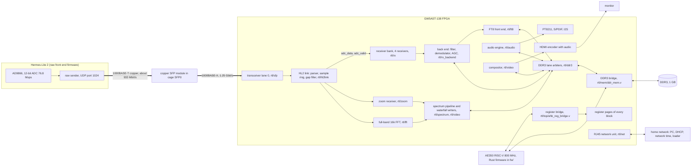
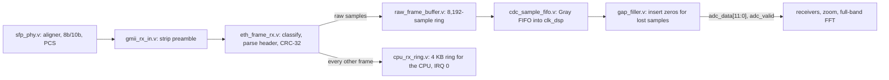
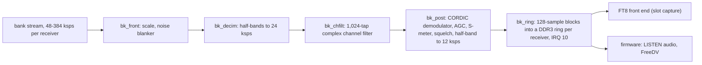
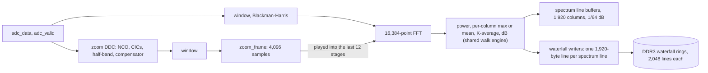
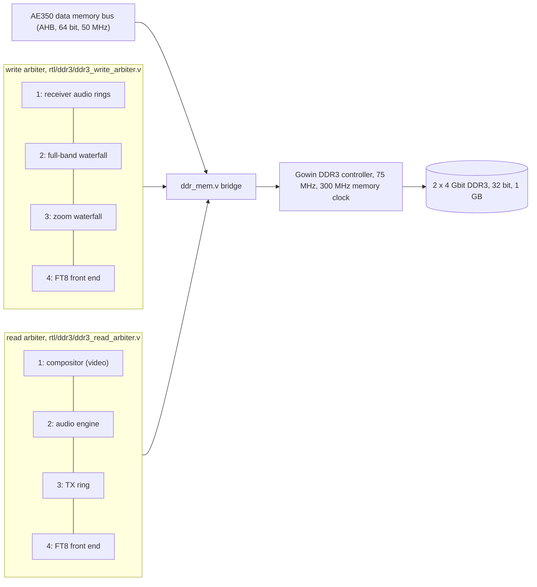
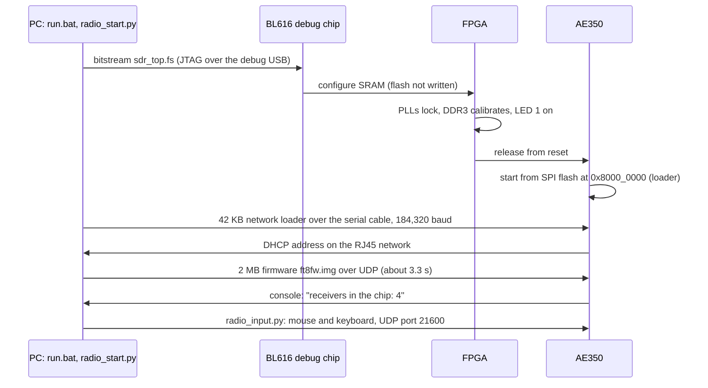

<!-- SPDX-License-Identifier: Apache-2.0 -->
<!-- Copyright 2026 Franz Schöning, https://www.schoning.com -->
# Architecture tour: from the antenna to the speaker and the screen

This tour follows the radio's data through the whole system, block by block, and names the file where each piece
lives. It assumes you have read [FPGA_PRIMER.md](FPGA_PRIMER.md) and [SDR_PRIMER.md](SDR_PRIMER.md), or at least know
what a clock domain, a block RAM, an NCO and a decimating filter are. Terms are in [GLOSSARY.md](GLOSSARY.md).

The tour describes the radio as it is built in the chip today: four receivers plus the zoom receiver, the Hermes-Lite 2
on SFP cage 0, the home network on the RJ45 socket, a 1920x1080 picture at 30 Hz, and transmit built but locked in the firmware.
`docs/ARCHITECTURE.md` is the older and much longer design document; it holds the plans, the resource ledger and the
reasons, and where it and this tour disagree (the HL2 moved from the RJ45 socket to SFP0 in October 2026, the picture
from 60 Hz to 30 Hz, the DDR3 clock from 400 to 300 MHz), `docs/DECISIONS.md` and this tour describe what is built.

## 1. The whole radio on one page



The split of work follows one design decision: as much as possible in hardware. The FPGA does every step that touches
every sample (mixing, decimation, filtering, demodulation, AGC, FFTs, the FT8 front end, drawing the waterfall, mixing
the picture). The processor does what is irregular or changes often: the screen with its buttons, the HL2 session,
tuning, filter design, FT8 and FreeDV decoding, and the network. Before this split was made the firmware did the
demodulation, and measured on the processor that cost 20 to 34 % of the core for one receiver at 384 ksps
(`docs/ARCHITECTURE.md` section 3.10), so the per-sample work moved into the chip.

## 2. Where things live in the repository

| Folder | What is in it |
|---|---|
| `rtl/top/` | `sdr_top.v` (pins, PLLs, AE350, DDR3, HDMI serializers: the parts only Gowin can build) and `sdr_core.v` (all of the radio's own logic, simulates whole); the register bus pieces |
| `rtl/sfp/`, `rtl/n1/` | the transceiver wrapper, 8b/10b coding and the 1000BASE-X PCS for the SFP lanes |
| `rtl/hl2link/` | the HL2 link: frame parser, CRC, sample ring, clock crossing, gap filler, TX framer and rate lock |
| `rtl/rx/` | the receiver bank: NCO mixer, CIC filters, compensating FIR |
| `rtl/rx_backend/` | the receiver back end: noise blanker, half-bands, channel filter, demodulator, AGC, S-meter, audio rings |
| `rtl/fft/`, `rtl/spectrum/` | the streaming FFT and the full-band spectrum pipeline (which also finishes the zoom spectrum) |
| `rtl/zoom/` | the zoom receiver: its DDC, window and frame buffer (its FFT is the last twelve stages of the full-band FFT) |
| `rtl/ft8/` | the FT8 front end: slot capture, spectrogram, Costas sync search, candidate engine |
| `rtl/video/` | the compositor, the waterfall writer, the HDMI wrapper; `rtl/vendor/hdmi` is the hdl-util HDMI core |
| `rtl/audio/` | the audio engine, the PT8211 serializer, S/PDIF and I2S |
| `rtl/ddr3/`, `rtl/mem/` | the DDR3 lane arbiters and the bridge to Gowin's DDR3 controller |
| `rtl/tx/` | the transmit chain (built, locked by firmware) |
| `rtl/net/` | the RJ45 network unit and the chip ID reader |
| `rtl/usb/`, `rtl/usbh/` | USB audio device on the "Custom USB" socket, USB host on a PMOD board |
| `rtl/blink/` | the optional board-to-board link on SFP1 |
| `rtl/hl2min/`, `rtl/top/ladder_*` | small bring-up designs: a minimal HL2 receive test and a step-by-step board test |
| `hw/regmap/` | one TOML file per register page; the Verilog constants and the Rust register crate are generated from them |
| `gowin/p1/` | the full-chip build: `build.sh`, `sdr.cst`, `sdr.sdc`, the IP configuration in `ip/` |
| `sim/` | testbenches for each block and for the whole core (`sim/top/tb_sdr_core.v`) |
| `fw/` | the Rust firmware workspace (section 10) |
| `tools/` | table and coefficient generators, `radio_start.py` and `radio_input.py`, Gowin report readers |
| `docs/` | design documents per block, decisions, board facts, the user manual |

## 3. Clock domains

Every block runs on one of these clocks, and the arrows show where data crosses between them and how it is made safe.
The frequencies and PLL settings are in [FPGA_PRIMER.md](FPGA_PRIMER.md) section 5.

```
   SFP lane 0                       DSP domain                           pixel domain
 n1_rxc 125 MHz  --Gray FIFO-->  clk_dsp 120 MHz  --toggle + snapshot-->  clk_pix 74.17 MHz
 (parser, ring)  <--cdc_word---  (receivers, back end, FFTs,             (compositor pixels,
 sfp_txc 125 MHz <--FIFO-------   zoom, FT8, audio, TX chain,              HDMI encoder,
 (TX framer)                      registers, DDR3 lanes)                   clk_pix5 x5 serializer)
                                     |  ^                 |
                     toggle handshake|  |toggle + Gray    |Gray FIFO, synchronizers
                     per access      |  |FIFO             v
 AE350 AHB 80 MHz ------------------+   +----------  ddr3_sys 75 MHz (DDR3 controller)
 (register bridge)                                   <-- AE350 DDR bus 50 MHz (CPU memory)
 clk_eth 100 MHz (RJ45 network unit)  <-- its own channel of the register bridge
 clk_48m 48 MHz (USB device and host) <-- Gray FIFO, toggles to clk_dsp
 clk_aud 49.152 MHz (S/PDIF, I2S)     <-- synchronizers or held words from clk_dsp
```

Two sample clocks exist in the system: the HL2's ADC clock (its own crystal) and the board's 50 MHz oscillator. Nothing
in the FPGA runs on the ADC clock. The samples carry `adc_valid`, and the count of valid samples is HL2 time, so the
receivers, the FFTs and the time stamps never see the difference between the two crystals. The audio output is the one
place where it shows (SDR_PRIMER section 9).

## 4. From the HL2 to `adc_valid`

### 4.1 The HL2 and its wire format

The HL2 runs the raw front end firmware from the author's Hermes-Lite2 fork (branch `hl2-rawfront-release`, wire format
in its `docs/rawfront/PROTOCOL.md`). It sends every ADC sample in UDP datagrams from port 1024. Each raw frame starts with
a header whose first byte is the magic 0xA5 and whose second byte is the version (20, 40 or 48 header bytes), followed by
the frame's sequence number, the 48-bit index of its first sample, the sample count N, an overflow count, flags and the
transmit-safety byte; then come the samples, three bytes for every two 12-bit values. With jumbo frames N is 5,968 and the
link is 93.0 % busy; with normal 1,500-byte frames N is 968 and it is 97.6 % busy (`docs/HL2_SFP.md` section 5). The
author's requirement is that 100 % of these samples arrive, so the chip counts every loss by its cause.

### 4.2 Through the SFP lane

The HL2's Ethernet port goes to a copper SFP module in cage SFP0, which speaks 1000BASE-X to the FPGA's transceiver
lane 0. `rtl/sfp/sfp_phy.v` aligns the 10-bit symbols, decodes 8b/10b and runs the PCS (with auto-negotiation, clause
37 of IEEE 802.3), and gives out one byte at a time with a byte-enable `ce`, in the lane's recovered 125 MHz clock
`n1_rxc`. Because a clock without a byte can happen, every register in the receive chain moves only when `ce` is high.

### 4.3 Parsing and the sample ring



`rtl/hl2link/eth_frame_rx.v` reads each frame one byte per clock. By byte 42 it knows whether the frame is a raw frame
(IPv4, UDP, from the HL2's address, source port 1024, first payload byte 0xA5), so it never has to buffer and replay
anything: raw samples go to the sample ring, and every other frame (discovery replies, register replies, DHCP, ARP)
goes to a small ring the processor reads, with an interrupt. It checks the Ethernet CRC-32 and drops a bad frame
completely. The sample ring `raw_frame_buffer.v` holds 8,192 samples, enough for one jumbo frame while the next one
arrives, and a Gray-coded FIFO (`cdc_sample_fifo.v`) carries the samples into `clk_dsp`.

The gap filler (`rtl/hl2link/gap_filler.v`) compares each frame's first-sample index with the index it expects. If k
samples are missing (a lost frame, or one dropped for a bad CRC), it inserts k zeros, so every NCO downstream keeps its
phase. A jump of more than 65,536 samples is a resync instead (counted, no fill). It can deliver one sample per clock,
120 M a second, well above the 76.8 M it has to, so after a fill it catches up. Its output is the radio's sample bus:
`adc_data` (12 bits, signed) and `adc_valid`.

The loss counters (`seq_lost`, `loss_a` to `loss_d`, CRC errors, gap counts) are on register page 0x01 and the firmware
reads them through `tr_fabric::hl2link::Hl2Link::loss()`. `docs/HL2_SFP.md` section 6 lists what each one counts.

### 4.4 Control traffic and the transmit side

The processor talks to the HL2 through the same link. Its frames to the HL2 go into a 4 KB transmit queue
(`cpu_tx_queue.v`), and `hl2_link_tx_top.v` sends them, with the CRC appended (`crc32_append.v`), through
`gmii_tx_out.v` and the PCS. The firmware's HL2 session (`fw/tr-station`, `hl2session`) answers the HL2's DHCP request,
finds it by discovery, switches it to raw mode, sets its band filter relays and gain, starts the stream, and starts it
again after a loss.

The same arbiter also carries the transmit samples when transmit is enabled: the TX chain (`rtl/tx/tx_chain.v`:
FIR x4, CIC x400, NCO up-mix to 76.8 Msps, 12 bits) feeds `tx_sample_framer.v`, which sends frames with the magic 0x5A
and 5,970 samples to the HL2's port 1026, and `tx_rate_lock.v` holds the HL2's transmit FIFO near 12,000 of its 16,384
samples. All of this is built and simulated, but it has never been tested end to end, so the firmware keeps it locked: the chain sends zeros unless the
firmware enables it, it goes to zeros at once when the HL2's safety byte shows a trip or over-temperature, and the firmware never sends the
HL2 its transmit permission.

## 5. The receivers and the back end

### 5.1 Receiver bank

`rtl/rx/rx_bank.v` holds `NRX` receivers (4 in the standard chip). Each has its own front end (`rx_channel.v`: the NCO
mixer and a 3-stage CIC that decimates by 10 to 7.68 Msps). Groups of up to four receivers share one 5-stage variable
CIC engine (`cic_var_shared.v`, decimation 5 to 40, its state for I and Q of each receiver in turn), and each receiver
has its own 65-tap compensating FIR that decimates by 4 (`fir_decim.v`). The outputs of all receivers leave on one
shared stream, tagged with the receiver number, at 48, 96, 192 or 384 ksps each. The firmware sets each receiver with
two registers on page 0x03: a 32-bit phase increment and a control word (enable and rate).

### 5.2 Back end



`rtl/rx_backend/rx_backend.v` turns the bank's stream into audio, one engine time-shared by all receivers. The channel
filter units hold six coefficient banks each; the firmware designs a filter, writes it into a free bank through a
1,024-tap coefficient window, and switches the receiver to it between two samples. The demodulator handles SSB, CW,
AM, SAM, FM and IQ pass-through, and the AGC works in the log domain (SDR_PRIMER sections 7 and 8). The output is
16-bit audio at 12 or 24 ksps, written as 128-sample blocks with a header (the HL2 sample index, a sequence number, the
S-meter) into one DDR3 ring per receiver through the write lane. Register page 0x0C holds a 128-byte slot per receiver
and the coefficient window. `docs/R4_BACKEND.md` has every formula, and the bit-exact Rust model is `tr-dsp::backend`.

### 5.3 FT8 front end

`rtl/ft8/ft8_frontend.v` takes each decoder receiver's 12 ksps audio from its ring, captures the 15-second slot into
DDR3, computes the spectrogram while the slot runs (`ft8_spectrogram.v`), searches the Costas sync pattern at the end of
the slot (`ft8_sync.v`), and for batches of candidates the processor chooses, mixes them down and computes soft symbols
(`ft8_cand.v`, two lanes). Results go to DDR3, interrupt line 11 says they are ready, and the processor runs LDPC and
unpacks the messages. Register page 0x0D. A second pass on the audio after the processor has subtracted the decoded
signals is supported (`docs/FT8_PASS2.md`).

## 6. Spectrum, zoom and waterfall



The full-band side windows the 76.8 Msps stream and runs the 16,384-point FFT (`rtl/fft/fft_r22sdf.v`) inside
`rtl/spectrum/spectrum_pipeline.v`. The zoom receiver (`rtl/zoom/zoom_frontend.v`, `zoom_ddc.v`, `zoom_window.v`,
`zoom_frame.v`) tunes its own center, decimates to one of eleven spans from 3.072 MHz to 3 kHz, windows the samples
and collects frames of 4,096. It has no FFT of its own: the spectrum pipeline plays each finished frame into the last
twelve stages of the 16,384-point FFT, which are a 4,096-point FFT, between full-band frames (`docs/ZOOM_FIT.md`;
`rtl/zoom/zoom_spectrum.v` is the older form with its own FFT, kept for the simulations). The pipeline also shares
its column walk engine (power, log2, the K-frame average, dB, and the color formula) between the two streams. Each stream has its own line buffers, read by the compositor for the spectrum trace,
and its own waterfall writer (`rtl/video/waterfall_writer.v`), which appends one 8-bit line per spectrum line to a DDR3
ring of 2,048 lines of 1,920 bytes. Registers: page 0x05 (full band), page 0x06 (zoom).

The LISTEN screen uses the zoom at 12 kHz span for SSB and CW and 24 kHz for AM, SAM and FM, centered on the tuned
frequency, and the FT8 and FreeDV screens use it at 6 kHz.

## 7. The screen

### 7.1 Slint and the framebuffer

The firmware draws its screen with Slint, a Rust GUI toolkit that renders in software without an operating system
(`fw/tr-gui`, the screens in `fw/tr-gui/ui/*.slint`). It draws 16-bit RGB565 pixels into a framebuffer of
1,920 x 1,080 x 2 bytes = 4,147,200 bytes in DDR3, and redraws only the parts that changed. The places where the FPGA
draws (the waterfall, the spectrum) are left as rectangles filled with the *key color* 0xF81F (magenta), and the
firmware tells the compositor where those rectangles are.

### 7.2 Compositor

`rtl/video/compositor.v` builds the picture pixel by pixel. Its fetch side runs on `clk_dsp`: it reads the framebuffer
lines and the waterfall lines from DDR3 through the highest-priority tier of the read arbiter, two lines ahead, into
block RAM line buffers. Its pixel side (`compositor_pix.v`) runs on `clk_pix` and, for each pixel, takes the Slint
pixel, and where that pixel is the key color inside one of up to four windows it shows the FPGA layer instead: a
spectrum trace or a waterfall (a waterfall byte through a 256-entry palette), with a grid, up to 8 receiver passbands
and a tuning cursor on top. Outside the windows the Slint layer is always shown, so menus can cover the waterfall. All
settings except the palette are copied once per frame in the vertical blank, so a change never tears the picture.
Register page 0x07.

### 7.3 HDMI out

`rtl/video/sdr_hdmi_video.v` wraps the hdl-util HDMI core (`rtl/vendor/hdmi`, MIT or Apache-2.0), which makes the
CEA-861 timing for mode 34 (1920x1080 at 30 Hz in a 2,200 x 1,125 frame), encodes each color to a 10-bit TMDS word, and
packs the 48 kHz audio into HDMI data islands, so the monitor plays the radio's sound too. In
`rtl/top/sdr_top.v` Gowin's `OSER10` serializers turn each 10-bit word into bits at 370.83 MHz x 2 (both edges of
`clk_pix5`), and the pins are emulated LVDS (`LVCMOS33D`). 1080p60 gave a black picture on these pins, which is why the
radio runs at 30 Hz (`docs/DECISIONS.md`, 2026-10-22).

## 8. DDR3 and how the memory is shared



The processor has no memory of its own beyond its caches and two 64 KB local memories, so its program and data live in
DDR3, and the logic needs DDR3 for every ring and buffer. Gowin's DDR3 controller IP sits in the logic, and
`rtl/mem/ddr_mem.v` bridges three clients to it: the AE350's data memory bus, one
read lane and one write lane for the logic. Each lane is 64 bits wide with bursts of up to 255 words, and each has an
arbiter with fixed priority tiers (the diagram above, from `rtl/top/sdr_core.v`); video is first on the read
side, because a pixel that arrives late breaks the picture at once, while the audio blocks have a ring of several
milliseconds behind them. One DDR3 burst moves 32 bytes, and the lanes'
ceiling at the 300 MHz memory clock is 64 bits x 75 MHz = 600 MB/s each; the picture needs about 374 MB/s at 60 Hz and
half of that at the 30 Hz the radio runs (`docs/DECISIONS.md`, 2026-10-20).

The processor and the logic see the same bytes, but the processor's data cache does not know when the logic writes. So
the firmware invalidates the cache lines of a ring before reading what the logic wrote, and writes back its own lines
before telling the logic that new data is there (`docs/ARCHITECTURE.md` section 4.2). The processor is released from
reset only after the DDR3 controller reports that calibration is done.

## 9. The processor and the register bus

### 9.1 The AE350

The AE350 is a hard RISC-V subsystem in the chip: an Andes A25 core at 800 MHz (RV32IMAFDC, five-stage in-order
pipeline), 32 KB instruction and 32 KB data cache, 64 KB each of local instruction and data memory, an interrupt
controller (PLIC) with 16 lines from the logic, UARTs, an SPI flash controller and a timer (`docs/BOARD.md`, from Gowin
MUG1031). It is configured with Gowin's IP generator (`gowin/p1/ip/riscv_ae350_soc.ipc`) and instantiated in
`rtl/top/sdr_top.v`; its buses run at 80 MHz.

### 9.2 Registers

The processor reaches the logic through the AE350's Extended AHB Slave port, a 128 MB window at 0xE800_0000. Each block
has a 64 KB page, and the page number is address bits 23 to 16:

| Page | Block | Page | Block |
|---|---|---|---|
| 0xE800_0000 | system: ID, status, interrupts | 0xE808_0000 | TX chain |
| 0xE801_0000 | HL2 link: settings, counters, safety byte | 0xE809_0000 | audio |
| 0xE802_0000 | HL2 link packet rings | 0xE80A_0000 | SFP transceiver, cages, I2C |
| 0xE803_0000 | receiver bank | 0xE80B_0000 | board link on SFP1 |
| 0xE805_0000 | full-band spectrum | 0xE80C_0000 | receiver back end |
| 0xE806_0000 | zoom | 0xE80D_0000 | FT8 front end |
| 0xE807_0000 | video compositor | 0xE80E_0000, 0xE80F_0000 | USB audio, USB host |
| 0xE924_0000 | RJ45 network unit | | |

`rtl/top/ahb_reg_bridge.v` is the one slave on that port. It carries each access into the clock domain that owns the
page with a toggle handshake (`regbus_cdc_dst.v` on the far side) and holds the bus until the answer is back, about
245 ns for a page in `clk_dsp`. That is slow for data but fine for control, and every bulk transfer goes through DDR3
rings instead. A page whose clock is missing answers 0xDEAD_BEEF after a timeout, so a dead link never hangs the
processor. The layout of every page is written once, in `hw/regmap/*.toml`, and both the Verilog constants
(`hw/regmap/generated/*.vh`) and the Rust register crate `fw/tr-regs` are generated from it.

### 9.3 Interrupts

Line 0 is a packet for the CPU from the HL2 link, 1 an HL2 status change (safety byte, gap), 3 and 4 the audio and TX
rings running low, 5 a spectrum line, 6 the RJ45 network unit, 7 the HL2 lane's link change, 8 the start of a video
frame, 10 a back-end audio block, 11 the FT8 front end, 12 USB playback samples, 13 the USB host, and 14 the board
link (`rtl/top/sdr_core.v`, `docs/ARCHITECTURE.md` section 4.3).

## 10. The Rust firmware

The firmware is pure Rust with no operating system and no C anywhere, built for the target
`riscv32imafc-unknown-none-elf` with the double-precision unit switched on. It is a Cargo workspace in `fw/`; most
crates are plain `no_std` libraries with tests that run on a PC, and only a few touch the hardware.

| Crate | Role |
|---|---|
| `tr-ae350` | start-up, traps, PLIC, timer, UART, cache operations |
| `tr-regs` | register access, generated from `hw/regmap/` |
| `tr-fabric` | drivers for the FPGA blocks: receivers, back end, zoom, spectrum, video, audio, HL2 link, SFP lane, RJ45 unit |
| `tr-hl2` | the HL2 protocol: discovery, commands, safety byte |
| `tr-station` | the radio as a whole: the HL2 session, the FT8 station, LISTEN, waterfall levels, key handling |
| `tr-gui` | the Slint screens and the framebuffer renderer |
| `tr-dsp` | DSP in f32 and the bit-exact model of the back end, filter design |
| `tr-modes` | FT8 and the other digital modes (mfsk-core), the model of the FT8 front end |
| `tr-freedv`, `tr-codec2` | FreeDV 700D and 700E receive, Rust ports of codec2 (LGPL-2.1) |
| `tr-net`, `tr-input` | DHCP and SNTP on the RJ45 unit; mouse and keyboard from the PC over UDP |
| `tr-usb`, `tr-usbh` | USB audio descriptors; the USB host stack |
| `tr-app` | the firmware binary `ft8fw` (`src/bin/ft8fw.rs`): set-up and the main loop |
| `tr-image`, `tr-loader` | the boot image format and the stage-0 loader |

`ft8fw` checks the chip's blocks at start-up, prints `receivers in the chip: 4` on the console, starts the HL2 session,
the receivers and the waterfall, and then runs one main loop: service the HL2 link and the radio, cut FT8 slots out of
receiver 0's audio by HL2 time and decode them, keep the LISTEN audio ring topped up, apply input from the PC, and draw
the screen. The loop is not split into tasks yet, so the mouse pointer can lag while a pass draws the screen (0.1 to
0.3 s per pass, `docs/NETINPUT.md`). The key `m` cycles the screens FT8, FreeDV and LISTEN.

## 11. Loading and starting



`run.bat` checks for Python and pyserial and starts `tools/radio_start.py`, which takes a lock file (one board is shared
between projects), finds the debug cable's console port, and calls a board loader tool (board.py with its board.json, not part of this repository) to
do the load. Nothing is written to any flash, so after a power-off the load has to be run again. The bitstream and the
firmware image it loads come from a keep folder of a tested build, set by `RADIO_KEEP`. Once the radio runs,
`tools/radio_input.py` sends the PC's mouse and keyboard to it as UDP datagrams (magic "TRIN", port 21600), and the
firmware feeds them into the same path as a USB mouse and keyboard. The network input can never transmit: keys that
would transmit are dropped before they reach the screen (`docs/NETINPUT.md` section 3).

## 12. What is not finished

Several parts are built and simulated but not proven on the board, and a reader should know which. From
`docs/USER_MANUAL.md`, `docs/LISTEN.md` and `docs/DECISIONS.md`: the audio outputs had not been heard on the board when
the manual was written; the timing-clean bitstream of November 2026 has not run on the board yet; the LISTEN screen's
audio level and S-meter calibration are not measured, and its audio ring of 85 ms is its weak point; TCI and VITA-49 streaming to the network are
designed but not built; and transmit, which is built, stays locked in the firmware until it has been tested end to end. The radio depends on a board loader tool
that is not part of this repository, so a reader without that tool needs another way to load a `.fs` file and a firmware
image (Gowin's programmer for the bitstream and the stage-0 loader, then the stage-0 UART loader in `fw/tr-loader` for
the firmware, as `docs/LADDER.md` section 3a and `docs/C2_LOADER.md` describe).
