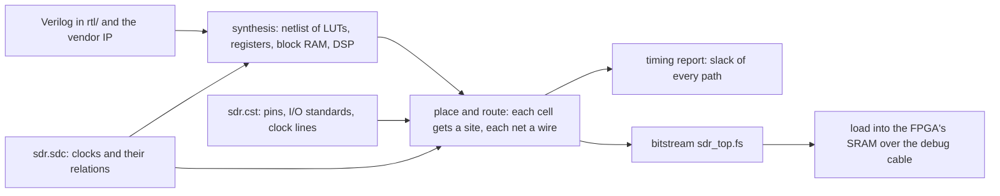

<!-- SPDX-License-Identifier: Apache-2.0 -->
<!-- Copyright 2026 Franz Schöning, https://www.schoning.com -->
# FPGA primer: the chip, the board and how a design gets into it

This is the first thing to read if you know a little programming but have never worked with an FPGA. It explains what
the chip is made of, why a design that is correct in simulation can still fail on the chip, what is on the Tang Mega
138K Pro board that this radio uses, and how the files in this repository become a running radio. Every number here
comes from this project (the constraint files, the build logs recorded in `docs/DECISIONS.md`, the RTL headers) or from
Gowin's own manuals, which are named with their section so you can look things up yourself.

If you already build FPGA designs for a living you can skip to section 4 (the board) and section 6 (the build), and keep
in mind that the Gowin tools have a few traps of their own, listed at the end. Words in *italics* the first time they
appear are explained in [GLOSSARY.md](GLOSSARY.md).

## 1. What an FPGA is

A normal processor runs a program one instruction after another. An FPGA (field programmable gate array) does not run
a program at all: it is a chip full of small logic blocks and wires that you connect, by loading a configuration file,
into whatever circuit you need. Once loaded, every part of that circuit works at the same time, which is why an FPGA
can mix four radio receivers, run a 16,384-point FFT, draw a waterfall and send pixels to a monitor in the same clock
tick, something the 800 MHz processor on the same chip could never do in software.

The language used to describe the circuit is Verilog. It looks like a programming language, but each line describes
hardware: `assign y = a & b;` is an AND gate whose output follows its inputs, and a `reg` written inside
`always @(posedge clk)` is a storage cell that takes a new value only when the clock rises. Keep that picture in mind
when you read the RTL in `rtl/`, because nothing in it "runs" from top to bottom.

### 1.1 The LUT

The basic logic block is the *LUT* (look-up table). A 4-input LUT is a tiny memory of 16 bits: the four inputs form an
address, and the stored bit at that address is the output, so a LUT can be any function of four inputs (an AND, an
XOR, a comparator slice, anything). The GW5AST-138 has 138,240 of them (data sheet DS1104 table 1-1, quoted in
`docs/BOARD.md`). Gowin groups them in *CFU*s: each CFU has four *CLS* sections, and each CLS holds two 4-input LUTs and
two registers (Gowin UG303, "Arora V Configurable Function Unit", chapter 2). A CLS can also join its two LUTs into a
5-input LUT, or work in ALU mode with a carry chain to build adders and counters, which is where the "ALU" count in the
build reports comes from.

A LUT can also be used as a very small memory of 16 words of 4 bits (UG303 section 2.1, "memory mode"). This is called
LUT RAM or distributed RAM, and the build reports count it as RAM16. It is handy for short FIFOs, such as the 16-entry
clock-crossing FIFOs in `rtl/mem/ddr_mem.v`.

### 1.2 The flip-flop

A *flip-flop* (Gowin calls it REG) stores one bit and changes only on a clock edge. The chip has as many registers as
LUTs, 138,240. Everything in a synchronous design moves from one set of flip-flops, through some LUTs, into the next set
of flip-flops, once per clock. A full radio build of this project used 68,376 registers (50 % of the chip) and 78,144
logic cells (57 %), as recorded for the four-receiver build with the zoom in `docs/ROUTE_CAUSE.md`.

### 1.3 Block RAM

Larger memories would eat thousands of LUTs, so the chip has dedicated memory blocks. Gowin calls them BSRAM (block
static RAM). Each is 18 kbit, there are 340 of them (6,120 kbit in all), and each has two ports with their own clock,
address and data, so one side can write while the other reads, even in a different clock domain (Gowin UG300, "Arora
V BSRAM & SSRAM User Guide", section 2.1). A block can be 16,384 x 1, 2,048 x 9, 1,024 x 18 or 512 x 36 bits, among
other shapes (UG300 table 2-1). This radio uses block RAM for the FFT delay lines, the receiver filter delay lines, the
back end's 1,024-tap filter coefficients, the video line buffers and the packet rings of the HL2 link. The
four-receiver build above used 221 of the 340 blocks (65 %).

Two details from the manual matter for this project. First, the 138K chip has no "read-before-write" mode (UG300
section 2.1, note 1), which means a memory written in Verilog so that a read and a write to the same address return the
old word cannot be built, and place-and-route stops with an error. Every memory in `rtl/` is written as simple dual
port with a registered read so it never asks for that mode. Second, a memory 32 or 36 bits wide used as a simple dual
port counts as two blocks in the place-and-route report, which is why `docs/ARCHITECTURE.md` section 3.14 has a second
"recount" table.

### 1.4 The DSP block

Multiplying two 18-bit numbers in LUTs takes a few hundred of them and is slow, so the chip has 298 *DSP* blocks.
Each one holds a multiplier that can be 12 x 12, 27 x 18 or 27 x 36 bits wide, a 26-bit pre-adder in front of it, a
48-bit adder (ALU) after it, and up to four register stages (input, pipeline, output, feedback), all with signed
numbers (Gowin UG305, "Arora V Digital Signal Processing (DSP) User Guide", chapters 2 and 3.1). Blocks can be cascaded
so that the 48-bit sum of one goes straight into the next.

In this radio a DSP block is in almost every arithmetic step: four in each NCO mixer (`rtl/rx/nco_mixer.v`: two for
the sine correction, two for the mix itself), one shared multiplier for all 65 taps of each receiver's decimating FIR
(`rtl/rx/fir_decim.v`), three twiddle multipliers per FFT stage pair. The FIR uses the multiply-accumulate mode by
instantiating Gowin's `MULTALU27X18` primitive directly (UG305 section 4.2.1), because the synthesis tool maps an
inferred multiply-accumulate with a load wrongly (see section 8). The four-receiver build used 127 of the 298 DSP
blocks (43 %).

### 1.5 The PLL

The board gives the chip one clock, a 50 MHz oscillator on pin P16 (`gowin/p1/sdr.cst`). A *PLL* (phase locked
loop) makes other frequencies from it: it multiplies the input up to a *VCO* frequency between 650 and 1,300 MHz on the
138K (Gowin UG306, "Arora V Clock User Guide", section 2.3), and then divides that by a whole number on each output.
The radio's main DSP clock is an example: 50 MHz x 24 = 1,200 MHz in the VCO, divided by 10 gives `clk_dsp` at
120 MHz, and the same VCO divided by 25 gives the 48 MHz USB and audio clock (`gowin/p1/ip/gowin_pll_dsp.mod`). The
design uses six PLLs, listed in section 5.

### 1.6 Clock lines

A clock has to reach tens of thousands of flip-flops at almost the same moment. If it traveled on ordinary wiring it
would arrive at one flip-flop a nanosecond or two later than at another, and data could slip into the wrong clock
cycle. The chip therefore has dedicated clock networks: the Arora V family has 16 global clock lines (UG306 section
2.1). Gowin's report shows them as 8 "primary" lines (0 to 7) and 8 "long wire" lines (8 to 15), and both kinds are good
enough for a clock. In the pin constraint file a clock is put on a line with `CLOCK_LOC "net" BUFG[n] = CLK;` (Gowin
SUG1541, "Physical Constraints User Guide", section 2.8). In `gowin/p1/sdr.cst` lines 8 to 15 are named by hand
(for example `clk_pix` on line 15 and the three transceiver clocks on lines 12, 13 and 14), because when they were
left to the tool it once gave a long-wire line to a DDR3 reset signal and left a real clock on ordinary wiring, which
gave hold failures.

## 2. Timing closure and why a long path fails

### 2.1 The clock period is a time budget

At 120 MHz the clock ticks every 8.33 ns. Between two flip-flops the signal has to leave the first flip-flop, pass
through every LUT and wire in between, and arrive at the second flip-flop a little before the next clock edge (the
*setup* time). If it arrives too late, the second flip-flop stores the old value or a mixture, and the design does
something it never did in simulation. The difference between the time a signal needs and the time it has is called
*slack*; a negative slack is a failing path, and the tool reports each flip-flop that receives a failing path as a
failing "end point".

The opposite problem also exists. If a signal arrives too soon after the clock edge (before the *hold* time has
passed), the second flip-flop may catch the new value in the same cycle in which it should still hold the old one. Hold
failures usually come from clocks that reach the two flip-flops at different times, which is why clocks belong on
the global lines.

*Timing closure* means that every path in the whole chip meets both checks at the real clock frequencies. The radio's
build of 5 November 2026 was the first with 0 failing setup and 0 failing hold end points on every clock
(`docs/DECISIONS.md`, entry of 2026-11-05).

### 2.2 What makes a path long

Each LUT the signal passes through is one *logic level*, and each level brings its own delay plus the wire to the next
one. Two real examples from this project show how fast that adds up:

- The gap filler (`rtl/hl2link/gap_filler.v`) once compared each frame's 48-bit sample index with the expected one in a
  single clock: a 48-bit subtract, a 48-bit compare and a select. In the full chip that was 16 logic levels and 8.7 ns,
  more than the 8.33 ns a 120 MHz clock gives, so roughly half a nanosecond per level including its wire. The fix was to
  spread it over three more clocks (latch, subtract, turn the difference into flags, decide), which costs nothing,
  because the samples wait in a small queue meanwhile.
- The receiver's FIR filter (`rtl/rx/fir_decim.v`) had one 14.4 ns path from the tap counter through a subtract, a
  coefficient ROM read, a multiply and the accumulate. It is now a pipeline of one short step per clock (counter,
  address, memory read, select, then the DSP block with its own registers), with the same results.

Long wires are the second cause. A signal that drives hundreds of inputs (high *fan-out*) has to be spread over a large
part of the chip, and the wire alone can take nanoseconds. In `rtl/rx/cic_var_shared.v` a reset and two enables were
single nets with 645, 215 and 430 loads, and the slowest of them took 14.0 ns. They were replaced by several kept
copies of the same register, each with at most 11 loads, so each copy can sit near what it drives. You will see this
pattern ("kept copies", "rx_fan") all through `rtl/rx`.

### 2.3 Clock domains and crossing them

Not everything runs on one clock. The HL2 link runs on the 125 MHz clock recovered from the SFP lane, the processor's
bus on 80 MHz, the pixels on 74.17 MHz and the DSP on 120 MHz, and these clocks have no fixed phase relation. A signal
that goes from one clock domain to another cannot be timed, so it has to be carried across safely: a single bit through
two or three flip-flops in a row (a *synchronizer*), a value held steady while a toggle bit announces it (a *toggle
handshake*), or a stream through a FIFO whose pointers are *Gray coded* so that only one bit changes at a time. The
constraint file then tells the tool not to time paths between the two clocks with `set_clock_groups -asynchronous`
(Gowin SUG940, "Design Timing Constraints User Guide", section 5.2.5). A crossing that is not built in one of these ways
and is still declared asynchronous will fail on the board in a way no timing report shows, so every
`set_clock_groups` line in `gowin/p1/sdr.sdc` has a comment saying which circuit makes it safe.

## 3. The chip in numbers

| Resource | GW5AST-138 | Source |
|---|---|---|
| 4-input LUTs and registers | 138,240 each | DS1104 table 1-1 (`docs/BOARD.md`) |
| Block RAM | 340 blocks of 18 kbit (6,120 kbit) | DS1104 table 1-1, UG300 section 2.1 |
| DSP blocks | 298 (27 x 18, 12 x 12, 27 x 36 multipliers, 48-bit ALU) | DS1104, UG305 chapter 2 |
| PLLs | up to 12 (6 used here) | DS1104 table 1-1 |
| Global clock lines | 16 | UG306 section 2.1 |
| Transceiver (SerDes) lanes | 8, 270 Mbit/s to 12.5 Gbit/s | DS1104 section 2.6 |
| User I/O in this package | 312 | DS1239 table 1-2 |
| Hard processor | AE350: Andes A25, RV32IMAFDC, up to 800 MHz, 32 KB + 32 KB caches | MUG1031 sections 2-4 |

The FPGA part on the board is the GW5AST-LV138FPG676A, device version B (`docs/BOARD.md`); the build names it
`GW5AST-LV138FPG676AC1/I0` with device name `GW5AST-138C` (`gowin/p1/build.sh`). Since the author's rule of 12
November 2026 there is no usage limit on any of these resources in this project: a build may use up to 100 % of
anything, and the only tests are whether it closes timing and whether it works on the board.

## 4. The board: Sipeed Tang Mega 138K Pro

The board is two parts: a core module (SOM) with the FPGA, the DDR3 memory and the flash, and a dock with the
connectors. The facts below are from `docs/BOARD.md`, which names the schematic sheet for each one.

```
      +-------------------------- dock --------------------------------------+
      |  RJ45 (RTL8211F PHY) ---- home network, 100 Mbit/s here              |
      |  SFP0 cage ---- copper SFP module ---- Hermes-Lite 2 (1000BASE-X)    |
      |  SFP1 cage ---- board-to-board link (2.5 Gbit/s, optional)           |
      |  HDMI TX ---- monitor, 1920x1080 at 30 Hz with sound                 |
      |  3.5 mm jack + speaker ---- PT8211 DAC                               |
      |  "Custom USB" (USB-C) ---- USB audio device to a PC                  |
      |  PMOD0 ---- USB host board (mouse, keyboard, headset)                |
      |  PMOD2 ---- S/PDIF and I2S audio out                                 |
      |  debug USB-C ---- BL616: loads the FPGA (JTAG) and the serial console|
      |   +---------------- core module ---------------+                     |
      |   | GW5AST-138 FPGA with the AE350 RISC-V      |                     |
      |   | 2 x DDR3 H5TQ4G63EFR (x16 each) = 1 GB     |                     |
      |   | 50 MHz oscillator, 2 x SPI flash           |                     |
      |   +--------------------------------------------+                     |
      +----------------------------------------------------------------------+
```

### 4.1 DDR3 memory

Two SK Hynix H5TQ4G63EFR-RDC chips of 4 Gbit, each 16 bits wide, together form a 32-bit bus with 1 GB. DDR3 moves
data on both edges of its clock, so a 300 MHz memory clock gives 600 million transfers per second on each of the 32
lines. The radio runs the memory at 300 MHz, not the 400 MHz the parts and Sipeed's examples use, because it was measured on this board that at 400 MHz reads with two or more in flight were lost or corrupted when much logic
on the chip switched at the same time (`docs/DECISIONS.md`, entry of 2026-10-20). The DDR3 PLL makes 1,200 MHz in its
VCO and divides it by 4 for the memory clock (`gowin/p1/ip/gowin_pll_ddr3.mod`); Gowin's DDR3 controller runs its
logic at a quarter of that, 75 MHz, and one memory burst moves 8 x 32 bits = 32 bytes.

The pins of a DDR3 bus are not ordinary 3.3 V pins: they use the SSTL15 standard at 1.5 V, and their drive strength
matters. This project uses Sipeed's values, drive 12 on data, mask, address and control, 4 on CKE, and 8 on the
clock and the strobes (DQS), which you can see in `gowin/p1/sdr.cst` (for example `DDR3_DQ[0]` on pin G4 with
`DRIVE=12`). A build that had drive 8 on every pin was one of the reasons the processor did not start on the board in
October 2026.

The same memory is shared by the processor (as its main memory) and by the logic (video, audio rings, waterfall
rings, receiver audio rings, the FT8 engines). How that works is in [ARCHITECTURE_TOUR.md](ARCHITECTURE_TOUR.md)
section 8.

### 4.2 SFP cages

The dock has two SFP+ cages, wired to transceiver quad 1, lanes 0 and 1. An SFP module is a small plug-in card that
turns the chip's high-speed serial signal into fiber or copper Ethernet. This radio puts a copper module (10Gtek
"1.25G SFP-T", Marvell 88E1111 inside) in cage SFP0 and connects the Hermes-Lite 2 to it with an ordinary network
cable. The chip talks to the module in 1000BASE-X at 1.25 Gbit/s (8b/10b coding, so 1 Gbit/s of data), and the
module converts that to the 1000BASE-T copper Ethernet the HL2 speaks. The transceiver needs a 125 MHz reference clock,
which comes from MS5351M clock chips on the dock. Cage SFP1 carries an optional link to a second board at 2.5 Gbit/s.

### 4.3 HDMI pins

There is no HDMI chip on the board. The four HDMI pairs (three data, one clock) go straight to FPGA pins configured as
`LVCMOS33D`, an emulated differential output, with only ESD protection between the pins and the connector
(`docs/BOARD.md`; port 0 on AB24/AC24, V24/W24, AA22/AA23 and the clock on Y22/Y23). The logic does the HDMI encoding
itself and Gowin's `OSER10` serializer turns each 10-bit TMDS word into a bit stream at ten times the pixel clock. At
1920x1080 and 60 Hz that would be 1,485 Mbit/s per pair, and on this board the picture stayed black at that rate, while
1920x1080 at 30 Hz (CEA mode 34, 74.17 MHz pixel clock, about 742 Mbit/s per pair) and 1280x720 at 60 Hz both work
(`docs/DECISIONS.md`, 2026-10-22). So the radio's screen is 1080p30.

### 4.4 RJ45

The RJ45 socket has a Realtek RTL8211F Ethernet PHY connected over RGMII. The radio uses it as its connection to the
home network: DHCP, network time for FT8, the mouse and keyboard from a PC, and the firmware loader. The unit that
drives it (`rtl/net/eth_top.v`) runs at 100 Mbit/s on a 100 MHz clock and samples the PHY's
receive clock as data instead of using it as a clock, which is why `gowin/p1/sdr.sdc` has false paths on those
pins instead of input delays.

### 4.5 Headphone DAC

A PT8211 stereo DAC drives the 3.5 mm headphone jack and, through an amplifier, the speaker. It takes 16-bit samples in
a serial format with three pins: bit clock on E22, word clock on F24 and data on G24. The radio sends it 48 kHz audio
interpolated eight times to 384 kHz, with a bit clock of 384 kHz x 32 = 12.288 MHz, inside the part's 20 MHz limit
(`rtl/audio/`, `docs/BOARD.md`).

### 4.6 The rest

The debug USB-C socket goes to a BL616 microcontroller that acts as the JTAG cable for loading the FPGA and as a
serial port to the processor's UART (pins N16 and P15); the radio's console runs at 184,320 baud. The "Custom USB"
socket is wired straight to FPGA pins and the radio makes it a USB sound card in logic (`rtl/usb`). There are 4
buttons, 6 LEDs (LED 1 shows that the DDR3 memory is ready), three PMOD headers, two 128 Mbit SPI flash chips (one for
the FPGA configuration, one for the processor), a microSD slot and an RGB LCD connector the radio does not use.

## 5. The clocks of this design

| Clock | Frequency | Made by | Used for |
|---|---|---|---|
| `clk_50m` | 50 MHz | oscillator, pin P16 | input of every PLL |
| `clk_dsp` | 120 MHz | DSP PLL, VCO 1,200 MHz / 10 | receivers, back end, FFTs, zoom, spectrum, compositor fetch, audio, TX chain, registers, DDR3 lanes |
| `clk_48m` | 48 MHz | DSP PLL, VCO / 25 | USB device, USB host, audio PLL input |
| `clk_aud` | 49.152 MHz | audio PLL, 48 MHz x 128 / 125 | S/PDIF and I2S (1,024 x 48 kHz) |
| `clk_pix`, `clk_pix5` | 74.17 and 370.83 MHz | video PLL | HDMI pixel pipeline and the 5x serializer clock |
| AE350 core, AHB/APB, DDR bus, RTC | 800, 80, 50, 10 MHz | AE350 PLL | the hard RISC-V and its buses |
| `ddr3_memory_clk`, `ddr3_sys`, `ddr3_ref` | 300, 75, 50 MHz | DDR3 PLL and the DDR3 IP | DDR3 controller |
| `clk_eth` | 100 MHz | Ethernet PLL, VCO 1,000 MHz / 10 | RJ45 network unit |
| `n1_rxc`, `sfp_txc`, `bl_rxc` | 125 MHz each | transceiver lanes | HL2 link receive and transmit, board link receive |

All of them are declared in `gowin/p1/sdr.sdc`. The 120 MHz main clock was chosen in October 2026 because it is
the one lower frequency where only the PLL divider changes: 48 kHz is exactly 2,500 clocks and a microsecond exactly
120 clocks (`docs/DECISIONS.md`, 2026-10-12, night).

## 6. How a design is built

### 6.1 The steps



1. **Synthesis** reads the Verilog and turns it into a *netlist*: a list of LUTs, registers, block RAMs, DSP blocks and
   the nets between them. It also decides what a piece of Verilog becomes (a memory written in a certain way becomes a
   block RAM, a multiply becomes a DSP block). Gowin's tool for this is GowinSynthesis (Gowin SUG550).
2. **Place and route** puts every cell of the netlist on a site of the chip and then finds a wire for every net. It is
   steered by the timing constraints, so it tries to put cells on a slow path close together. On this design it takes
   about an hour: the timing-clean builds of November 2026 took 56 to 70 minutes each (`docs/DECISIONS.md`,
   2026-11-05).
3. **Timing analysis** checks every path against its clock and writes the report (setup and hold slack per clock,
   the worst paths, the highest frequency each clock reached).
4. **Bitstream generation** writes the configuration file, `sdr_top.fs`.
5. **Loading** sends that file into the FPGA. The radio loads it into the FPGA's configuration SRAM, which is lost at
   power-off, so `run.bat` has to be run again after every power cycle. The configuration flash is not written.

### 6.2 The two constraint files

`gowin/p1/sdr.cst` is the physical constraint file (Gowin SUG1541, chapter 2). It says which port goes to which
pin (`IO_LOC "clk_50m" P16;`), what electrical standard and drive each pin has (`IO_PORT "DDR3_CKE" IO_TYPE=SSTL15
... DRIVE=4`), and which clock goes on which global line (`CLOCK_LOC "clk_aud" BUFG[10] = CLK;`). It is 338 lines and
each group of pins names the schematic sheet or the Sipeed example it came from.

`gowin/p1/sdr.sdc` is the timing constraint file, in the SDC format Gowin shares with other vendors (SUG940,
chapter 5). It declares the one real input clock (`create_clock -name clk_50m -period 20`), every PLL output as a
generated clock with its multiply and divide (`create_generated_clock -name clk_dsp ... -multiply_by 12 -divide_by 5`),
the clock groups that are asynchronous to each other, and a few false paths (pins sampled through synchronizers, the
reset of the HDMI serializers). The build adds `rtl/rx_backend/rx_backend.sdc` and `rtl/ft8/ft8_spectrogram.sdc`, which
give a few register paths two clocks instead of one with `set_max_delay`, because the RTL guarantees they have that
long.

### 6.3 Running the build

`gowin/p1/build.sh`, run from the repository root in a Git Bash shell, does all of it with Gowin EDA V1.9.12.04:

- it regenerates the IP from the committed configuration only (the PLLs from `gowin/p1/ip/*.mod` with GowinModGen, the
  AE350 configuration from `riscv_ae350_soc.ipc`, the SerDes wrapper from `gowin/p1/ip/serdes/`); no Gowin source is
  kept in git;
- it collects the RTL, joins the constraint files into one, writes a Tcl script and runs `gw_sh`;
- after place and route it prints a verdict (failing end points over all clock pairs) and copies the deliverables
  (netlist, constraints, reports, bitstream) to a keep folder.

Switches choose variants: `TR_NRX=1..8` sets the number of receivers (4 by default), `TR_NO_ZOOM=1` removes the zoom
receiver (the 8-receiver chip needs it), `TR_DDR=256` builds the fall-back with the AE350's own DDR3 controller on one
chip, and `TIMING_MARGIN_PCT=5` tightens the main clocks by 5 % in the build's copy of the constraints so that a build
that passes has some margin. A dry run (`GOWIN_DRY=1`) writes the project and stops before Gowin starts, which is a
cheap way to see what a build would do.

The open-source tools in this repository (iverilog and Verilator for simulation, yosys for resource estimates) cannot
build a bitstream for this chip, and they cannot simulate the AE350, the DDR3 IP or the PLLs. That is why the RTL is
split: `rtl/top/sdr_core.v` holds all of the radio's own logic and simulates whole in iverilog
(`sim/top/tb_sdr_core.v`), while `rtl/top/sdr_top.v` adds only what needs Gowin (pins, PLLs, the AE350, the
DDR3 path, the HDMI serializers).

### 6.4 Loading and starting

`run.bat` calls `tools/radio_start.py`, which uses a board loader tool (board.py with its board.json) that is not part of this repository. It loads the
bitstream into the FPGA over the debug cable, waits for the processor to start from its SPI flash (where a small network
loader lives), and then sends the 2 MB radio firmware over UDP on the RJ45 network (about 3.3 s, `docs/DECISIONS.md`,
2026-10-21 night). The processor is held in reset until the DDR3 memory has calibrated (`rtl/top/sdr_top.v`),
because its program runs from DDR3; if the memory does not calibrate, the console stays silent. When the firmware
prints `receivers in the chip: 4` on the serial console the radio is up. Section 11 of
[ARCHITECTURE_TOUR.md](ARCHITECTURE_TOUR.md) has the details.

## 7. Reading a timing report

A Gowin timing report (`impl/pnr/sdr_top_tr_content.html` in the build folder) lists, for each clock, the highest frequency
it reached and the worst paths with their slack, and at the end a summary of failing end points per clock pair. Three
numbers from this project show the scale of the work:

- In the 300 MHz DDR3 build of October 2026, `clk_dsp` reached 111.96 MHz against the 120 MHz asked, with 320 failing
  setup end points over all clocks (`docs/DECISIONS.md`, 2026-10-20).
- In the merged build of 21 October the AE350 PLL moved to another site and the result went to 2,493 failing setup end
  points without any change in the radio logic, which shows how much a placement can move.
- The 1,780 setup and 3 hold failures of the 1080p30 build turned out to be the DDR3 controller's own reset paths,
  timed as if they were synchronous because one PLL output had no clock name. Naming it `ddr3_ref` and putting it in
  its own asynchronous group brought the build to 0 and 0 (`docs/DECISIONS.md`, 2026-11-05).

The last example is worth keeping in mind: a large number of failing end points is often one missing or wrong
constraint, so read the paths before changing the logic.

## 8. Gowin traps this project ran into

These are tool problems found and reported to Gowin, and this project works
around them (the list is in docs/TANG_LESSONS.md section 8):

- An inferred multiply-accumulate with a load (`acc <= (first ? c : acc) + a*b`) is mapped into the DSP block wrongly.
  The RTL instantiates `MULTALU27X18` instead, and DSP mappings are checked by simulating the synthesized netlist.
- A register array loaded in a loop is built wrongly and can be shared across instances. Use packed vectors.
- `(* syn_preserve = 1 *)` is ignored, while the comment form `reg x /* synthesis syn_preserve = 1 */;` works. Equal
  registers are merged even when kept by name, so kept copies must be made genuinely different.
- A memory that reads the old word on a write to the same address becomes a read-before-write block RAM, which the 138K
  does not have, and place and route stops with error PA2122.
- Multicycle constraints hang the placer, so two-clock paths are given with `set_max_delay`.

## 9. What this primer does not cover

It does not teach Verilog syntax in depth (any Verilog book does that better), and it does not cover the transceiver
(SerDes) block or the DDR3 controller's calibration in detail; those are Gowin IP blocks used through their wrappers,
and `docs/HL2_SFP.md`, `docs/SFP_LINKS.md` and `docs/MEM_1GB.md` describe how this project uses them. Next, read
[SDR_PRIMER.md](SDR_PRIMER.md) for the radio side, then [ARCHITECTURE_TOUR.md](ARCHITECTURE_TOUR.md) for how the
pieces fit together.
