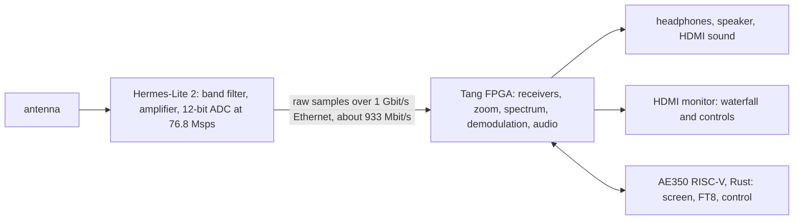

<!-- SPDX-License-Identifier: Apache-2.0 -->
<!-- Copyright 2026 Franz Schöning, https://www.schoning.com -->
# SDR primer: how a radio becomes numbers and the numbers become sound

This primer explains the ideas behind a software defined radio for someone who can program a little but has never
studied signal processing. Each idea is explained with the real numbers of this radio, so that when you later open
`rtl/rx/nco_mixer.v` or `fw/tr-station/src/listen.rs` the constants in the code are already familiar. Terms in
*italics* are in [GLOSSARY.md](GLOSSARY.md). The math is kept to what you need to follow the code, and if you want
the full theory a book such as Lyons' "Understanding Digital Signal Processing" goes much deeper than this page can.

This primer is about receiving. Transmit is built too, but it has never been tested end to end, so the firmware keeps it locked and never keys the
Hermes-Lite 2, and nothing in this primer covers how to make it transmit.

## 1. What a software defined radio is

An old radio does its work with coils, capacitors and crystals: it mixes the antenna signal down to a fixed
intermediate frequency, filters it with a crystal filter and demodulates it with a diode or a product detector. Every
mode and every filter width needs its own parts. A software defined radio (SDR) does as little as possible with
parts: it turns the antenna signal into numbers as early as it can, and from then on mixing, filtering and demodulation
are arithmetic, so changing a filter means loading a new table of coefficients and adding a mode means writing new
code, without touching the hardware.

In this project the "as early as it can" part is the Hermes-Lite 2 (HL2), an open-source HF transceiver board. Its
AD9866 converter samples the antenna signal directly with a 12-bit ADC at 76.8 million samples per second (76.8 Msps)
and sends every one of those samples, unchanged, over Ethernet. The HL2 runs special firmware for this (the "raw
front end" release on the author's Hermes-Lite2 fork). Everything after that happens on the Tang board: the FPGA does
the heavy, regular arithmetic on all 76.8 million samples a second, and the RISC-V processor running Rust firmware does
what is irregular or changes often (the screen, FT8 decoding, control of the HL2).



## 2. Sampling

### 2.1 Sample rate and the Nyquist limit

Sampling means measuring the signal's voltage at regular moments. The HL2 measures it 76.8 million times a second, so
the samples are 13 nanoseconds apart. A sampled signal can only represent frequencies up to half the sample rate (the
*Nyquist* frequency), here 38.4 MHz. The whole HF range, 0 to 30 MHz, fits below that with room for the HL2's
anti-alias filter to roll off. A signal above 38.4 MHz that got through the filter would fold back and appear at a false
frequency below it (an *alias*), which is why the input filter matters and why every decimation step later in the chain
has its own filter.

### 2.2 Bits and dynamic range

Each sample is a 12-bit signed number, -2,048 to +2,047, in *two's complement*. More bits mean a lower quantization
noise floor; the usual rule is about 6 dB per bit, so 12 bits give about 74 dB between a full-scale sine and the
noise of the conversion itself. That sounds small for a radio, but the noise is spread over the whole 38.4 MHz, and a
receiver that looks at a 2.4 kHz slice only sees a tiny part of it. This *processing gain* is what lets a 12-bit SDR
hear weak signals. The spectrum FFT in this radio measures a spurious-free range of 93 to 94 dBc for a tone just below
full scale, limited by the ADC and not by the FFT arithmetic (`docs/ARCHITECTURE.md` section 3.3).

### 2.3 The stream as the FPGA sees it

The samples arrive in Ethernet frames, three bytes for every two 12-bit samples, up to 5,968 samples in one jumbo frame
or 968 in a normal 1,500-byte one. The FPGA unpacks them and hands them to the receivers one at a time with a
one-clock *valid strobe* called `adc_valid`. The DSP clock is 120 MHz and the samples come at 76.8 Msps, so on average
`adc_valid` is high in about 64 % of the clocks, but it comes in bursts while a frame is unpacked and pauses between
frames. Every block in the receive chain therefore advances only when `adc_valid` is high, and the sample count, not
the clock, is the radio's sense of time. When a frame is lost the *gap filler* (`rtl/hl2link/gap_filler.v`) inserts
exactly as many zero samples as were lost, so that every oscillator downstream keeps its phase and every time stamp
stays right.

## 3. Real signals, complex signals and I/Q

A single row of numbers from the ADC is a *real* signal. Its spectrum is mirrored: a tone at +7.074 MHz is also a tone at
-7.074 MHz, and you cannot tell from the numbers alone which side a signal is on once you move it near zero.

The fix is to carry two numbers per sample, called *I* (in phase) and *Q* (quadrature), and treat them as one complex
number I + jQ. A complex signal can have a tone at +1 kHz without one at -1 kHz, so after mixing a station down to zero
frequency the upper sideband and the lower sideband stay apart, and a receiver can pick one of them. Every receiver
in this radio turns the real ADC stream into I/Q in its first step and keeps I/Q until the demodulator.

## 4. The NCO and the mixer

### 4.1 Moving a station to zero

To listen to 7.074 MHz, the receiver multiplies every sample by a complex sine wave at 7.074 MHz. Multiplying two
signals shifts frequencies by their difference and their sum, so the station lands at 0 Hz (and an unwanted copy lands
at 14.148 MHz, which the following filters remove). Once the wanted signal sits at zero, the rest of the chain only has to
keep a narrow band around zero and can throw almost all the samples away.

### 4.2 The numerically controlled oscillator

The sine wave comes from a *numerically controlled oscillator* (NCO). It is a 32-bit counter, the phase accumulator, to
which a fixed number (the phase increment) is added on every sample; one full turn of the sine is 2^32. The increment
for a frequency f is

```
phase_increment = round(f / 76.8 MHz x 2^32)
```

so 7.074 MHz needs round(7,074,000 / 76,800,000 x 4,294,967,296) = 395,606,753, and the smallest step is
76.8 MHz / 2^32 = 0.018 Hz. That is the tuning resolution of every receiver, far finer than the 1 Hz steps the screen
offers.

The top bits of the phase address a sine table. In `rtl/rx/nco_mixer.v` the table holds a quarter of a sine wave in
1,024 entries of 18 bits; the other three quarters come from symmetry, and the two ports of one block RAM give sine and
cosine in the same clock. The phase bits below the table address are not thrown away: a first-order correction
(sin(a + d) = sin a + d cos a) uses them, with two multipliers, and two more multipliers do the mix itself, four DSP
blocks per mixer. Measured over 1,000 random tuning words, the worst spurious tone the mixer makes is 117.3 dB below the
signal, well below the ADC's own limits. The same module, in a second mode, mixes up for the transmit chain.

## 5. Decimation and filters

### 5.1 Why decimate

After the mixer each receiver still has 76.8 million complex samples a second, although a voice signal needs only a
few kilohertz. *Decimation* means keeping only every Nth sample, which lowers the sample rate by N. Before you drop
samples you must remove everything that would alias into the band you keep, so every decimation step is a low-pass
filter followed by "keep one of N". The receiver bank goes from 76.8 Msps down to 48, 96, 192 or 384 ksps in three
steps (`rtl/rx/rx_channel.v`, `rtl/rx/rx_bank.v`, `docs/RX_DSP.md`):

| Stage | File | Decimation | Rate after it |
|---|---|---|---|
| NCO mixer | `rtl/rx/nco_mixer.v` | 1 | 76.8 Msps complex |
| fixed CIC, 3 stages | `rtl/rx/rx_channel.v` (`rx_cic_fixed`) | 10 | 7.68 Msps |
| variable CIC, 5 stages, shared by 4 receivers | `rtl/rx/cic_var_shared.v` | 5, 10, 20 or 40 | 1,536, 768, 384 or 192 ksps |
| compensating FIR, 65 taps | `rtl/rx/fir_decim.v` | 4 | 384, 192, 96 or 48 ksps |

### 5.2 The CIC filter

A *CIC* (cascaded integrator-comb) filter is the standard first step after a fast mixer because it needs no multipliers
at all. An integrator is a running sum (each output is the previous output plus the new input), and a comb subtracts
the value from a fixed number of samples ago. A chain of integrators at the high rate, a "keep one of N" in the middle
and a chain of combs at the low rate together make a moving-average filter repeated several times, using only adders.
The integrators grow without limit, but because two's complement arithmetic wraps around, the combs take the growth
back out and the result is exact as long as the registers are wide enough. That is why the variable CIC uses 43-bit
accumulators: 12 input bits plus the bit growth of five stages at the largest decimation.

The price of a CIC is its shape. Its pass band is not flat, it droops towards the edge, and its stop band is a series
of humps instead of a flat floor. So a CIC is used only for the large steps where the wanted band is small against the
sample rate, and a proper filter follows it.

### 5.3 The FIR filter

A *FIR* (finite impulse response) filter computes each output as a weighted sum of the last N inputs; the weights are
the filter's *taps* or coefficients. With enough taps a FIR can have almost any shape: a flat pass band, a steep edge
and a deep stop band. The receiver bank's last stage is a 65-tap FIR that decimates by 4 and also undoes the CIC's
droop, which is why it is called a compensating FIR. It uses one multiplier for all 65 taps of both I and Q, one
multiply per clock, which works because at most one input arrives every 50 clocks.

The back end's *channel filter* is the FIR that decides what you hear: up to 1,024 complex taps at 24 ksps with
32-bit coefficients (`rtl/rx_backend/bk_chfilt.v`). The firmware designs the coefficients for each filter width
(`tr_dsp::backend::design`) and writes them into one of six coefficient banks per filter unit, and the receiver switches
banks between two samples so a filter change makes no click. The LISTEN screen's SSB filter is 2.4 kHz wide (300 to
2,700 Hz), uses 1,023 taps and delays the audio by 21 ms (`docs/LISTEN.md`). A *half-band* filter is a FIR whose cutoff
sits exactly at a quarter of the sample rate; almost half of its taps are zero, which makes it the cheap way to
decimate by 2, and the back end uses a cascade of them (11, 15, 23 and 63 taps) to get from the bank's rate down to
24 ksps.

### 5.4 Fixed point

None of this arithmetic uses floating point. Every number in the FPGA is an integer with an agreed position for the
binary point, and every step either keeps all the bits or rounds in a stated way. When a comment says "Q25
coefficients" it means 25 bits after the binary point; when it says "round half up" it means add half of the last kept
bit and then shift. Getting the widths right is most of the work of FPGA DSP, and it is why the project keeps bit-exact
models of the RTL in Rust (`fw/tr-rxmodel`, `tr-dsp::backend`) that produce the same integers as the hardware.

## 6. The FFT, the spectrum and the waterfall

### 6.1 The FFT

A *FFT* (fast Fourier transform) turns a block of N samples into N frequency *bins*, each one the strength (and phase)
of the signal in a slice of width (sample rate / N). The radio runs two of them all the time.

- **Full band**: a 16,384-point FFT straight on the 76.8 Msps stream, so each bin is 76.8 MHz / 16,384 = 4.6875 kHz wide,
  0 to 30 MHz is 6,400 bins, and the FFT runs 4,687.5 times a second with no gap
  (`rtl/fft/fft_r22sdf.v`, `rtl/spectrum/spectrum_pipeline.v`).
- **Zoom**: one extra receiver, the *zoom receiver*, mixes any center frequency down, decimates to one of eleven spans
  from 3.072 MHz down to 3 kHz, windows the result and collects it in frames of 4,096 complex samples (`rtl/zoom/`).
  At the 12 kHz span that LISTEN uses for SSB, 15,000 samples a second go in and a bin is 3.7 Hz.

The FFT core is the project's own streaming design (radix 2^2, single-path delay feedback): it takes one sample per
`adc_valid` and gives one bin per sample out, so it never stops. It uses 24 DSP multipliers and 35 block RAMs at
16,384 points (`docs/ARCHITECTURE.md` section 3.3). In the chip the zoom has no FFT of its own: a 16,384-point FFT is
built from stages, and the last twelve of them form a 4,096-point FFT, so the spectrum pipeline plays each finished
zoom frame into those last twelve stages between the full-band data (`rtl/zoom/zoom_frame.v`, `docs/ZOOM_FIT.md`).
That saves a whole FFT's worth of multipliers and memory, and the cost is that zoom samples arriving while a full frame
waits to be played are dropped, which only thins out how many zoom transforms are made.

### 6.2 The window

An FFT assumes the block repeats forever, so a tone whose period does not fit the block exactly smears into every bin.
Multiplying the block by a *window* that fades in and out at the ends keeps that smear low. The full-band spectrum uses
a 4-term Blackman-Harris window whose side lobes are about 92 dB down, chosen because a 12-bit ADC plus the FFT's gain
spans more than 80 dB, and a weaker window would draw false signals around every strong station.

### 6.3 From bins to a picture

A bin's power is I^2 + Q^2. The screen has 1,920 columns, so the spectrum pipeline combines the bins that fall in one
column (the largest, so a narrow carrier stays visible, or the mean, for a smooth noise floor), averages K transforms
into one line, and takes 10 log10 of the result in steps of 1/64 dB. That gives the spectrum trace. The same line,
shifted by an offset and scaled by a gain, becomes an 8-bit color index, and a *waterfall* is simply those lines stacked
over time, newest on top, with a 256-entry *palette* turning each index into a color. The waterfall lines live in a DDR3
ring of 2,048 lines of 1,920 bytes, and scrolling is done by moving a start-line register, never by copying pixels.

The LISTEN screen shows a practical problem with this. With no antenna, most zoom power words at the narrow spans were
0, so the waterfall was black at any color setting. The firmware now raises the zoom's narrow-span gain to 64 and sets
the color level automatically so that the noise floor (the 25th percentile of each line) lands on palette index 32,
dark blue (`docs/LISTEN.md` section 8).

## 7. Demodulation

After the channel filter the receiver has a complex signal at 24 ksps that holds only the wanted station. The
demodulator turns it into audio. All modes share one iterative *CORDIC* (a way to compute angles and rotations with
shifts and adds, 20 iterations here) and one multiplier in `rtl/rx_backend/bk_post.v`.

| Mode | What it is | How it is demodulated here |
|---|---|---|
| SSB (USB, LSB) | single sideband: the voice spectrum shifted up by the carrier frequency, with the carrier and the other sideband removed | the channel filter keeps one side only, and the audio is simply the real part of the filtered signal |
| CW | Morse code, a carrier switched on and off | the receiver is tuned 600 Hz below the carrier and the filter sits around +600 Hz, so the carrier is heard as a 600 Hz tone |
| AM | the carrier's strength follows the audio | the envelope (the length of the I/Q vector, from the CORDIC) minus a DC tracker that removes the carrier's steady part |
| SAM | synchronous AM | a phase-locked loop locks to the carrier (CORDIC angle error, a PI loop, a CORDIC rotation), then the signal is demodulated against it; it fades less than plain AM |
| FM | the frequency follows the audio | the phase difference between consecutive samples, then de-emphasis (530 us here) to undo the treble boost of the sender |
| IQ | no demodulation | I and Q are passed through for digital modes that want them |

The FM path in LISTEN uses a 12 kHz filter and a discriminator range of plus or minus 12 kHz, with +12 dB of fixed gain
to make up for the de-emphasis (`docs/LISTEN.md` section 2).

## 8. AGC, S-meter and squelch

### 8.1 AGC

A strong station can be a million times stronger than a weak one. The *AGC* (automatic gain control) keeps the audio at
a steady level: it measures the signal's envelope, compares it with a reference and turns the gain down quickly when the
signal rises (the *attack*, 2 ms in LISTEN), holds it for a moment, and lets it come back up slowly (the *decay*).
This radio does the AGC in the log domain (`rtl/rx_backend/bk_post.v`): the level is log2 of the envelope from a
leading-one detector and a 1,024-entry table (0.009 dB steps), the wanted gain is the reference minus the level (a
subtraction, so no divider is needed), and the gain goes back to a linear factor through a 2^x table and one multiply.
FM uses a fixed gain instead, because its audio level does not depend on the signal strength.

### 8.2 S-meter

The *S-meter* shows the signal strength. The back end writes it per receiver in steps of 1/64 dB; the LISTEN screen
adds 22.3 dB so that a full-scale sine at the ADC reads 0 dBFS (`docs/LISTEN.md` section 1). So the meter reads in dB
below the ADC's full scale. Showing classic S-units or dBm at the antenna would need a measured offset for the HL2's
gain and front end, and the radio does not have that calibration yet.

### 8.3 Squelch

The *squelch* mutes the audio when the S-meter level is below a threshold, so you do not hear noise between
transmissions. In LISTEN it can be set from -140 to -20 dBFS and closes 3 dB below the level at which it opened, so
that a signal right at the threshold does not chatter. It works on the level only, so FM has no noise squelch.

## 9. Audio out

The back end's audio is 16-bit samples at 12 ksps (or 24 ksps for wide modes), written into a DDR3 ring of 128-sample
blocks per receiver. On the LISTEN screen the firmware reads each block, interpolates it four times to 48 kHz, applies
the volume and writes it to the audio engine's ring. The audio engine (`rtl/audio/audio_engine.v`) interpolates eight
times again to 384 kHz and sends it to the PT8211 headphone DAC; the same 48 kHz samples go into the HDMI audio
packets, and to S/PDIF and I2S outputs on a PMOD header. *Interpolation* is decimation backwards: insert zeros between
the samples and low-pass filter them, so the images of the audio move far above hearing where the DAC's simple output
filter can remove them.

The engine's ring is 4,096 frames, 85 ms, fixed in the logic, and the firmware has to top it up often, even from inside
the screen drawing. The HL2's clock and the board's clock differ by a few parts per million, and nothing matches the
two rates yet, so about once an hour the ring runs dry for a moment or a block is dropped (`docs/LISTEN.md` section 3).
None of the audio outputs had been heard on the board at the time the user manual was written (`docs/USER_MANUAL.md`
section 6), so treat this part as built and simulated rather than proven.

## 10. FT8 in one page

FT8 is a digital mode for weak signals. Every station transmits in fixed 15-second slots aligned to UTC, so the
radio needs the time to within about a second, which it gets from the network (SNTP). A message is 79 symbols, each one
of 8 tones 6.25 Hz apart, sent for 0.16 s each, inside a 3 kHz audio band, so dozens of stations fit side by side.
Three groups of 7 symbols follow a known *Costas* pattern that the decoder searches for to find each signal's start time
and frequency; the remaining symbols carry the message with *LDPC* error correction.

The radio splits the decode (`docs/ARCHITECTURE.md` section 3.12). The FPGA front end (`rtl/ft8/`) captures each slot's
12 ksps audio into DDR3, computes a spectrogram (a 3,840-point transform every 480 samples, 40 ms, with 3.125 Hz bins),
runs the Costas sync search, and for each candidate the processor picks it mixes the signal down and computes the soft
symbols. The processor does the rest in Rust with the mfsk-core library: choosing candidates, fine sync, LDPC, the
CRC check and unpacking the message text. The chip's front end is what makes FT8 on several receivers fit in the
processor's time; if the chip's search fails in a slot, the firmware decodes that slot in software and tries the chip
again in the next one.

## 11. Four receivers and a zoom

The FPGA builds `NRX` receivers, 4 in the standard chip together with the zoom receiver; an 8-receiver chip without the
zoom can be built with `TR_NRX=8 TR_NO_ZOOM=1` (`docs/DECISIONS.md`, 2026-10-13). All receivers see the same 76.8 Msps
stream and each one has its own NCO, so they can listen to four different frequencies anywhere in 0 to 30 MHz at once,
and the HL2 itself is never tuned (only its band filter relays are switched). Today the firmware uses receiver 0 for
FT8 and receiver 1 for the LISTEN screen, and the zoom receiver draws the waterfall of whichever screen is shown.

## 12. Where to go next

[ARCHITECTURE_TOUR.md](ARCHITECTURE_TOUR.md) follows the samples through the actual files, from the SFP cage to the
speaker and the screen. For more depth on one block, the design documents in `docs/` are the next step:
`docs/RX_DSP.md` for the receiver bank, `docs/R4_BACKEND.md` for the back end's fixed-point formulas, `docs/F3_ZOOM.md`
for the zoom, `docs/F2_SPECTRUM.md` for the spectrum pipeline and `docs/LISTEN.md` for how the firmware drives it all.
